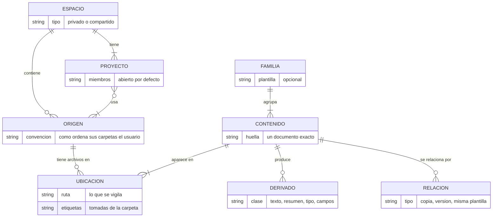
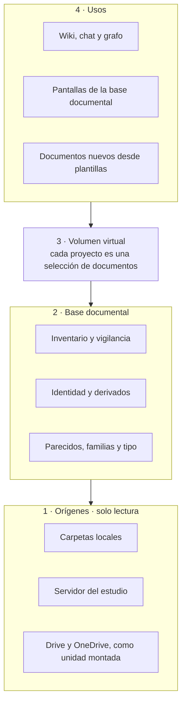
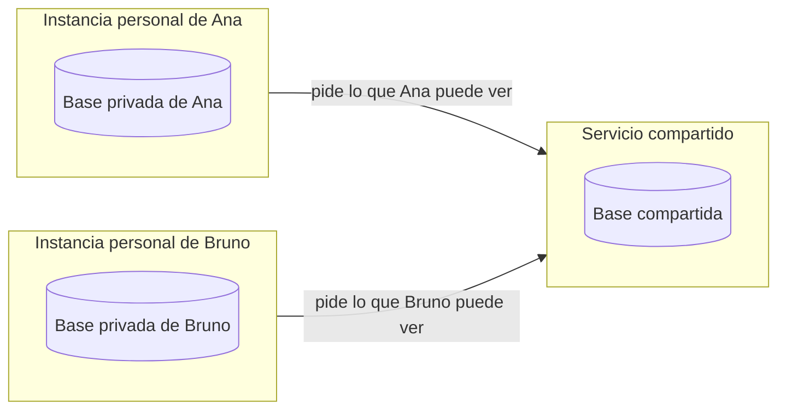
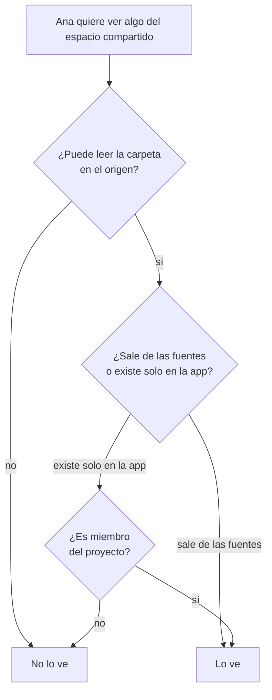
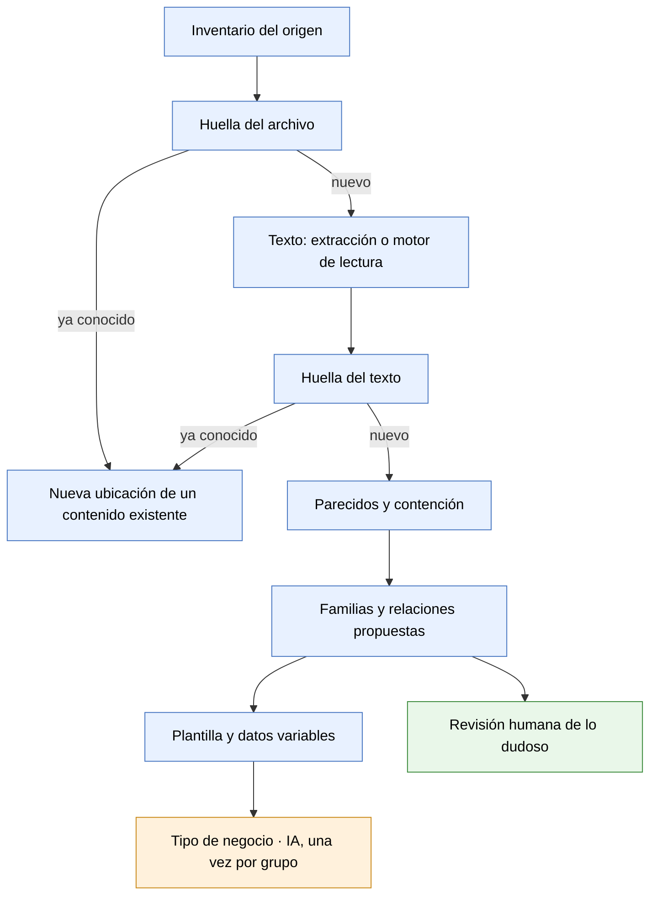
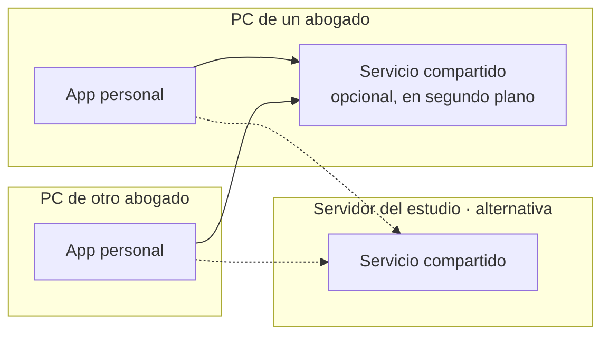
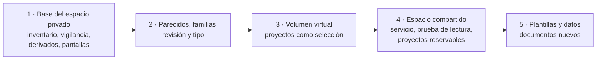

# Base documental — documento de diseño

**Estado:** dirección acordada · consolidado el 11 de octubre de 2026
**Alcance:** qué vamos a construir y en qué orden. No describe código.

## 1. Propósito

Micelya Desktop deja de ser "una app de wiki con manejo de fuentes" y pasa a tener como cimiento una **base documental**: un componente que sabe qué archivos existen, dónde está cada copia, cuáles son el mismo documento, cuáles están emparentados y de qué tipo son, y que los vigila. El wiki, el chat y el grafo se montan encima.

Es una aplicación de uso personal que además puede trabajar con un espacio compartido y con otras instancias.

**Cómo se avanza.** Primero un producto mínimo funcionando (sección 11); el detalle de lo demás se define después, con algo a la vista. Lo que se posterga queda en la lista de la sección 10 y en `pendientes.json`.

## 2. Principios

1. **Centrado en el archivo.** Todas las apariciones de un documento y sus variantes están identificadas y vigiladas.
2. **Los originales no se tocan.** No se alteran, mueven ni copian. Solo se guarda el resultado de procesarlos.
3. **Cada documento se procesa una sola vez por espacio.** Aunque haya muchas copias, su texto, resumen, huella y tipo se obtienen una vez.
4. **Dos espacios.** Privado (de una persona) y compartido (de varias).
5. **Determinista primero.** La IA entra donde el cálculo no alcanza, y una vez por grupo, no por documento.
6. **El wiki ve un volumen virtual,** no el disco.
7. **Nos apoyamos en lo que ya hacen los orígenes.** La plataforma agrega capacidades por encima de carpetas, servidores y discos en la nube; no rehace un sistema de archivos.
8. **Nuestras necesidades pesan más que la compatibilidad con upstream.**

## 3. Conceptos

Tres niveles que conviene no mezclar al decir "archivo":

- **Ubicación:** un archivo en una ruta. Es lo que aparece, cambia, se mueve o se borra. Registra su origen y su carpeta.
- **Contenido:** un documento exacto. De él cuelgan los derivados.
- **Familia:** contenidos emparentados. De ella cuelgan las relaciones y, si existe, la plantilla.
- **Etiquetas.** La estructura de carpetas es un indicio de qué contiene cada una. Al incorporar un origen se le pregunta al usuario cómo lo ordena (por ejemplo, un nivel por cliente y otro por caso, o solo por caso, o con otros criterios). Cada nivel pasa a ser una etiqueta de las ubicaciones. Los nombres de las etiquetas los define el usuario y su valor se puede corregir: siempre hay archivos mal guardados.
- **Proyecto general.** Al indicar qué carpetas se incorporan a un espacio se crea su proyecto general, que las abarca todas. Los demás proyectos son puntos de vista sobre parte de esas fuentes, con sus propias instrucciones para el modelo, como hace hoy la app.

## 4. Capas

La capa 3 le pregunta a la base solo tres cosas: qué fuentes hay, cuál es el texto de una, y qué cambió. Esa interfaz angosta permite que la capa de wiki siga pareciéndose a la original. Las páginas del wiki siguen nombrando sus fuentes por una ruta lógica; la base sabe a qué contenido corresponde cada una.

La base documental es un **componente separado dentro de la misma app**: datos propios, código en un lugar propio y esa interfaz angosta. Reutiliza los extractores de texto, los proveedores de IA, la cola de trabajo, la búsqueda y la interfaz. Reemplaza la importación que copia archivos, la vigilancia de fuentes, la identificación por ruta y los cachés atados a la ruta.

## 5. Orígenes

| Origen | Cómo se lee | Cómo se detectan cambios |
|---|---|---|
| Carpeta local | Directo | Avisos del sistema y barrido de respaldo |
| Servidor del estudio | Carpeta de red | Avisos si el servicio corre en esa máquina; si no, barrido periódico |
| Drive y OneDrive | Como unidad montada | Barrido periódico |

- **Vigilar** es siempre aviso en vivo, cuando existe, más un barrido de respaldo: al arrancar, cada cierto tiempo y cuando se pierden avisos.
- **Un origen que no se puede leer no es un origen vacío.** Si está desconectado, lo que se sabe de sus archivos se conserva.
- **Un archivo movido** se reconoce por su huella: desaparece de una ruta y aparece en otra.
- **La huella de un archivo se calcula al leerlo.** En un disco en la nube eso lo descarga la primera vez; se hace de a poco, en segundo plano.
- **Documentos nativos de Google** (Docs, Sheets, Slides): en la unidad montada son solo un acceso directo, sin contenido. Se registran como "detectado, no procesable", para que se vea qué queda afuera.
- Conectarse a Drive y OneDrive por sus propias interfaces queda para más adelante: exige registrar la aplicación ante cada proveedor.

## 6. Espacios, visibilidad y autorización

- El espacio compartido **solo conoce lo compartido**. Nunca sabe qué hay en un espacio privado.
- Lo que ve una persona es **su espacio privado más lo que puede ver del compartido**. Esa vista se arma en su instancia y no sale de su PC.
- Hay **una base por espacio**: la de cada instancia personal y la del servicio compartido. A la compartida se llega solo a través del servicio.
- Un proyecto de wiki tiene **una sola visibilidad**. Uno privado puede usar documentos compartidos; uno compartido no puede usar privados.

### El mismo contenido en los dos espacios

- La instancia personal guarda una **referencia** al contenido compartido y usa sus derivados, en vez de procesarlo de nuevo.
- Deja de ser privado el **contenido**, no la copia: que la persona tiene ese archivo, y dónde, sigue siendo privado.
- Para no delatar lo privado, la instancia trae la lista de huellas compartidas que puede ver y **compara localmente**. Las relaciones entre un documento privado y uno compartido se guardan solo en la base privada.
- Si pierde el acceso, su copia vuelve a ser un documento privado común. Si la modifica, pasa a ser un documento privado relacionado como versión.
- **Puede haber dos procesamientos** del mismo contenido, uno por espacio: por ejemplo, si la persona lo procesó sin conexión. Al detectar la coincidencia, la instancia pasa a usar los derivados del compartido.
- **"Publicar" algo privado** es mover o copiar el archivo a una carpeta compartida, por cuenta del usuario. El servicio compartido lo detecta.

### Autorización en el espacio compartido

El origen es el **techo** y el proyecto es el **alcance**.

- **Techo.** La app nunca muestra más de lo que el origen dejaría leer a esa persona. Puede mostrar menos, nunca más. Los permisos de las fuentes no se administran en la app.
- **Prueba de lectura.** En vez de interpretar los permisos del origen, el servicio le pide a la instancia que demuestre que puede leer una carpeta: elige archivos al azar, y la instancia devuelve una huella de un tramo leído con las credenciales de su dueño. Si coincide, recibe un pase por tiempo acotado, que se renueva solo. Sirve para cualquier origen. Queda siempre activa.
- **Lo que sale de las fuentes** (inventario, texto, resumen, familias) lo gobierna solo el techo. Es lo que muestra el proyecto general.
- **Lo que existe solo en la app** (el wiki y las síntesis de un proyecto) lo gobierna además la membresía del proyecto.
- **Los proyectos nacen abiertos** a quien pueda leer sus carpetas. Quien quiera reservar uno elige quiénes lo ven. Administra un proyecto quien lo crea.
- **Hay un administrador del espacio,** definido al instalar el servicio, con potestad sobre todos los proyectos.
- **Identidad.** Cada instancia personal se empareja una vez con el servicio, con un código que se confirma en la máquina del servicio.
- **Reglas para lo calculado.** Una relación se ve solo si se ven sus dos extremos. Una familia se muestra solo con sus miembros visibles y sin cantidades totales.

Experiencia de uso: reservar es una sola acción; la app muestra siempre el resultado efectivo ("lo ven 3 de 10 personas") y avisa cuando una restricción no alcanza a los archivos originales.

Límites aceptados:

- Restringir un proyecto en la app no protege los archivos si el origen está abierto.
- Lo que ya llegó a una base privada queda ahí aunque después se quite el permiso; la revocación corta hacia adelante.
- Una subcarpeta más restringida que su carpeta no se detecta sola; hay que declararla aparte.
- Protege contra exposición accidental, no contra quien altere su propia app.

## 7. Procesamiento

Azul: herramientas deterministas. Naranja: IA generativa. Verde: una persona.

- **Motores de lectura** (escaneos, fotos, audio): intercambiables. Leen y, cuando pueden, extraen campos. No clasifican.
- **Plantilla y datos:** en un comprobante la plantilla salta a la vista; en un contrato o un escrito hay mucho texto común y la plantilla es difusa. Se obtiene alineando los textos de una familia: lo que se repite es plantilla, lo que cambia son datos.
- **Versiones y ancestros:** el cálculo dice cuánto comparten dos documentos, no cuál vino primero. Se trata como un pipeline que suma señales (contención, fechas, nombres, etiquetas de carpeta) y se mejora por iteraciones. El parecido nunca fusiona: propone.
- **Borrado:** cuando desaparecen todas las ubicaciones de un contenido, se borran sus derivados.

## 8. Despliegue

- El servicio compartido no exige otra máquina: puede correr en la PC de un abogado o en un servidor.
- Hay **un solo escritor** por base compartida.
- Punto de partida: la app ya queda en segundo plano en la bandeja, puede arrancar con el sistema y levanta dos servicios locales que se pueden abrir a la red local.
- **Limitación actual:** la generación del wiki corre en la ventana de la app, no en su motor. Funciona en segundo plano porque la ventana solo se oculta, pero necesita una sesión abierta. Alcanza para el producto mínimo; convertirlo en un servicio de verdad está en la lista de la sección 10.
- **Cuenta de IA:** cada instancia usa la suya; los proveedores siguen siendo configurables. El rango de usuarios va de un abogado solo a un estudio mediano.
- **Las bases** van siempre en una carpeta local de la app: nunca en una carpeta de red ni en una sincronizada con la nube.

## 9. Decisiones tomadas

| Tema | Decisión |
|---|---|
| Unidad de la base | El espacio, no el proyecto |
| Componente | Separado dentro de la misma app; reutiliza y amplía lo existente |
| Motor | SQLite como fuente de verdad, con su búsqueda por palabras; LanceDB para la búsqueda por vectores, como índice reconstruible |
| Bases | Una por instancia personal y una del servicio compartido |
| Procesamiento | Una vez por espacio |
| Borrado | Sin ubicaciones, se borran los derivados |
| Drive y OneDrive | Como unidad montada, por ahora |
| Documentos nativos de Google | Detectados, no procesados |
| Clasificación | IA, una vez por grupo |
| Autorización | El origen es el techo, verificado con prueba de lectura; el proyecto es el alcance, abierto por defecto y reservable; hay un administrador del espacio |
| Proyecto general | Uno por espacio, con todas las fuentes incorporadas |
| Proveedores de IA | Configurables por instancia |
| Proyectos de prueba existentes | Se reconstruyen. Sus fuentes originales no se tocan. Las fuentes copiadas dentro de un proyecto se tratan como un origen más |
| Upstream | Se analiza cambio por cambio; no condiciona el diseño |

## 10. Decisiones abiertas y lista de espera

**Abiertas:**

1. **La red entre instancias.** Cómo se encuentran y se comunican, y si hace falta un componente en la nube.
2. **La vista unificada.** Qué parte de lo compartido se copia a cada instancia y qué se consulta en el momento. Depende de cuánto se trabaje sin conexión; se decide midiendo.

**En espera, para definir en detalle después del producto mínimo:**

- Al reservar un proyecto, ocultar también sus carpetas en la app.
- La misma carpeta en dos proyectos con miembros distintos: gana el menos restrictivo, y la app tiene que avisarlo.
- Poder desactivar la prueba de lectura en estudios donde todos ven todo.
- La generación del wiki como servicio, sin depender de una ventana.
- Drive y OneDrive por sus interfaces, y con eso los documentos nativos de Google.
- El registro de cambios de Windows, para evitar el barrido completo al arrancar en carpetas muy grandes.

## 11. Etapas

Se empieza por el espacio privado y un solo usuario. El espacio compartido multiplica cada decisión, así que llega cuando la base ya esté probada.

**El producto mínimo es la etapa 1.** Para que lo compartido entre después sin rehacer nada, desde esa etapa:

- cada ubicación guarda su origen, su carpeta y sus etiquetas;
- toda consulta (búsqueda, grafo, familias) recibe el conjunto de lo visible, que en el espacio privado es "todo";
- cada proyecto tiene sus miembros, con "abierto" como valor inicial;
- existe el proyecto general del espacio.

## 12. Qué existe hoy

Dentro de `src-tauri/src/source_volume/`, todo por proyecto: montaje de carpetas, detección de cambios segura ante orígenes desconectados, catálogo de duplicados exactos, huella del archivo y texto reconocido guardado por huella. Es la semilla del componente: los conceptos son los de este documento; cambia dónde viven los datos y a quién pertenecen.

Hoy cada proyecto guarda esos datos en su propia carpeta. Con la base, pasan a guardarse una vez por espacio: el mismo escaneo usado en dos proyectos se lee una sola vez.
