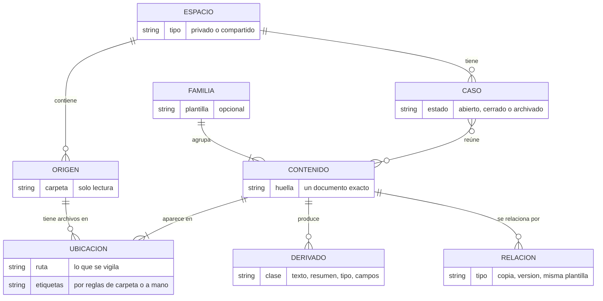
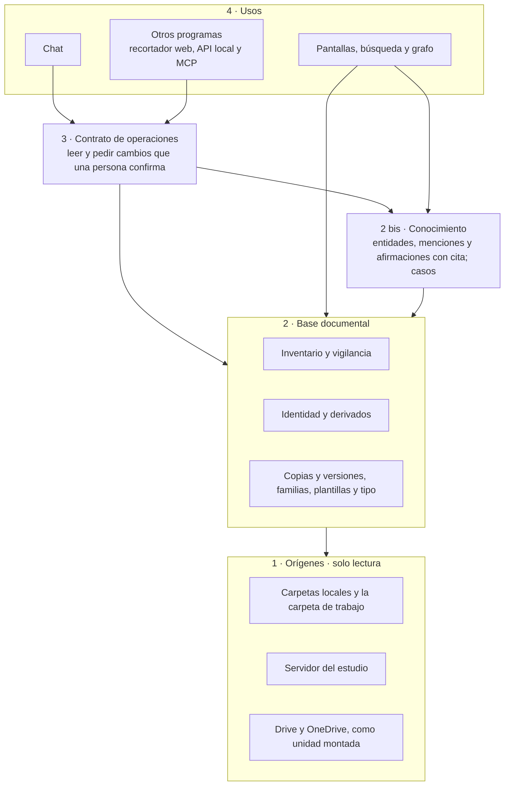
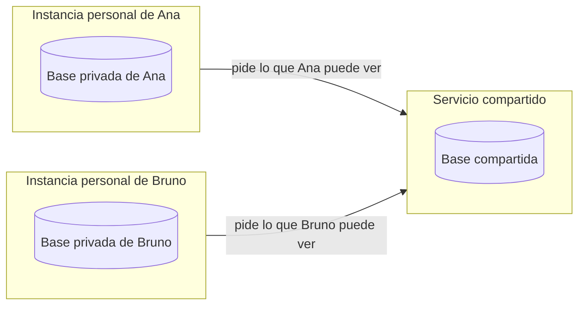
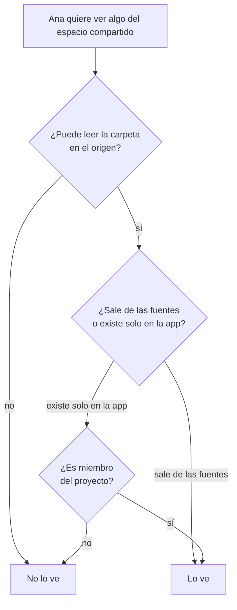
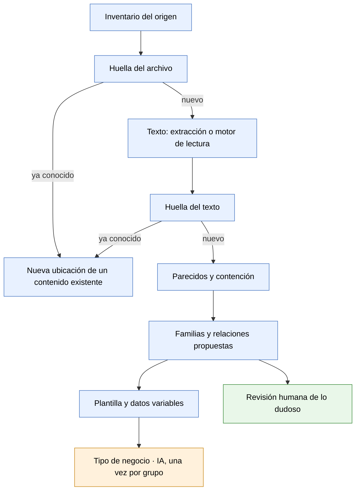
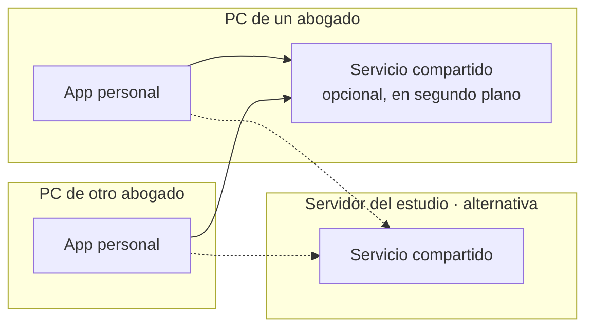
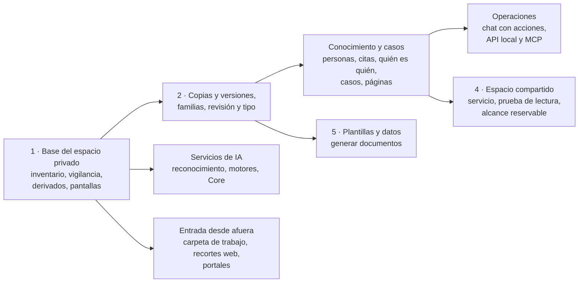

# Base documental — documento de diseño

**Estado:** dirección acordada · consolidado el 11 de octubre de 2026 · ajustado el 16 de octubre de 2026 (sección 13: vista de atención) · capa de conocimiento agregada el 16 de octubre de 2026 (D-170) · sus pantallas y su lugar en la vista de atención, el 16 de octubre de 2026 (D-215 a D-224) · **puesto al día el 23 de octubre de 2026:** sin el wiki heredado (retirado el 21 de octubre, D-395 a D-400) y con lo construido hasta la versión 27 de la base; secciones 11 a 13 rehechas, las demás corregidas donde nombraban el wiki o los proyectos, y una sección 14 con el documento de cada tema
**Alcance:** qué vamos a construir, en qué orden y qué existe hoy. No describe código. El detalle de cada tema está en su propio documento (sección 14).

## 1. Propósito

Micelya Desktop deja de ser "una app de wiki con manejo de fuentes" y pasa a tener como cimiento una **base documental**: un componente que sabe qué archivos existen, dónde está cada copia, cuáles son el mismo documento, cuáles están emparentados y de qué tipo son, y que los vigila. Las pantallas, el chat, la búsqueda, el grafo y los otros programas que usan la base se montan encima. El wiki de archivos que traía la app original se retiró el 21 de octubre de 2026 (D-395 a D-400).

Es una aplicación de uso personal que además puede trabajar con un espacio compartido y con otras instancias.

**Cómo se avanza.** Primero un producto mínimo funcionando (sección 11); el detalle de lo demás se define después, con algo a la vista. Lo que se posterga queda en la lista de la sección 10 y en `pendientes.json`.

## 2. Principios

1. **Centrado en el archivo.** Todas las apariciones de un documento y sus variantes están identificadas y vigiladas.
2. **Los originales no se tocan.** No se alteran, mueven ni copian. Solo se guarda el resultado de procesarlos.
3. **Cada documento se procesa una sola vez por espacio.** Aunque haya muchas copias, su texto, resumen, huella y tipo se obtienen una vez.
4. **Dos espacios.** Privado (de una persona) y compartido (de varias).
5. **El mejor resultado primero.** Cada paso usa la herramienta que da el mejor resultado: el cálculo cuando iguala o supera al modelo, el modelo cuando el proceso lo necesita o rinde más. Cuando un grupo de documentos comparte la respuesta, se le pregunta al modelo una vez por grupo.
6. **Todo lee la base, no el disco.** Las pantallas, la búsqueda, el chat, el grafo y los otros programas leen la base; el disco lo recorre solo el inventario. *(Reemplaza, el 23 de octubre de 2026, a "el wiki ve un volumen virtual", que salió con el wiki.)*
7. **Nos apoyamos en lo que ya hacen los orígenes.** La plataforma agrega capacidades por encima de carpetas, servidores y discos en la nube; no rehace un sistema de archivos.
8. **No se sincroniza con upstream.** El proyecto diverge; la compatibilidad con el original no es un criterio.

## 3. Conceptos

Tres niveles que conviene no mezclar al decir "archivo":

- **Ubicación:** un archivo en una ruta. Es lo que aparece, cambia, se mueve o se borra. Registra su origen y su carpeta.
- **Contenido:** un documento exacto. De él cuelgan los derivados.
- **Familia:** contenidos emparentados. De ella cuelgan las relaciones y, si existe, la plantilla.
- **Grupos y etiquetas.** Una etiqueta agrupa archivos lógicamente. Un **grupo** es la pregunta ("¿de qué cliente es?") y una **etiqueta** es la respuesta ("Zentora"); también hay etiquetas sueltas, sin grupo. Un archivo puede tener varias. Las etiquetas se guardan aparte y los archivos las referencian, así que renombrar una no toca ningún archivo.
- **Reglas de carpeta.** La estructura de carpetas es un indicio de qué contiene cada una, pero rara vez es pareja en todo un origen. Por eso las etiquetas se asignan con reglas puestas en cualquier carpeta, que valen para ella y todo lo que cuelga de ella: "todo lo de acá adentro lleva esta etiqueta" o "cada subcarpeta de acá es un… (cliente)". La regla queda guardada: lo que aparezca después la hereda. Encima, a un archivo se le agrega o se le quita una etiqueta a mano, y eso manda sobre lo heredado: siempre hay archivos mal guardados. Al incorporar un origen se puede indicar cómo está ordenado, pero solo conviene si toda su estructura es pareja. Las reglas de carpeta no crean casos (D-373).
- **Exclusión.** Un archivo o una carpeta se pueden excluir: siguen en su lugar y a la vista, pero la base no los procesa. Se puede deshacer.
- **Entidad, mención y afirmación** (capa de conocimiento, sección 4). Una **entidad** es una persona o una organización, con un identificador estable que no depende de su nombre. Una **mención** es una forma en que un documento la nombra, con un rol (parte, apoderado, firmante…). Una **afirmación** es algo que los documentos dicen de ella, con la cita textual que lo respalda, verificada por cálculo en el texto. El detalle está en la [propuesta de la capa](conocimiento-propuesta.md).
- **Caso** (asunto, en general; D-373 a D-376). Un reclamo con sus cartas y facturas, un contrato con sus pagos: un grupo de documentos unidos por evidencia propia de ese caso (el mismo número, el mismo importe, lo que decidió una persona), nunca por compartir una persona (D-213). Lo crea una persona o lo propone el sistema contando familias, no copias; lo propuesto se confirma en la vista de atención. Las referencias (número de acta, expediente) son datos del documento. Un caso se cierra, se archiva y se reabre a mano (D-475). Ver [Asuntos: un solo concepto](asuntos-propuesta.md).
- **Archivo.** Cada espacio tiene un archivo, que abarca todos sus orígenes; la app abre en Inicio. La lectura con el modelo no arranca sola, porque usa cupo: se enciende con «Lectura automática», en Orígenes, y desde entonces se alimenta sola con lo que se agrega, cambia o se quita. Los proyectos de wiki salieron con el wiki (D-395); volver a tenerlos, con un propósito definido, queda en espera (P-225).
- **Carpeta de trabajo** (D-450, D-451). La carpeta de Micelya, elegida en Ajustes, donde la app guarda lo que trae o produce: «Recortes web», «Expedientes» y «Generados». Es un origen más de la base y nunca varios.

## 4. Capas

La capa 3 es el **contrato de operaciones** (D-498, D-504): una sola lista de lo que se puede leer y pedir sobre la base, con lo que pide cada operación, lo que cambia, cómo se confirma y cómo se deshace. El chat y los otros programas solo pueden usar operaciones de esa lista: leer no pide confirmación, y un cambio lo confirma una persona en la app. Los botones de las pantallas pasan a usarla de a poco (P-306). Detalle en el [contrato de operaciones](contrato-de-operaciones.md).

La capa 3 anterior, el volumen virtual que le mostraba la base al wiki como si fuera una carpeta, y el índice de las páginas del wiki salieron con el wiki (D-395 a D-400).

Entre la base y los usos está la **capa de conocimiento** (D-170): un registro, dentro de la misma base del espacio, de las personas y organizaciones que nombran los documentos, de cómo los nombra cada uno y de lo que dicen de ellas, cada cosa con la cita que la respalda, y de los casos. Las páginas de cada persona u organización, de cada documento y de cada caso las escribe la base desde ese registro (son una proyección) y se rehacen cuando cambia lo que se sabe. Detalle en la [propuesta de la capa](conocimiento-propuesta.md).

La base documental es un **componente separado dentro de la misma app**: datos propios y código en un lugar propio. Reutiliza los extractores de texto, los proveedores de IA, la cola de trabajo, la búsqueda y la interfaz. Reemplazó la importación que copiaba archivos, la vigilancia de fuentes, la identificación por ruta y los cachés atados a la ruta.

## 5. Orígenes

| Origen | Cómo se lee | Cómo se detectan cambios |
|---|---|---|
| Carpeta local | Directo | Avisos del sistema y barrido de respaldo |
| Carpeta de trabajo de Micelya | Directo, como una carpeta local | Igual; lo que la app guarda adentro lo encuentra el mismo recorrido |
| Servidor del estudio | Carpeta de red | Avisos si el servicio corre en esa máquina; si no, barrido periódico |
| Drive y OneDrive | Como unidad montada | Barrido periódico |

- **Vigilar** es siempre aviso en vivo, cuando existe, más un barrido de respaldo: al arrancar, cada cierto tiempo y cuando se pierden avisos.
- **Un origen que no se puede leer no es un origen vacío.** Si está desconectado, lo que se sabe de sus archivos se conserva.
- **Un archivo movido** se reconoce por su huella: desaparece de una ruta y aparece en otra.
- **La huella de un archivo se calcula al leerlo.** En un disco en la nube eso lo descarga la primera vez; se hace de a poco, en segundo plano.
- **Documentos nativos de Google** (Docs, Sheets, Slides): en la unidad montada son solo un acceso directo, sin contenido. Se registran como "detectado, no procesable", para que se vea qué queda afuera.
- Conectarse a Drive y OneDrive por sus propias interfaces queda para más adelante: exige registrar la aplicación ante cada proveedor.

## 6. Espacios, visibilidad y autorización

**Sin proyectos** (salieron con el wiki, D-395), el alcance que se reserva y los miembros que lo ven (lo que esta sección llama "proyecto") queda por definir: puede ser el caso, una selección de orígenes u otra cosa. Se decide al empezar la etapa 4 (sección 11); hasta entonces, donde aquí dice "proyecto" hay que leer "alcance reservable".

- El espacio compartido **solo conoce lo compartido**. Nunca sabe qué hay en un espacio privado.
- Lo que ve una persona es **su espacio privado más lo que puede ver del compartido**. Esa vista se arma en su instancia y no sale de su PC.
- Hay **una base por espacio**: la de cada instancia personal y la del servicio compartido. A la compartida se llega solo a través del servicio.
- Un alcance reservable tiene **una sola visibilidad**. Uno privado puede usar documentos compartidos; uno compartido no puede usar privados.

### El mismo contenido en los dos espacios

- La instancia personal guarda una **referencia** al contenido compartido y usa sus derivados, en vez de procesarlo de nuevo.
- Deja de ser privado el **contenido**, no la copia: que la persona tiene ese archivo, y dónde, sigue siendo privado.
- Para no delatar lo privado, la instancia trae la lista de huellas compartidas que puede ver y **compara localmente**. Las relaciones entre un documento privado y uno compartido se guardan solo en la base privada.
- Si pierde el acceso, su copia vuelve a ser un documento privado común. Si la modifica, pasa a ser un documento privado relacionado como versión.
- **Puede haber dos procesamientos** del mismo contenido, uno por espacio: por ejemplo, si la persona lo procesó sin conexión. Al detectar la coincidencia, la instancia pasa a usar los derivados del compartido.
- **"Publicar" algo privado** es mover o copiar el archivo a una carpeta compartida, por cuenta del usuario. El servicio compartido lo detecta.

### Autorización en el espacio compartido

El origen es el **techo** y el proyecto es el **alcance**.

- **Techo.** La app nunca muestra más de lo que el origen dejaría leer a esa persona. Puede mostrar menos, nunca más. Los permisos de las fuentes no se administran en la app.
- **Prueba de lectura.** En vez de interpretar los permisos del origen, el servicio le pide a la instancia que demuestre que puede leer una carpeta: elige archivos al azar, y la instancia devuelve una huella de un tramo leído con las credenciales de su dueño. Si coincide, recibe un pase por tiempo acotado, que se renueva solo. Sirve para cualquier origen. Queda siempre activa.
- **Lo que sale de las fuentes** (inventario, texto, resumen, familias) lo gobierna solo el techo.
- **Lo que existe solo en la app** (las notas de una persona, las consultas guardadas, lo que decidió una persona) lo gobierna además la membresía del proyecto.
- **Los proyectos nacen abiertos** a quien pueda leer sus carpetas. Quien quiera reservar uno elige quiénes lo ven. Administra un proyecto quien lo crea.
- **Hay un administrador del espacio,** definido al instalar el servicio, con potestad sobre todos los proyectos.
- **Identidad.** Cada instancia personal se empareja una vez con el servicio, con un código que se confirma en la máquina del servicio.
- **Reglas para lo calculado.** Una relación se ve solo si se ven sus dos extremos. Una familia se muestra solo con sus miembros visibles y sin cantidades totales.

Experiencia de uso: reservar es una sola acción; la app muestra siempre el resultado efectivo ("lo ven 3 de 10 personas") y avisa cuando una restricción no alcanza a los archivos originales.

Límites aceptados:

- Restringir un proyecto en la app no protege los archivos si el origen está abierto.
- Lo que ya llegó a una base privada queda ahí aunque después se quite el permiso; la revocación corta hacia adelante.
- Una subcarpeta más restringida que su carpeta no se detecta sola; hay que declararla aparte.
- Protege contra exposición accidental, no contra quien altere su propia app.

## 7. Procesamiento

Azul: herramientas deterministas. Naranja: IA generativa. Verde: una persona.

- **Motores de lectura** (escaneos, fotos, audio): intercambiables. Leen y, cuando pueden, extraen campos. No clasifican. Hoy son Codex y Micelya Core ([servicios de IA](servicios-de-ia-propuesta.md)).
- **Plantilla y datos:** en un comprobante la plantilla salta a la vista; en un contrato o un escrito hay mucho texto común y la plantilla es difusa. Se obtiene alineando los textos de una familia: lo que se repite es plantilla, lo que cambia son datos.
- **Versiones y ancestros:** el cálculo dice cuánto comparten dos documentos, no cuál vino primero. Se trata como un pipeline que suma señales (contención, fechas, nombres, etiquetas de carpeta) y se mejora por iteraciones. El parecido nunca fusiona: propone. Antes de proponer una versión se comparan los datos clave de los dos documentos: si difieren, son documentos distintos (D-502).
- **Revisión humana:** solo de lo que puede ser el mismo documento; lo hecho con la misma plantilla son documentos distintos y no se le pregunta a nadie (D-497).
- **Borrado:** cuando desaparecen todas las ubicaciones de un contenido, se borran sus derivados.

## 8. Despliegue

- El servicio compartido no exige otra máquina: puede correr en la PC de un abogado o en un servidor.
- Hay **un solo escritor** por base compartida.
- Punto de partida: la app ya queda en segundo plano en la bandeja y puede arrancar con el sistema. Tiene **un solo servidor dentro de la máquina** para el recortador web, la API local y el MCP, que escucha solo en esa computadora (D-487, D-509).
- Las páginas las escribe la base en su propio motor, en segundo plano, sin depender de la ventana (desde el retiro del wiki).
- **Cuenta de IA:** cada instancia usa la suya; los proveedores siguen siendo configurables. El estudio de referencia va a usar Micelya Core (D-468), con el inicio de sesión de cada persona (D-501). El rango de usuarios va de un abogado solo a un estudio mediano.
- **Las bases** van siempre en una carpeta local de la app: nunca en una carpeta de red ni en una sincronizada con la nube. Una actualización de la app respeta los datos de la versión anterior: antes de cambiar la forma de la base guarda un respaldo comprobado (D-496, D-505; ver [actualizaciones](actualizaciones.md)).

## 9. Decisiones tomadas

| Tema | Decisión |
|---|---|
| Unidad de la base | El espacio |
| Componente | Separado dentro de la misma app; reutiliza y amplía lo existente |
| Motor | SQLite como fuente de verdad, con su búsqueda por palabras; LanceDB para la búsqueda por vectores, como índice reconstruible |
| Bases | Una por instancia personal y una del servicio compartido |
| Procesamiento | Una vez por espacio |
| Borrado | Sin ubicaciones, se borran los derivados |
| Drive y OneDrive | Como unidad montada, por ahora |
| Documentos nativos de Google | Detectados, no procesados |
| Clasificación | IA, una vez por grupo |
| Autorización | El origen es el techo, verificado con prueba de lectura; el alcance es reservable y abierto por defecto (sin proyectos, se redefine en la etapa 4); hay un administrador del espacio |
| Archivo | Uno por espacio, con todos sus orígenes; la app abre en Inicio; la lectura con el modelo se enciende a mano y después se alimenta sola. Los proyectos de wiki salieron (D-395) |
| Etiquetas | Grupos y etiquetas guardados aparte, asignados por reglas de carpeta y a mano |
| Exclusión | Por archivo o carpeta; no borra ni mueve nada |
| Vocabulario | Los términos del dominio no van escritos en el código: salen de un vocabulario por vertical y por idioma |
| Proveedores de IA | Configurables por instancia; un motor por servicio y Micelya Core es uno más (D-422, D-443) |
| Upstream | No se sincroniza; el proyecto diverge y la compatibilidad no es un criterio |
| Conocimiento | Una capa propia dentro de la base del espacio: entidades con identificador estable, menciones con rol y afirmaciones con cita verificada por cálculo (D-170, D-171) |
| Tipos de entidad | Persona y organización; el asunto dejó de ser un tipo de entidad (D-373). Tipos, roles y predicados son datos, no código (D-172) |
| Identidad de entidades | En cascada, con abstención: mismo identificador une solo y se puede deshacer, identificador distinto nunca une, lo dudoso va a una persona (D-173, D-174) |
| Páginas | Proyección del registro: documentos agrupados por caso y síntesis solo desde afirmaciones verificadas; las citas son notas numeradas y nada se repite (D-175, D-236, D-441) |
| Importes en el lector | Un `$` suelto es el signo de moneda, nunca una fórmula (D-234) |
| Correcciones de entidades | Siempre como decisiones de una persona sobre el registro (unir, separar, dato incorrecto, sacar de un caso), reversibles; nunca editando una página (D-219, D-220) |
| Casos | Un solo concepto: lo crea una persona o lo propone el sistema, nunca una regla de carpeta; se cierran, se archivan y se reabren a mano (D-373 a D-376, D-475) |
| Misma plantilla | Son documentos distintos y no piden decisión; solo piden decisión las copias y versiones del mismo documento (D-497, D-502) |
| Operaciones | Una sola lista para el chat, la API local, el MCP y los botones; los otros programas leen y piden cambios que una persona confirma (D-498, D-504) |
| Servidor dentro de la máquina | Uno solo, para el recortador, la API local y el MCP, con un token por programa (D-487, D-495, D-509) |
| Actualizaciones | Respetan los datos de la versión anterior, con un respaldo comprobado antes de cada cambio de forma de la base (D-496, D-505) |

Salieron con el wiki (D-395 a D-400): el proyecto general del wiki, los enlaces y el índice del wiki, el control de las páginas que escribía el modelo del wiki (D-237, D-238) y la reconstrucción de los proyectos de prueba.

## 10. Decisiones abiertas y lista de espera

**Abiertas:**

1. **La red entre instancias.** Cómo se encuentran y se comunican, y si hace falta un componente en la nube.
2. **La vista unificada.** Qué parte de lo compartido se copia a cada instancia y qué se consulta en el momento. Depende de cuánto se trabaje sin conexión; se decide midiendo.
3. **El alcance reservable sin proyectos** (sección 6): el caso, una selección de orígenes u otra cosa. Se decide al empezar la etapa 4.

**En espera, para definir en detalle después del producto mínimo:**

- Al reservar un alcance, ocultar también sus carpetas en la app.
- La misma carpeta en dos alcances con miembros distintos: gana el menos restrictivo, y la app tiene que avisarlo.
- Poder desactivar la prueba de lectura en estudios donde todos ven todo.
- Volver a tener proyectos, con un propósito definido (P-225).
- Drive y OneDrive por sus interfaces, y con eso los documentos nativos de Google.
- El registro de cambios de Windows, para evitar el barrido completo al arrancar en carpetas muy grandes.

## 11. Etapas

Estado al 23 de octubre de 2026. **Construido no es terminado** (D-154): una etapa construida se da por cerrada recién cuando el dueño la usa con su archivo real y deja de encontrar fallas que la vuelvan inútil.

| Etapa | Qué incluye | Estado |
|---|---|---|
| 1 · Base del espacio privado | Inventario y vigilancia de orígenes, huella, copias exactas, texto una vez por contenido, exclusiones, etiquetas, pantallas | Construida |
| 2 · Copias y versiones, familias, revisión y tipo ([propuesta](parecidos-propuesta.md)) | Copias firmadas, versiones, contenido en, acuses y constancias; lo hecho con la misma plantilla, como documentos distintos; familias con su principal; revisión en bloque; tipo y datos del tipo con el modelo, una vez por grupo | Construida; «Copias y versiones» rehecha el 23 oct (D-497, D-502), falta que el dueño la vea (P-296) |
| Conocimiento y casos (D-170, D-373 a D-376; [capa](conocimiento-propuesta.md), [casos](asuntos-propuesta.md)) | Lectura con cita verificada, quién es quién, páginas escritas desde la base, cambios y borrados, relaciones, casos propuestos o creados por una persona, su lugar en la vista de atención | Construida; en mejora con casos reales. Cerrar, archivar y reabrir un caso, el 23 oct (D-475, D-506) |
| 5 · Plantillas y datos | La plantilla de cada familia de "misma plantilla", sus campos y el valor de cada documento (D-438 a D-440); la sección «Plantillas», con nombres para los campos (D-466, D-488, D-490); generar un Word simple desde una plantilla (D-492) | Construida el 22 oct; falta que el dueño la vea (P-285, P-287, P-257). El membrete y el Word original como formato, después (P-295) |
| Servicios de IA ([propuesta](servicios-de-ia-propuesta.md)) | Reconocimiento de escaneos en la base, registro de motores por servicio, claves en el llavero, Micelya Core como proveedor, la comparación de motores | Reconocimiento, registro, conexión con Core y lectura de escaneos por Core, construidos el 21 y el 22 oct. Preguntar al modelo por Core espera la respuesta de Core al mensaje 002 (P-300); el inicio de sesión por persona con Keycloak está decidido y sin construir (D-501, P-302) |
| Entrada desde afuera | La carpeta de trabajo como origen, el recortador web, los portales judiciales ([propuesta](portales-judiciales-propuesta.md)) | Construida el 22 oct. El PJN funcionó de punta a punta en la prueba real del dueño del 22 oct; los arreglos del 23 falta verlos (D-503, P-298). El recortador, sin la prueba del dueño con el navegador (P-227) |
| Operaciones ([contrato](contrato-de-operaciones.md)) | Una sola lista de operaciones para el chat, la API local y el MCP; el chat con acciones; el servidor único dentro de la máquina | Construida el 23 oct en la corrida desatendida (D-504, D-506, D-509); falta verla, el chat con un modelo real (P-286, P-227) |
| 4 · Espacio compartido | Servicio compartido, prueba de lectura, alcance reservable, otras instancias (secciones 6 y 8) | Sin empezar |

**La antigua etapa 3 (volumen virtual, proyectos como selección) sale.** Existía para que el wiki heredado viera la base como si fuera una carpeta. Con el wiki retirado (D-395 a D-400), las pantallas, la búsqueda, el chat y el grafo leen la base directamente. Si más adelante vuelven los proyectos, primero se define para qué sirven (P-225).

Se empieza por el espacio privado y un solo usuario. El espacio compartido multiplica cada decisión, así que llega cuando la base ya esté probada. Para que entre después sin rehacer nada se mantienen dos reglas desde la etapa 1:

- cada ubicación guarda su origen, su carpeta y sus etiquetas;
- toda consulta (búsqueda, grafo, familias) recibe el conjunto de lo visible, que en el espacio privado es "todo".

Lo que antes hacía el proyecto en el espacio compartido (el alcance que se reserva y los miembros que lo ven, sección 6) queda por definir sin proyectos: puede ser el caso, una selección de orígenes u otra cosa. Se decide al empezar la etapa 4.

### El producto mínimo

Lo fijó el dueño el 22 de octubre, sin el wiki (D-463): termina cuando cada parte está funcionando y la vio el dueño.

| Parte | Estado al 23 oct |
|---|---|
| La experiencia de uso revisada, con el marco visual de la marca (D-469, D-493) | La marca aplicada a toda la app el 23 oct (D-507, D-508, D-510); falta que el dueño la vea y la revisión de la experiencia de uso (P-057) |
| La conexión con Micelya Core, que va a usar el estudio de referencia (D-468) | Conexión y lectura de escaneos por Core, construidas el 22 oct (D-483, D-489, D-494); faltan preguntar al modelo por Core (P-300) y el inicio de sesión por persona (D-501, P-302) |
| Generar un documento desde una plantilla, con una sección para verlas (D-466, D-488) | Construido el 22 oct (D-490, D-492); falta verlo (P-285, P-287) |
| Acciones pedidas por el chat (D-498) | Construido el 23 oct (D-504, D-506); falta verlo con un modelo real (P-286) |
| Un instalador de prueba para el estudio de referencia (D-467) | Cuando el dueño lo pida; antes, la prueba de la actualización con el instalador (P-297, P-307) |
| El servidor único para el recortador y otros programas, si se puede (sumado el 22 oct, D-495) | Construido el 23 oct (D-509); falta verlo (P-227) |
| Una actualización que respete los datos de la versión anterior (sumado el 22 oct, D-496) | El respaldo comprobado antes de cada cambio de forma de la base, construido el 23 oct (D-505); falta la prueba con el instalador (P-297) |
| Lo de la misma plantilla no pide decisión (sumado el 22 oct, D-497) | Construido el 23 oct (D-502); falta verlo (P-296) |

Al entregarlo se valida el vocabulario con el estudio de referencia (D-470) y se revisan con ellos los términos de uso del portal judicial, probando también el inicio de sesión del abogado (D-478).

## 12. Qué existe hoy

Al 23 de octubre de 2026. Hay **una base por espacio privado** (SQLite, en la carpeta de datos de la app, versión 27 del esquema). El wiki de archivos que se heredó ya no existe: sus páginas, notas, consultas guardadas e investigaciones pasaron a la base y su carpeta se borró (D-395 a D-400). No hay proyectos: la app abre en Inicio. Lo que falta que el dueño vea en la app está en la sección 11 y en `pendientes.json`.

- **Orígenes e inventario.** Carpetas locales, carpetas de red y unidades en la nube montadas; vigilancia con avisos y barrido de respaldo, segura ante orígenes desconectados; huella de cada archivo; copias exactas; exclusiones; grupos, etiquetas y reglas de carpeta. La **carpeta de trabajo** de Micelya se elige en Ajustes y es un origen más, con las subcarpetas «Recortes web», «Expedientes» y «Generados»; lo que la app guarda adentro nunca es un origen aparte y, si la carpeta cambia, el origen se muda sin perder lo que se sabía (D-450, D-451).
- **Texto de cada documento,** una vez por contenido. Los escaneos, fotos y PDF sin texto los **reconoce la base sola**, de a un documento y antes que cualquier otra pregunta, mientras la lectura automática esté activa, o **a pedido** («Reconocer el texto», aunque esté apagada). Usa el motor que eligen los Servicios de IA: Codex o **Micelya Core** (Textract), que lee cada página por separado, hasta 4 a la vez, y borra en Core cada lectura apenas la guarda (D-483, D-489, D-494). Lo ya leído de un escaneo largo se guarda por página, así un reintento no repite; una falla del proveedor espera y una del documento lo marca con el motivo. El documento dice qué motor lo reconoció, cuándo, y qué páginas tienen partes ilegibles (D-428 a D-431). Los pedidos hechos a mano se guardan en la base y sobreviven al cierre (D-452).
- **Copias y versiones, familias y tipo** (D-497, D-502). Copias firmadas, versiones, contenido en, acuses de recibo, constancias de firma, vistas previas y «prácticamente el mismo», por cálculo: solo esas relaciones piden una decisión, porque pueden ser el mismo documento. Dos documentos de la misma plantilla son documentos distintos y no piden nada; el documento dice «Hecho con la plantilla «X», como N documentos más». Antes de proponer una versión o un parecido se comparan los datos clave que la base ya sabe de cada documento (partes, número de expediente, identificadores, importes y fechas): si difieren de verdad, son documentos distintos. Familias con su documento principal; tipo y datos del tipo con el modelo, una vez por grupo, desde un catálogo de tipos que es un dato.
- **Plantillas** (D-438 a D-440, D-466, D-488, D-490, D-492). Cada familia de "misma plantilla" tiene su plantilla guardada: el texto común, los campos que cambian y el valor de cada documento, armada sin modelo alineando cada documento con el principal. La sección «Plantillas» las muestra todas; cada una se llama como el tipo de su documento principal hasta que una persona la nombra. Los campos se nombran por su rótulo en el texto cuando lo tienen; el resto lo nombra una pregunta automática al modelo por plantilla, y lo que escribe una persona nunca se pisa. Desde una plantilla se **genera un Word simple** (A4, sin membrete) en «Generados», con valores tomados de la base y su origen; el documento entra al caso para el que se generó y nunca forma par con su familia. Dos documentos de una plantilla en los que no cambia ningún dato quedan como "posiblemente el mismo documento" (D-440).
- **Conocimiento** (D-170). Personas y organizaciones con sus menciones y su rol en cada documento; afirmaciones con la cita verificada por cálculo en el texto; relaciones entre personas cuya cita tiene que nombrar a las dos, con parentescos y herencia en el catálogo (D-433 a D-437); quién es quién con abstención, y lo dudoso a una persona. Un cambio en las instrucciones de lectura **no relee nada solo**: lo ya leído se vuelve a controlar con las respuestas guardadas, y releer con el modelo es a pedido, con aviso de costo (D-432). Atención cuenta lo leído con otra versión de la pregunta o con otro modelo, con un botón para releerlo, y siempre se puede releer todo (D-465). Las preguntas de quién es quién y de resumen que siguen a un cambio van solas con la lectura automática, hasta 50 por vuelta (D-484).
- **Casos** (asunto, en general; D-373 a D-376). Un solo concepto: lo crea una persona o lo propone el sistema contando familias, no copias; lo propuesto se confirma en la vista de atención. Las referencias (número de acta, expediente) son datos del documento. Cada expediente que trae Portales crea un caso confirmado (D-446). Un caso se cierra, se archiva y se reabre a mano; cerrado o archivado sale de la lista y de Atención y no recibe propuestas, pero sigue en la búsqueda (D-475, D-506).
- **Páginas,** que escribe la base con lo que sabe: el artículo de cada persona u organización, de cada documento y de cada caso. Las citas son notas numeradas; nada se repite entre el artículo y sus datos; el documento se titula por su tipo, número, partes y fecha, y las fechas van en castellano (D-441, D-442). El resumen general está en Inicio. Las notas de una persona, las consultas guardadas y las investigaciones en internet viven en la base.
- **Servicios de IA** (D-443 a D-445). Un registro en la base dice qué motor usa cada servicio (preguntar al modelo, reconocer escaneos, investigar en internet), con su modelo, su razonamiento y un alternativo; un catálogo de motores dice qué sabe hacer cada uno, dónde procesa y qué guarda su proveedor. Las claves de API están en el llavero del sistema. La **conexión con Micelya Core** se carga en Ajustes → «Conexiones», con «Probar la conexión»; su credencial va al llavero y nunca vuelve a las pantallas. Hoy entra con un usuario técnico de desarrollo; el destino es que cada persona inicie sesión con Keycloak (D-501), sin construir. La base pregunta al modelo solo con Codex; por Core, cuando Core responda el mensaje 002 (P-300). «Lo que se le pregunta al modelo», en Ajustes, muestra cada pregunta armada sobre un documento inventado (D-481).
- **Entrada desde afuera.** El recortador web «Micelya Clipper» guarda cada página como archivo en «Recortes web» (D-450, D-451), a través del servidor único de la app (D-509). **Portales**: un navegador dentro de la app trae expedientes del PJN a «Expedientes», cada documento con sus datos al lado, y crea su caso (D-446 a D-449). Funcionó de punta a punta en la primera prueba real del dueño (22 oct), después de los arreglos del desafío (D-480, D-491); el 23 se corrigió el lector de la tabla y las descargas siguen solas, con la ventana del portal oculta y el avance a la vista (D-503).
- **Operaciones** (D-498, D-504, D-506, D-509; [contrato](contrato-de-operaciones.md)). Una sola lista de lo que se puede leer y cambiar en la base, que usan el chat y los otros programas. El chat propone cambios (agregar o sacar documentos de un caso; crear, renombrar, confirmar, descartar, cerrar, archivar o reabrir un caso; unir y separar fichas; volver a leer documentos; guardar una consulta) y una persona los confirma en una tarjeta con casillas y los puede deshacer; cada operación queda en un registro. El **servidor único** (`127.0.0.1:19827`, solo en esta computadora) atiende al recortador, a la API local y al MCP. Cada programa se agrega en Ajustes → «Programas conectados», con su propio token y su permiso («Solo leer», por defecto, o «Leer y pedir cambios»), y los cambios que pide esperan a una persona en Atención → «Pedidos de otros programas».
- **Chat, búsqueda y grafo** leen la base. El chat cita sus documentos y se le pueden adjuntar documentos de la base (D-453); la búsqueda se abre desde la barra superior; el grafo muestra los casos con su estado.
- **Actualizaciones** (D-496, D-505). Antes de cada cambio de forma de la base, la app guarda sola un respaldo comprobado y, sin respaldo, no cambia nada. Ajustes → «Datos y respaldos» muestra dónde están los datos y los respaldos, la versión de la base y los respaldos guardados. Cómo se prueba y cómo se vuelve atrás: [actualizaciones](actualizaciones.md).
- **La marca de Micelya** en toda la app, y la app en castellano por defecto (D-507, D-508, D-510): ver la sección 13.

**Versiones del esquema de la base:** 8, la vista de atención; 9 a 11, la capa de conocimiento (D-215); 12, lo que se le mostró al modelo al separar dos grupos de quién es quién; 13, importes, términos definidos y fecha del documento (D-244 a D-247); 14, grupos de sociedades (D-260); 15, la certeza de las afirmaciones y "confirmar" como decisión; 16, el resumen de cada documento; 17, la búsqueda por números y resúmenes; 18, estado, origen y confirmación de los casos; 19, lo que una persona agrega o saca de un caso; 20, páginas, resumen general, notas, consultas guardadas e investigaciones (retiro del wiki); 21, plantillas; 22, pedidos de reconocimiento; 23, lo que decide una persona sobre una plantilla y sus campos (D-490); 24, los documentos generados desde una plantilla (D-492); 25, los datos clave con que se midió cada par de copias y versiones (D-502); 26, el registro de operaciones (D-506); 27, los programas conectados y sus usos (D-509).

**Lo que todavía no existe:** el espacio compartido y todo lo de la sección 6; preguntar al modelo por Core (P-300) y el inicio de sesión por persona (P-302); identificar las piezas de un escaneo, que va a hacer Core (D-486, P-173); el membrete del estudio y el Word original como formato de lo generado (P-295); la revisión con el modelo que busca contradicciones en una ficha o un caso (D-476, P-226); que la app proponga quién es el cliente y quién la contraparte en un caso (D-472, P-106); otros portales (P-264) y las actuaciones históricas del PJN (P-263); la agenda, los plazos, las aprobaciones y las reuniones de «Mi semana» (P-059, P-062); Drive y OneDrive por sus interfaces; el registro de cambios de Windows.

## 13. Interfaz

Lo que hay hoy. La maqueta con la marca se aprobó el 22 de octubre (D-493) y se aplicó a toda la app en la corrida del 23 (D-507, D-508, D-510); falta que el dueño la vea (P-057).

- **Marco común a toda la app.** Una barra superior con la línea del gradiente de la marca, el logo (lleva a Inicio), «Archivo del estudio», la búsqueda de todo el archivo (Ctrl K desde cualquier pantalla) y el cambio entre modo claro y oscuro. El menú, a la izquierda, con sus nombres escritos y el contador de Atención; en una ventana de menos de 1000 px quedan solo los íconos. La ventana abre en 1280 × 800, o maximizada si no entra (D-510). Los colores, las tipografías (Mulish e Inter, dentro de la app) y las medidas de la marca son las únicas variables de la interfaz, en claro y en oscuro, y las pantallas nuevas se arman con sus componentes (botón, etiqueta, aviso, pestañas, paneles y cifras). Falta del marco: el usuario (llega con el inicio de sesión por persona, D-501) y la franja que dice en qué caso se está y si es privado.
- **El menú:** el archivo (Inicio, Atención, Documentos, Personas y organizaciones, Casos, Plantillas, Orígenes y Portales) y, debajo, «Herramientas» (Chat, Grafo, Investigación y Habilidades); Ajustes al pie. Los nombres del dominio salen del vocabulario.
- **Línea del avance,** al pie del área de trabajo en cualquier pantalla, con su barra: el último error del modelo con cuándo vuelve a intentar, o «Procesando: etapa, n de N», o que la lectura automática está en pausa, o «Todo al día». Un clic lleva a Atención → «En curso» (D-426). Mientras se trae un expediente, otra línea encima dice cómo va y lleva a «Portales» (D-503).
- **Páginas con forma de artículo de enciclopedia** (D-423, D-441, D-508). Documento, persona u organización y caso tienen la misma pantalla: arriba dónde se está («Casos › nombre») y qué es; dos pestañas, **«Artículo»** (lo que se lee: el texto con sus citas) y **«Datos y correcciones»** (cada dato en una fila fija, con su cita y sus acciones); a la derecha del artículo, una ficha con los identificadores, los datos, los casos, los documentos y lo que espera una decisión, y «En esta página», que queda a la vista al bajar. En una ventana angosta la ficha va arriba y el índice se oculta. Los documentos y las partes van en tablas, «sin confirmar» es una etiqueta ámbar, los datos en que los documentos difieren van en un aviso con su enlace y los relacionados, como tarjetas. Las citas son **notas numeradas**: al pasar el mouse o llegar con el teclado, una tarjeta muestra la cita y su documento con «Abrir el documento»; los enlaces a una persona, organización, documento o caso muestran su tipo, su nombre y un resumen corto (D-454). Las vistas previas se apagan en Ajustes → Interfaz (D-455). Las notas de una persona van al pie de las dos pestañas.
- **Pantalla de inicio** (D-493, D-507): la salud del archivo, con la barra de lo procesado; lo que requiere atención ("2 problemas · 9 decisiones", con las primeras líneas y su botón), que lleva a la vista de atención, y lo que está en proceso; el resumen general, con sus cifras y lo más nombrado; la actividad reciente; y **«Mi semana»**, que hoy muestra los casos activos y lo que espera en Atención, y suma los plazos, la agenda, las aprobaciones y las reuniones cuando existan (P-059, P-062).
- **Vista de atención** (su nombre sale del vocabulario; en el vertical jurídico, "Atención"). Es el único lugar de lo que requiere a una persona, sea cual sea la parte de la app que lo detectó. Detalle en la [propuesta](atencion-propuesta.md).
  - **Tres pestañas, una por clase,** cada una con su cantidad al lado (D-424): **«Problemas»** (algo no funciona y la app no lo puede arreglar sola), **«Decisiones»** (algo espera el criterio de una persona) y **«En curso»** (lo que la app está haciendo; no requiere atención, se muestra para saber qué pasa y para pausarlo). Los problemas se cuentan en rojo y las decisiones en ámbar.
  - **«En curso» muestra todas las etapas del procesamiento,** hechas y por hacer, en su orden: recorrido de las carpetas, texto de cada documento, texto de los escaneos, copias, versiones y plantillas, tipo y datos, lectura con el modelo, quién es quién, casos y páginas (D-425), y los nombres de los campos de las plantillas (D-490). Cada etapa dice «hechos de total» y lo que procesa ahora, y se despliega con sus documentos; la de los escaneos dice además cuántas páginas faltan y cuáles fallaron con el motivo, con «Reconocer» a pedido. Arriba, un filtro por origen o carpeta, el estado de la lectura automática con su botón para pausarla o activarla, y el último error del modelo en palabras (D-427). «Casos» y «Páginas» no figuran como hechas hasta la primera vuelta del motor (D-452). Si las preguntas que siguen a un cambio pasan de 50, la etapa se pausa con «Seguir con las N» o «Dejarlas para después» (D-499). También está el recorrido de un portal, con «Detener» (D-503).
  - **Cada línea agrupa un tema** y dice qué pasa, por qué importa y qué hacer; trae la acción en la fila o lleva al lugar exacto donde se hace, nunca a una lista para buscar. Al abrirla se ven los casos uno por uno, cada uno con su acción.
  - **Se escala solo lo que requiere una acción.** De los documentos, solo las copias y versiones que podrían ser el mismo documento (copia firmada, versión, contenido en, acuse de recibo, constancia de firma, prácticamente el mismo, vista previa) y dos documentos de una plantilla en los que no cambia ningún dato (D-440, D-502). Lo hecho con la misma plantilla y lo que solo comparte texto no piden nada: se ven en el documento y, plegados, en «Copias y versiones».
  - **Un aviso se va solo cuando deja de ser cierto.** No se marca como leído y, por ahora, no se puede posponer. Las excepciones: los recortes web nuevos quedan hasta que alguien toca «Ya los vi» (D-451), y un pedido de otro programa vence a los 7 días si nadie lo decide (D-509).
  - **El contador** de la navegación suma problemas y decisiones, no lo que está en curso. Un problema cuenta una vez por línea; una decisión cuenta por cada decisión que hay que tomar (una familia de documentos es una). Las líneas de baja prioridad ("puede esperar") se muestran pero no cuentan.
  - **Fuentes enchufables.** Cada parte de la app detecta lo suyo y lo entrega con la misma forma (clase, tema, título, por qué importa, qué hacer, acción o destino, cuándo deja de ser cierto); la vista solo junta y ordena. Sumar una parte nueva es agregar una fuente, no rehacer la vista. Hoy son cuatro: la base documental (orígenes que no se pueden leer, archivos sin texto, copias y versiones, tipos propuestos, el avance del procesamiento, los recortes web nuevos y las lecturas que no se pudieron borrar en Micelya Core, D-494), la capa de conocimiento, los portales (el recorrido en curso, el portal que espera a la persona y cómo terminó, D-503) y los programas conectados («Pedidos de otros programas», D-509).
  - **La capa de conocimiento** (D-217). Problemas: documentos que no se pudieron leer para saber a quiénes nombran (con el motivo) y documentos que perdieron muchas citas al leerlos (suele ser un escaneo mal reconocido). Decisiones: identidades dudosas, una por grupo de dudas que comparten una entidad (D-216); datos en los que los documentos difieren; casos propuestos y documentos que el modelo propone para un caso, que se confirman o se descartan desde la línea. Además, los documentos leídos con otra versión de la pregunta o con otro modelo, con «Volver a leer con el modelo» y su costo (D-465). Con prioridad baja: uniones recientes por identificador de nombres distintos, entidades que dejaron el registro con documentos excluidos y oraciones de las páginas que se descartaron.
- **Vistas para resolver en bloque,** a las que lleva la vista de atención: **«Copias y versiones»** por familia (unir, elegir otra relación, descartar, ver los dos textos lado a lado; lo que solo comparte texto, plegado y sin decisión; R-03, D-502); los tipos de documento que propuso el modelo (confirmar, cambiar el nombre o rechazar; lo confirmado pasa a la lista cerrada, R-22); las identidades dudosas por grupo, con lo que dice cada documento de cada lado (son la misma o no; lo que se mostró se guarda con la decisión, R-08); y los pedidos de otros programas, con la misma tarjeta del chat (D-509).
- **Documentos:** la lista, como tabla densa, con buscador y filtros (al filtrar por una familia, su plantilla); en una ventana angosta, la carpeta, la fecha, el tamaño y las copias pasan debajo del nombre (D-510). En el detalle, el «Artículo» tiene el tema, lo esencial con sus notas, importes, versiones y relacionados; «Datos y correcciones» tiene el recuadro del reconocimiento si es un escaneo, tipo y etapa, datos del tipo, personas y organizaciones con su rol, referencias, casos (agregar o sacar), la plantilla con que se hizo («Hecho con la plantilla…», o «Generado… desde la plantilla… para el caso…»), sus copias y versiones, ubicaciones y copias, etiquetas y, al final, el texto completo. En las dos pestañas, «Abrir el original» y «Ver en su carpeta». Además, «Preguntar al chat sobre este documento» y «Volver a leer con el modelo».
- **Personas y organizaciones, y casos** (sus nombres salen del vocabulario; D-219). Una tabla densa con buscador y filtro por tipo, y cada una con su artículo: cómo la escriben los documentos, sus identificadores, sus documentos agrupados por caso con su rol en cada uno, lo que dicen de ella con su cita, los datos en que difieren, los vínculos con otras, la investigación en internet y lo que decidió una persona. Las acciones son decisiones sobre el registro y están en «Datos y correcciones»: unir con otra, separar una mención, "no es una entidad", marcar un dato como incorrecto y deshacer. Los casos: sus documentos (cada familia una vez) con el motivo por el que está cada uno, sus partes, sus referencias, los documentos que propone el modelo (confirmar o descartar); crear un caso a mano, cambiarle el nombre y agregar o sacar documentos, también desde el documento (D-218, D-386); «Cerrar», «Archivar» y «Reabrir» (D-475, D-506).
- **Plantillas** (D-466, D-488, D-490, D-492). La lista, con el nombre de cada plantilla, sus documentos, sus campos, de dónde viene su formato y sus avisos. El detalle: el texto común con los campos marcados, los documentos de los que salió con el valor de cada campo y los documentos generados con ella; nombrar la plantilla y sus campos, decir qué es cada uno y fijarlo. «Generar»: los campos a completar (una persona u organización de la base, con su DNI, su CUIT y su domicilio sugeridos; un caso; una fecha), la vista previa y el caso para el que es; después, «Abrir en Word», «Mostrar en la carpeta» y «Ver el documento».
- **Enlaces dentro de la página de cada documento** (D-221): además de la lista del final, la app enlaza el primer lugar del texto donde aparece un nombre tal como lo escribe el documento, solo cuando no puede ser otra entidad del documento; esos enlaces llevan una marca de la app, que no se muestra, y se rehacen.
- **Orígenes como árbol.** Cada origen se recorre como un árbol de carpetas y archivos. En cada fila: abrir, excluir y, en las carpetas, volver a barrer, definir reglas de etiquetas y «Volver a leer con el modelo», con aviso de cuántos documentos y preguntas son (D-432). El interruptor «Lectura automática» gobierna las preguntas al modelo y el reconocimiento de escaneos.
- **Portales** (D-446, D-503). Un formulario (jurisdicción, número, año), la lista de expedientes seguidos con su última actualización, «Actualizar», «Actualizar todos», «Revisar todo el expediente» y los vinculados para traer, y la ventana del portal. La app maneja el portal; la ventana se habilita para una persona solo para el desafío o el inicio de sesión, con «Ya lo resolví, seguir»; «Usar la ventana yo» la deja usar cuando la app no trabaja, y «Detener» deja todo guardado. Mientras la app baja, la ventana se oculta y se ve el avance grande, con «Ver el portal» y «Detener». Detalle en la [propuesta](portales-judiciales-propuesta.md).
- **Chat** (D-453, D-506): busca y lee en la base y cita sus documentos; con el botón «Documento» o escribiendo «@» se le adjuntan documentos de la base. Propone cambios con una tarjeta (cada elemento con su casilla, «¿Cuál?» cuando hay más de uno posible, una segunda confirmación con más de 10 elementos o con costo, y «Deshacer» una vez hecho); dice «Vuelta i de n» y, al tope, ofrece «Seguir buscando».
- **Ajustes,** con su propio menú: «Carpeta de trabajo» (la ruta, abrir «Recortes web», «Expedientes» y «Generados», cambiarla con aviso); «Servicios de IA» (un renglón por servicio con su motor, modelo, razonamiento y alternativo, qué sabe hacer el motor, dónde procesa y qué guarda el proveedor); «Conexiones» (Micelya Core, con «Probar la conexión»); «Lo que se le pregunta al modelo» (D-481); «Programas conectados» (D-509); «Conexiones con modelos»; «Búsqueda en internet»; «Interfaz»; «Datos y respaldos» (D-505); «Acerca de», con los enlaces de Micelya y el aviso legal que pide la licencia (D-485).
- **Idioma:** la app arranca en castellano; los textos que la app original tenía en inglés están traducidos y, si alguien ya había elegido otro idioma, se respeta (D-508).
- **Vocabulario por vertical.** Cómo se llama cada cosa del dominio (el archivo, los casos, los tipos de documento, los papeles y los parentescos) depende de la profesión: no es lo mismo un estudio jurídico que una escribanía o un estudio contable. Esos términos salen de un vocabulario, uno por vertical y dentro de él uno por idioma, y no van escritos en las pantallas. Los nombres técnicos (carpetas en disco, identificadores) son neutros y no cambian con la vertical. Por ahora queda fijo en estudios jurídicos de Argentina, a validar con el estudio de referencia (D-470).

"Caso" es el nombre del asunto en la vertical de abogados (D-373): lo crea una persona o lo propone el sistema, nunca una regla de carpeta. "Cliente" sigue siendo un grupo de etiquetas (sección 3); cada vertical sugiere los suyos y el usuario los nombra como quiera.

## 14. Documentos de cada tema

| Tema | Documento | Estado |
|---|---|---|
| Copias y versiones, familias y tipo de documento | [Documentos parecidos](parecidos-propuesta.md) | Construido; «Copias y versiones» desde el 23 oct (D-502), a ver por el dueño |
| Reglas que respeta todo análisis de la base | [Reglas del procesamiento](reglas-de-procesamiento.md) | Vigentes; dos reglas nuevas el 23 oct (D-502), en revisión |
| Los tipos de documento que la app reconoce | [Catálogo de tipos](catalogo-de-tipos.md) | Primera versión, como archivo de datos |
| Lo que requiere a una persona | [Vista de atención](atencion-propuesta.md) | Construida; lo vigente está en la sección 13 de este documento |
| Personas, organizaciones, citas y páginas | [Capa de conocimiento](conocimiento-propuesta.md) | Construida |
| Casos | [Asuntos: un solo concepto](asuntos-propuesta.md) | Construido; el ciclo de vida, el 23 oct |
| Lo que salió con el wiki y dónde quedó | [Retiro del wiki](retiro-del-wiki.md) · antes, [el wiki sobre la base](wiki-sobre-la-base-propuesta.md) (historia) | Hecho el 21 oct |
| Motores por servicio, reconocimiento de escaneos y Micelya Core | [Servicios de IA](servicios-de-ia-propuesta.md) | En construcción; lo de Core espera su respuesta |
| Expedientes de portales judiciales | [Portales judiciales](portales-judiciales-propuesta.md) · [el desafío del PJN](portales-pjn-desafio-hipotesis.md) | Construido para el PJN; los arreglos del 23 oct, a ver |
| Lo que pueden leer y pedir el chat, la API local y el MCP | [Contrato de operaciones](contrato-de-operaciones.md) | Asumido y construido el 23 oct (D-504), a revisar por el dueño |
| Actualizar la app sin perder los datos | [Actualizaciones](actualizaciones.md) | Construido el 23 oct (D-505); falta la prueba con el instalador |
| Vistas previas de enlaces y citas | [Sugerencias](hovercards-sugerencias.md) | Material de referencia; lo construido, en D-454 y D-455 |

Sin documento propio en esta carpeta: las **plantillas** (lo vigente está en las secciones 12 y 13 y en D-438 a D-440, D-466, D-488, D-490 y D-492; la propuesta de la sección «Plantillas» y de generar documentos quedó fuera del repositorio) y la **marca** (la maqueta aprobada, D-493, fuera del repositorio; cómo se aplicó, en D-507, D-508 y D-510).
