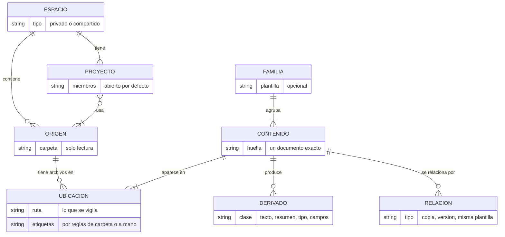
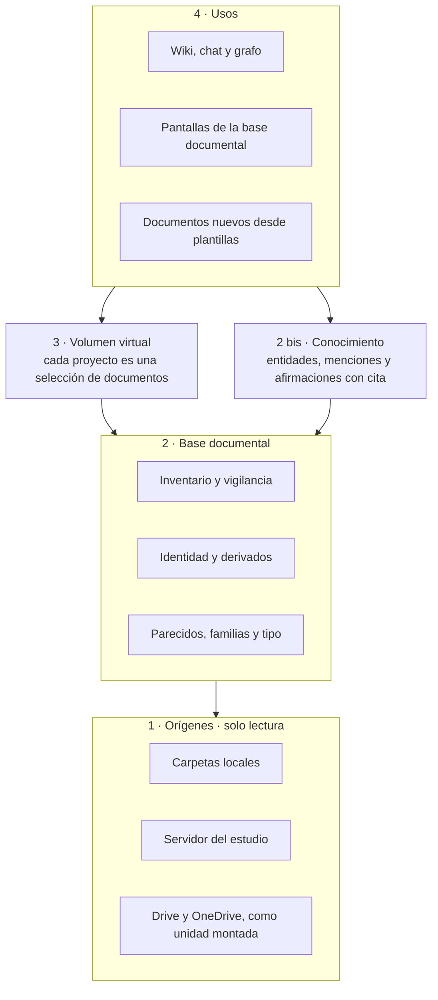
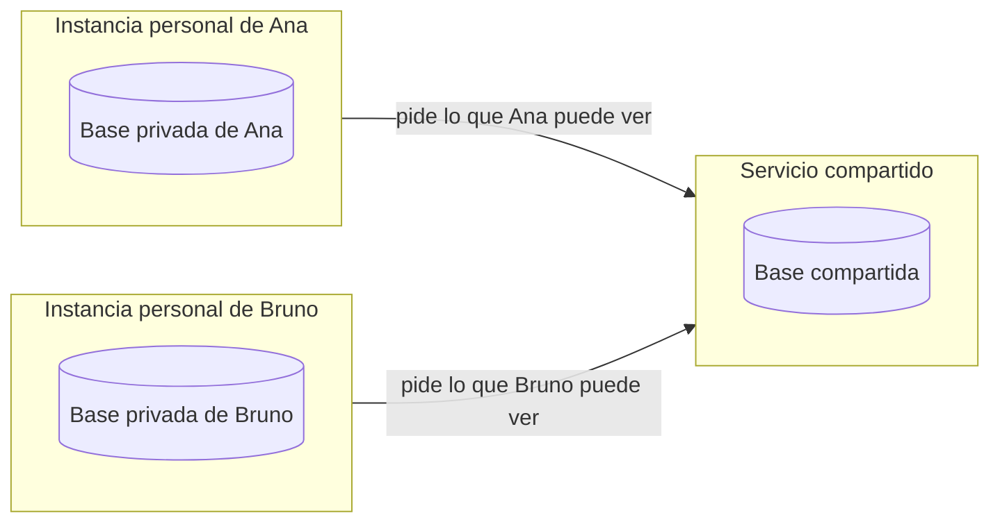
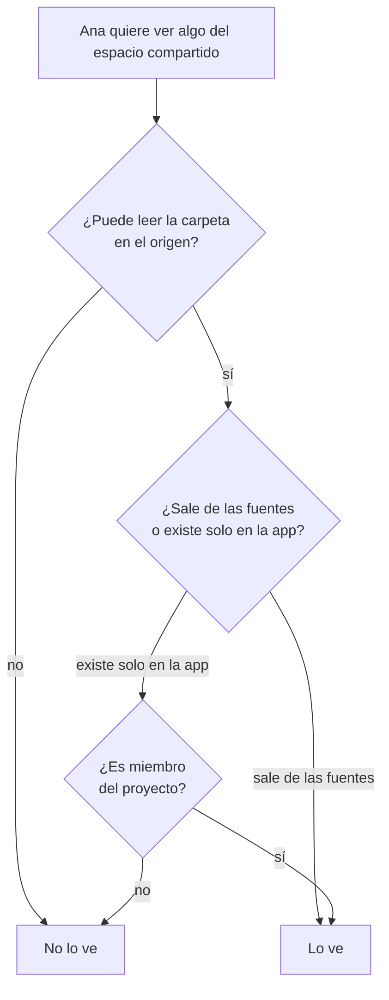
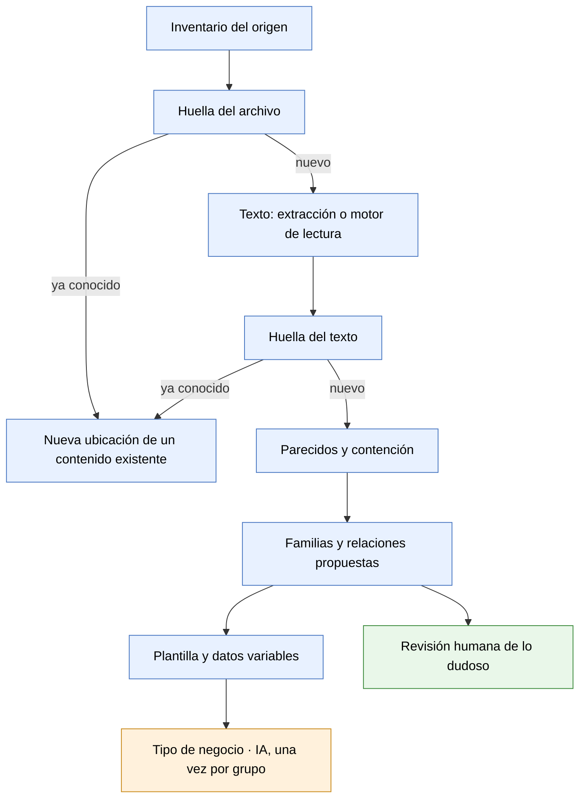
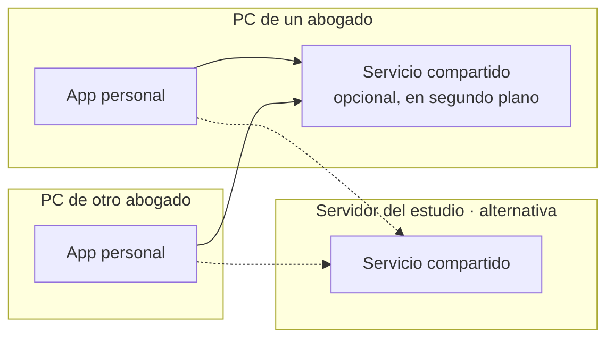
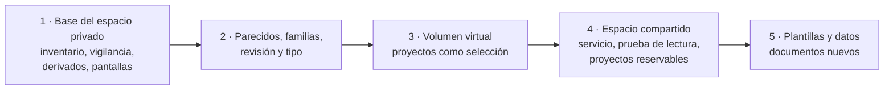

# Base documental — documento de diseño

**Estado:** dirección acordada · consolidado el 11 de octubre de 2026 · ajustado el 16 de octubre de 2026 (sección 13: vista de atención) · capa de conocimiento agregada el 16 de octubre de 2026 (D-170) · sus pantallas y su lugar en la vista de atención, el 16 de octubre de 2026 (D-215 a D-224)
**Alcance:** qué vamos a construir y en qué orden. No describe código.

## 1. Propósito

Micelya Desktop deja de ser "una app de wiki con manejo de fuentes" y pasa a tener como cimiento una **base documental**: un componente que sabe qué archivos existen, dónde está cada copia, cuáles son el mismo documento, cuáles están emparentados y de qué tipo son, y que los vigila. El wiki, el chat y el grafo se montan encima.

Es una aplicación de uso personal que además puede trabajar con un espacio compartido y con otras instancias.

**Cómo se avanza.** Primero un producto mínimo funcionando (sección 11); el detalle de lo demás se define después, con algo a la vista. Lo que se posterga queda en la lista de la sección 10 y en `pendientes.json`.

## 2. Principios

1. **Centrado en el archivo.** Todas las apariciones de un documento y sus variantes están identificadas y vigiladas.
2. **Los originales no se tocan.** No se alteran, mueven ni copian. Solo se guarda el resultado de procesarlos.
3. **Cada documento se procesa una sola vez por espacio.** Aunque haya muchas copias, su texto, resumen, huella y tipo se obtienen una vez.
4. **Dos espacios.** Privado (de una persona) y compartido (de varias).
5. **El mejor resultado primero.** Cada paso usa la herramienta que da el mejor resultado: el cálculo cuando iguala o supera al modelo, el modelo cuando el proceso lo necesita o rinde más. Cuando un grupo de documentos comparte la respuesta, se le pregunta al modelo una vez por grupo.
6. **El wiki ve un volumen virtual,** no el disco.
7. **Nos apoyamos en lo que ya hacen los orígenes.** La plataforma agrega capacidades por encima de carpetas, servidores y discos en la nube; no rehace un sistema de archivos.
8. **No se sincroniza con upstream.** El proyecto diverge; la compatibilidad con el original no es un criterio.

## 3. Conceptos

Tres niveles que conviene no mezclar al decir "archivo":

- **Ubicación:** un archivo en una ruta. Es lo que aparece, cambia, se mueve o se borra. Registra su origen y su carpeta.
- **Contenido:** un documento exacto. De él cuelgan los derivados.
- **Familia:** contenidos emparentados. De ella cuelgan las relaciones y, si existe, la plantilla.
- **Grupos y etiquetas.** Una etiqueta agrupa archivos lógicamente. Un **grupo** es la pregunta ("¿de qué cliente es?") y una **etiqueta** es la respuesta ("Zentora"); también hay etiquetas sueltas, sin grupo. Un archivo puede tener varias. Las etiquetas se guardan aparte y los archivos las referencian, así que renombrar una no toca ningún archivo.
- **Reglas de carpeta.** La estructura de carpetas es un indicio de qué contiene cada una, pero rara vez es pareja en todo un origen. Por eso las etiquetas se asignan con reglas puestas en cualquier carpeta, que valen para ella y todo lo que cuelga de ella: "todo lo de acá adentro lleva esta etiqueta" o "cada subcarpeta de acá es un… (cliente, caso)". La regla queda guardada: lo que aparezca después la hereda. Encima, a un archivo se le agrega o se le quita una etiqueta a mano, y eso manda sobre lo heredado: siempre hay archivos mal guardados. Al incorporar un origen se puede indicar cómo está ordenado, pero solo conviene si toda su estructura es pareja.
- **Exclusión.** Un archivo o una carpeta se pueden excluir: siguen en su lugar y a la vista, pero la base no los procesa ni los entrega al wiki. Se puede deshacer.
- **Entidad, mención y afirmación** (capa de conocimiento, sección 4). Una **entidad** es una persona, una organización o un asunto, con un identificador estable que no depende de su nombre. Una **mención** es una forma en que un documento la nombra, con un rol (parte, apoderado, firmante…). Una **afirmación** es algo que los documentos dicen de ella, con la cita textual que lo respalda, verificada por cálculo en el texto. Un **asunto** del archivo (un reclamo con sus cartas y facturas, un contrato con sus pagos) es además un grupo de documentos unidos por evidencia propia de ese asunto (el mismo número, el mismo importe, lo que decidió una persona), nunca por compartir una persona (D-213). El detalle está en la [propuesta de la capa](conocimiento-propuesta.md).
  **Actualización del 20 oct (D-373 a D-376):** el asunto deja de ser un tipo de entidad. Hay un solo concepto de asunto, que crea una persona o propone el sistema (sin reglas de carpeta); las referencias (número de acta, expediente) pasan a ser datos del documento. Ver [Asuntos: un solo concepto](asuntos-propuesta.md).
- **Archivo (proyecto general).** Cada espacio tiene un proyecto general que abarca todos sus orígenes; para el usuario es su archivo. La app lo crea sola y abre ahí. Su wiki no arranca sola, porque usa el modelo: se activa una vez y desde entonces se alimenta sola con lo que se agrega, cambia o se quita. Los demás proyectos son puntos de vista sobre parte de esas fuentes, con sus propias instrucciones para el modelo, como hace hoy la app.

## 4. Capas

La capa 3 le pregunta a la base solo tres cosas: qué fuentes hay, cuál es el texto de una, y qué cambió. Esa interfaz angosta permite que la capa de wiki siga pareciéndose a la original. Las páginas del wiki siguen nombrando sus fuentes por una ruta lógica; la base sabe a qué contenido corresponde cada una.

La base guarda además un **índice del wiki**: qué páginas hay, qué enlaces tienen entre sí y de qué documento salió cada una. Las páginas siguen siendo archivos de texto y son la verdad; el índice es una copia consultable que se reconstruye entera a partir de ellas. Sirve para responder sin releer todas las páginas: qué páginas citan un documento, qué enlaza a una página, qué enlaces están rotos.

Entre la base y los usos está la **capa de conocimiento** (D-170): un registro, dentro de la misma base del espacio, de las personas, organizaciones y asuntos que nombran los documentos, de cómo los nombra cada uno y de lo que dicen de ellos, cada cosa con la cita que la respalda. Las páginas de entidad del wiki se arman desde ese registro (son una proyección) y se rehacen cuando cambia lo que se sabe de la entidad. Detalle en la [propuesta de la capa](conocimiento-propuesta.md).

La base documental es un **componente separado dentro de la misma app**: datos propios, código en un lugar propio y esa interfaz angosta. Reutiliza los extractores de texto, los proveedores de IA, la cola de trabajo, la búsqueda y la interfaz. Reemplaza la importación que copia archivos, la vigilancia de fuentes, la identificación por ruta y los cachés atados a la ruta.

## 5. Orígenes

| Origen | Cómo se lee | Cómo se detectan cambios |
|---|---|---|
| Carpeta local | Directo | Avisos del sistema y barrido de respaldo |
| Servidor del estudio | Carpeta de red | Avisos si el servicio corre en esa máquina; si no, barrido periódico |
| Drive y OneDrive | Como unidad montada | Barrido periódico |

- **Vigilar** es siempre aviso en vivo, cuando existe, más un barrido de respaldo: al arrancar, cada cierto tiempo y cuando se pierden avisos.
- **Un origen que no se puede leer no es un origen vacío.** Si está desconectado, lo que se sabe de sus archivos se conserva.
- **Un archivo movido** se reconoce por su huella: desaparece de una ruta y aparece en otra.
- **La huella de un archivo se calcula al leerlo.** En un disco en la nube eso lo descarga la primera vez; se hace de a poco, en segundo plano.
- **Documentos nativos de Google** (Docs, Sheets, Slides): en la unidad montada son solo un acceso directo, sin contenido. Se registran como "detectado, no procesable", para que se vea qué queda afuera.
- Conectarse a Drive y OneDrive por sus propias interfaces queda para más adelante: exige registrar la aplicación ante cada proveedor.

## 6. Espacios, visibilidad y autorización

- El espacio compartido **solo conoce lo compartido**. Nunca sabe qué hay en un espacio privado.
- Lo que ve una persona es **su espacio privado más lo que puede ver del compartido**. Esa vista se arma en su instancia y no sale de su PC.
- Hay **una base por espacio**: la de cada instancia personal y la del servicio compartido. A la compartida se llega solo a través del servicio.
- Un proyecto de wiki tiene **una sola visibilidad**. Uno privado puede usar documentos compartidos; uno compartido no puede usar privados.

### El mismo contenido en los dos espacios

- La instancia personal guarda una **referencia** al contenido compartido y usa sus derivados, en vez de procesarlo de nuevo.
- Deja de ser privado el **contenido**, no la copia: que la persona tiene ese archivo, y dónde, sigue siendo privado.
- Para no delatar lo privado, la instancia trae la lista de huellas compartidas que puede ver y **compara localmente**. Las relaciones entre un documento privado y uno compartido se guardan solo en la base privada.
- Si pierde el acceso, su copia vuelve a ser un documento privado común. Si la modifica, pasa a ser un documento privado relacionado como versión.
- **Puede haber dos procesamientos** del mismo contenido, uno por espacio: por ejemplo, si la persona lo procesó sin conexión. Al detectar la coincidencia, la instancia pasa a usar los derivados del compartido.
- **"Publicar" algo privado** es mover o copiar el archivo a una carpeta compartida, por cuenta del usuario. El servicio compartido lo detecta.

### Autorización en el espacio compartido

El origen es el **techo** y el proyecto es el **alcance**.

- **Techo.** La app nunca muestra más de lo que el origen dejaría leer a esa persona. Puede mostrar menos, nunca más. Los permisos de las fuentes no se administran en la app.
- **Prueba de lectura.** En vez de interpretar los permisos del origen, el servicio le pide a la instancia que demuestre que puede leer una carpeta: elige archivos al azar, y la instancia devuelve una huella de un tramo leído con las credenciales de su dueño. Si coincide, recibe un pase por tiempo acotado, que se renueva solo. Sirve para cualquier origen. Queda siempre activa.
- **Lo que sale de las fuentes** (inventario, texto, resumen, familias) lo gobierna solo el techo. Es lo que muestra el proyecto general.
- **Lo que existe solo en la app** (el wiki y las síntesis de un proyecto) lo gobierna además la membresía del proyecto.
- **Los proyectos nacen abiertos** a quien pueda leer sus carpetas. Quien quiera reservar uno elige quiénes lo ven. Administra un proyecto quien lo crea.
- **Hay un administrador del espacio,** definido al instalar el servicio, con potestad sobre todos los proyectos.
- **Identidad.** Cada instancia personal se empareja una vez con el servicio, con un código que se confirma en la máquina del servicio.
- **Reglas para lo calculado.** Una relación se ve solo si se ven sus dos extremos. Una familia se muestra solo con sus miembros visibles y sin cantidades totales.

Experiencia de uso: reservar es una sola acción; la app muestra siempre el resultado efectivo ("lo ven 3 de 10 personas") y avisa cuando una restricción no alcanza a los archivos originales.

Límites aceptados:

- Restringir un proyecto en la app no protege los archivos si el origen está abierto.
- Lo que ya llegó a una base privada queda ahí aunque después se quite el permiso; la revocación corta hacia adelante.
- Una subcarpeta más restringida que su carpeta no se detecta sola; hay que declararla aparte.
- Protege contra exposición accidental, no contra quien altere su propia app.

## 7. Procesamiento

Azul: herramientas deterministas. Naranja: IA generativa. Verde: una persona.

- **Motores de lectura** (escaneos, fotos, audio): intercambiables. Leen y, cuando pueden, extraen campos. No clasifican.
- **Plantilla y datos:** en un comprobante la plantilla salta a la vista; en un contrato o un escrito hay mucho texto común y la plantilla es difusa. Se obtiene alineando los textos de una familia: lo que se repite es plantilla, lo que cambia son datos.
- **Versiones y ancestros:** el cálculo dice cuánto comparten dos documentos, no cuál vino primero. Se trata como un pipeline que suma señales (contención, fechas, nombres, etiquetas de carpeta) y se mejora por iteraciones. El parecido nunca fusiona: propone.
- **Borrado:** cuando desaparecen todas las ubicaciones de un contenido, se borran sus derivados.

## 8. Despliegue

- El servicio compartido no exige otra máquina: puede correr en la PC de un abogado o en un servidor.
- Hay **un solo escritor** por base compartida.
- Punto de partida: la app ya queda en segundo plano en la bandeja, puede arrancar con el sistema y levanta dos servicios locales que se pueden abrir a la red local.
- **Limitación actual:** la generación del wiki corre en la ventana de la app, no en su motor. Funciona en segundo plano porque la ventana solo se oculta, pero necesita una sesión abierta. Alcanza para el producto mínimo; convertirlo en un servicio de verdad está en la lista de la sección 10.
- **Cuenta de IA:** cada instancia usa la suya; los proveedores siguen siendo configurables. El rango de usuarios va de un abogado solo a un estudio mediano.
- **Las bases** van siempre en una carpeta local de la app: nunca en una carpeta de red ni en una sincronizada con la nube.

## 9. Decisiones tomadas

| Tema | Decisión |
|---|---|
| Unidad de la base | El espacio, no el proyecto |
| Componente | Separado dentro de la misma app; reutiliza y amplía lo existente |
| Motor | SQLite como fuente de verdad, con su búsqueda por palabras; LanceDB para la búsqueda por vectores, como índice reconstruible |
| Bases | Una por instancia personal y una del servicio compartido |
| Procesamiento | Una vez por espacio |
| Borrado | Sin ubicaciones, se borran los derivados |
| Drive y OneDrive | Como unidad montada, por ahora |
| Documentos nativos de Google | Detectados, no procesados |
| Clasificación | IA, una vez por grupo |
| Autorización | El origen es el techo, verificado con prueba de lectura; el proyecto es el alcance, abierto por defecto y reservable; hay un administrador del espacio |
| Proyecto general | Uno por espacio, con todas las fuentes incorporadas. Lo crea la app en su carpeta de trabajo; su wiki se activa a mano y después se alimenta sola |
| Etiquetas | Grupos y etiquetas guardados aparte, asignados por reglas de carpeta y a mano |
| Exclusión | Por archivo o carpeta; no borra ni mueve nada |
| Enlaces del wiki | En las páginas; la base lleva un índice reconstruible |
| Vocabulario | Los términos del dominio no van escritos en el código: salen de un vocabulario por vertical y por idioma |
| Proveedores de IA | Configurables por instancia |
| Proyectos de prueba existentes | Se reconstruyen. Sus fuentes originales no se tocan. Las fuentes copiadas dentro de un proyecto se tratan como un origen más |
| Upstream | No se sincroniza; el proyecto diverge y la compatibilidad no es un criterio |
| Conocimiento | Una capa propia dentro de la base del espacio: entidades con identificador estable, menciones con rol y afirmaciones con cita verificada por cálculo (D-170, D-171) |
| Tipos de entidad | Persona, organización y asunto; tipos, roles y predicados son datos, no código (D-172) |
| Identidad de entidades | En cascada, con abstención: mismo identificador une solo y se puede deshacer, identificador distinto nunca une, lo dudoso va a una persona (D-173, D-174) |
| Páginas de entidad | Proyección del registro: documentos agrupados por asunto y síntesis solo desde afirmaciones verificadas; lo que la síntesis no usa se lista igual con su cita; la incorporación del wiki deja de crearlas (D-175, D-236) |
| Páginas que escribe el modelo del wiki | Pasan por un control antes de guardarse: siempre `.md`, título igual al encabezado, sin campos académicos, sin hablar del propio wiki ni de "el material", enlaces solo a páginas que existen (D-237); el esquema de un proyecto nuevo es el de un estudio jurídico (D-238) |
| Importes en el lector | Un `$` suelto es el signo de moneda, nunca una fórmula (D-234) |
| Correcciones de entidades | Siempre como decisiones de una persona sobre el registro (unir, separar, dato incorrecto, sacar de un asunto), reversibles; nunca editando una página. La fusión de duplicados de Mantenimiento también, para las páginas del registro (D-219, D-220) |

## 10. Decisiones abiertas y lista de espera

**Abiertas:**

1. **La red entre instancias.** Cómo se encuentran y se comunican, y si hace falta un componente en la nube.
2. **La vista unificada.** Qué parte de lo compartido se copia a cada instancia y qué se consulta en el momento. Depende de cuánto se trabaje sin conexión; se decide midiendo.

**En espera, para definir en detalle después del producto mínimo:**

- Al reservar un proyecto, ocultar también sus carpetas en la app.
- La misma carpeta en dos proyectos con miembros distintos: gana el menos restrictivo, y la app tiene que avisarlo.
- Poder desactivar la prueba de lectura en estudios donde todos ven todo.
- La generación del wiki como servicio, sin depender de una ventana.
- Drive y OneDrive por sus interfaces, y con eso los documentos nativos de Google.
- El registro de cambios de Windows, para evitar el barrido completo al arrancar en carpetas muy grandes.

## 11. Etapas

La **capa de conocimiento** (D-170) se construye en paralelo, sobre la etapa 2, en seis pasos: extracción con cita verificada, resolución de identidad, proyección en páginas, cambios y borrados, relaciones entre entidades y asuntos, y su lugar en la vista de atención ([propuesta](conocimiento-propuesta.md), sección 12).

Se empieza por el espacio privado y un solo usuario. El espacio compartido multiplica cada decisión, así que llega cuando la base ya esté probada.

**El producto mínimo es la etapa 1 más un puente mínimo:** el wiki del proyecto general toma sus fuentes de la base documental. El resto de la etapa 3 queda para después. Para que lo compartido entre después sin rehacer nada, desde la etapa 1:

- cada ubicación guarda su origen, su carpeta y sus etiquetas;
- toda consulta (búsqueda, grafo, familias) recibe el conjunto de lo visible, que en el espacio privado es "todo";
- cada proyecto tiene sus miembros, con "abierto" como valor inicial;
- existe el proyecto general del espacio.

## 12. Qué existe hoy

Dentro de `src-tauri/src/source_volume/`, todo por proyecto: montaje de carpetas, detección de cambios segura ante orígenes desconectados, catálogo de duplicados exactos, huella del archivo y texto reconocido guardado por huella. Es la semilla del componente: los conceptos son los de este documento; cambia dónde viven los datos y a quién pertenecen.

La capa de conocimiento ocupa las versiones 9 a 11 del esquema de la base, después de la 8 de la vista de atención (las decisiones sobre tipos); una base en la versión 8 recibe las tablas de la capa sin perder nada (D-215). La versión 13 agrega lo que trae la segunda pregunta de lectura: el importe y su detalle en evidencias y afirmaciones, la marca de término definido de una mención y la fecha del documento (D-244 a D-247). La versión 14, los grupos de sociedades (`knowledge_group`, D-260).

Hoy cada proyecto guarda esos datos en su propia carpeta. Con la base, pasan a guardarse una vez por espacio: el mismo escaneo usado en dos proyectos se lee una sola vez.

## 13. Interfaz

Hacia dónde va la interfaz. El detalle visual se define en una pasada de diseño propia, antes de aplicarlo.

- **Marco común a toda la app:** una barra superior con la marca, el buscador global y el usuario; una franja que dice en qué estudio y en qué caso se está, y si es privado; navegación a la izquierda, con texto y contadores.
- **Páginas con forma de artículo de enciclopedia:** pestañas, índice a la izquierda, ficha de datos a la derecha, enlaces entre páginas y referencias numeradas a las fuentes. Es una forma que cualquier persona ya sabe leer.
- **Pantalla de inicio:** la salud del archivo, un resumen de lo que requiere atención ("2 problemas · 9 decisiones", con las primeras líneas) que lleva a la vista de atención, y la actividad reciente.
- **Vista de atención** (su nombre sale del vocabulario; en el vertical jurídico, "Atención"). Es el único lugar de lo que requiere a una persona, sea cual sea la parte de la app que lo detectó: la base documental, el wiki y, más adelante, plazos, tareas, aprobaciones y la capa de entidades. Detalle en la [propuesta](atencion-propuesta.md), construida el 16 de octubre.
  - **Tres clases que no se mezclan,** en este orden: *problemas* (algo no funciona y la app no lo puede arreglar sola), *decisiones* (algo espera el criterio de una persona) y *en curso* (lo que la app está haciendo; no requiere atención, se muestra para saber qué pasa y para pausarlo).
  - **Cada línea agrupa un tema** y dice qué pasa, por qué importa y qué hacer; trae la acción en la fila o lleva al lugar exacto donde se hace, nunca a una lista para buscar. Al abrirla se ven los casos uno por uno, cada uno con su acción.
  - **Se escala solo lo que requiere una acción.** De los documentos parecidos, solo los que podrían ser el mismo documento (prácticamente el mismo, ejemplar firmado, versión), porque deciden qué va al wiki. "Misma plantilla", "contenido en" y "parecidos" se ven en el documento y en la vista de parecidos.
  - **Un aviso se va solo cuando deja de ser cierto.** No se marca como leído y, por ahora, no se puede posponer.
  - **El contador** de la navegación suma problemas y decisiones, no lo que está en curso. Un problema cuenta una vez por línea; una decisión cuenta por cada decisión que hay que tomar (una familia de documentos es una). Las líneas de baja prioridad ("puede esperar") se muestran pero no cuentan.
  - **"En curso" reemplaza al panel de actividad** del wiki: la cola de incorporación y su control, los cambios de archivos, lo que el wiki hace con el modelo. Al pie del costado del wiki queda una sola línea que lleva a la vista.
  - **Muestra los avisos del archivo y los del proyecto abierto.** Si el proyecto abierto no es el archivo, sus líneas dicen de qué proyecto son, y las del wiki del archivo se muestran sin botones.
  - **Fuentes enchufables.** Cada parte de la app sigue detectando lo suyo y lo entrega con la misma forma (clase, tema, título, por qué importa, qué hacer, acción o destino, cuándo deja de ser cierto); la vista solo junta y ordena. Sumar una parte nueva es agregar una fuente, no rehacer la vista.
  - **La revisión estructural de los enlaces del wiki corre sola** cada vez que la cola del wiki termina (sin modelo), así el número de enlaces rotos de la vista coincide con el de la revisión de enlaces.
  - **La capa de conocimiento es una fuente más** (D-217). Problemas: documentos que no se pudieron leer para saber a quiénes nombran (con el motivo) y documentos que perdieron muchas citas al leerlos (suele ser un escaneo mal reconocido). Decisiones: identidades dudosas, una por grupo de dudas que comparten una entidad (D-216); datos en los que los documentos difieren; el asunto que el modelo propone para un documento suelto, que se confirma o se descarta desde la línea. Con prioridad baja: uniones recientes por identificador de nombres distintos, páginas que se conservan por sus notas, entidades que dejaron el registro con documentos excluidos y oraciones de las páginas que se descartaron. En curso: la lectura, la resolución de identidades y la escritura de las páginas.
- **Vistas para resolver en bloque,** a las que lleva la vista de atención: los documentos parecidos por familia (unir, elegir otra relación, descartar, ver los dos textos lado a lado, y confirmar de un clic una familia de la misma plantilla, para que las pasadas que vienen tengan una base confirmada, R-03); los tipos de documento que propuso el modelo (confirmar, cambiar el nombre o rechazar; lo confirmado pasa a la lista cerrada, R-22); las identidades dudosas por grupo, con lo que dice cada documento de cada lado (son la misma o no; lo que se mostró se guarda con la decisión, R-08); y la revisión del wiki, en español.
- **Personas y organizaciones, y asuntos** (sus nombres salen del vocabulario; D-219). Una lista con buscador y filtro por tipo, y el detalle de cada entidad con forma de artículo: cómo la escriben los documentos, sus identificadores, sus documentos agrupados por asunto con su rol en cada uno, lo que dice cada documento con la cita, los datos en que difieren, los vínculos desde otras entidades, su página del wiki y lo que decidió una persona. Las acciones son decisiones sobre el registro: unir con otra, separar una mención, "no es una entidad", marcar un dato como incorrecto y deshacer. Los asuntos: sus documentos con el motivo por el que está cada uno, sus partes, los que el modelo propone (confirmar o descartar) y sacar un documento del asunto (D-218). El detalle de un documento dice a quiénes nombra, con su rol, y de qué asunto es.
  **Actualización del 20 oct (D-376):** estas pantallas se unifican con su página del wiki (arriba el artículo, en una pestaña los datos y las correcciones), empezando por persona u organización; los asuntos tienen pantallas propias. Ver [Asuntos: un solo concepto](asuntos-propuesta.md), secciones 4 y 5.
- **Enlaces dentro de la página de cada documento** (D-221): además del bloque del final, la app enlaza el primer lugar del texto donde aparece un nombre tal como lo escribe el documento, solo cuando no puede ser otra entidad del documento; esos enlaces llevan una marca de la app y se rehacen. El lector del wiki no muestra los comentarios de las páginas, que son las marcas de la app.
- **Marca propia:** colores, tipografías y logo de Micelya.
- **Idioma:** las pantallas de la base documental nacen en español.
- **Vocabulario por vertical.** Cómo se llama cada cosa del dominio (el archivo, los grupos sugeridos, más adelante los tipos de documento) depende de la profesión: no es lo mismo un estudio jurídico que una escribanía o un estudio contable. Esos términos salen de un vocabulario, uno por vertical y dentro de él uno por idioma, y no van escritos en las pantallas. Los nombres técnicos (carpetas en disco, identificadores) son neutros y no cambian con la vertical.
- **Orígenes como árbol.** Cada origen se recorre como un árbol de carpetas y archivos. En cada fila: abrir, incorporar al wiki (si está activo), excluir y, en las carpetas, volver a barrer y definir reglas de etiquetas.

**En el producto mínimo** las pantallas de la base son Inicio, Atención, Orígenes, Documentos y Detalle de un documento, más las vistas para resolver en bloque (parecidos, tipos de documento e identidades dudosas) y las de la capa de conocimiento (personas y organizaciones, y asuntos). Se construyen con el estilo que la app tiene hoy; el marco común y la marca se aplican después, a toda la app de una vez.

"Cliente" y "caso" son grupos de etiquetas (sección 3), no proyectos; cada vertical sugiere los suyos y el usuario los nombra como quiera.
