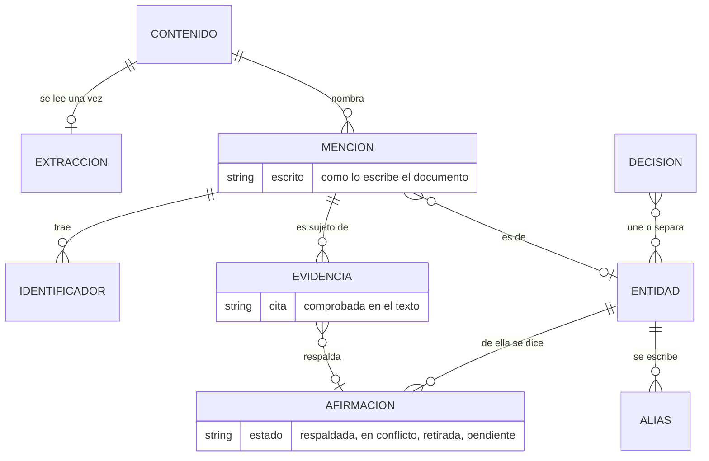

# Capa de conocimiento — propuesta

**Estado:** dirección acordada con el dueño del producto el 16 de octubre de 2026 (D-170 a D-176) · las seis etapas construidas en la rama `feat/knowledge-layer`, rebasada sobre la vista de atención; las decisiones que tomó el agente al construirlas (D-177 a D-224) esperan la revisión del dueño (P-066)
**Alcance:** cómo sabe la app quiénes son las personas, organizaciones y asuntos que nombran los documentos, qué dicen los documentos de cada uno y cómo se arma con eso una página por entidad. Es una capa nueva entre la base documental y el wiki ([documento de diseño](base-documental.md), sección 4). No describe código.

## 1. El problema

El wiki de hoy procesa un documento por vez. Para cada uno, el modelo decide qué personas y organizaciones "merecen página" y escribe o completa esas páginas. Para saber qué páginas existen ve solo sus títulos (el índice del wiki, que además guarda las últimas 200 líneas), nunca su contenido. Una entidad es el nombre de su archivo: no hay alias ni identificador estable. Cada página guarda de qué documentos salió, pero no qué dijo cada documento, así que borrar una fuente no retira lo que aportó. La fusión de duplicados de Ajustes no se puede deshacer. Y las instrucciones al modelo son de investigación académica: permiten agregarle a una entidad conocimiento público, que en un estudio jurídico no sirve y confunde.

Medido sobre el wiki generado con la carpeta de prueba (14 de octubre):

- 39 páginas de entidad; 28 con una sola fuente.
- La contraparte principal aparece en 31 páginas de documentos y su página usa 5. La empresa propia, 34 contra 5. Una persona, 24 contra 3: su página habla solo de 3 boletas y su ficha de cliente no le sumó nada.

Para un abogado eso es peor que no tener páginas: la página de una persona parece completa y le falta casi todo, sin decirlo.

## 2. La idea

Una **capa de conocimiento** dentro de la base del espacio, con un registro propio:

- **Entidades canónicas** (personas, organizaciones y asuntos) con un **identificador estable**, que no depende del nombre, de un alias, del título de una página ni de una ruta.
- **Menciones:** cada vez que un documento nombra a una entidad, cómo la escribe y con qué **rol** (parte, apoderado, firmante, destinatario, emisor, domicilio constituido…).
- **Afirmaciones:** lo que los documentos dicen de cada entidad (su cargo, su domicilio, a quién representa, qué debe), cada una con la **cita textual** que la respalda y su documento.
- **Decisiones de una persona** sobre identidades: "son la misma", "son distintas", "este dato está mal". Firmes y reversibles.

El wiki pasa a ser una **proyección** de ese registro: la página de una entidad se arma desde él y se rehace cuando cambia lo que se sabe de ella.

**El control que ordena todo:** toda mención y toda afirmación que extrae el modelo trae su cita textual, y **un cálculo comprueba que la cita está en el texto del documento**, con la misma normalización que usa la base (sin mayúsculas, acentos ni puntuación). Lo que no se encuentra se descarta y se cuenta. Así todo queda anclado a una fuente (R-01), y escribir páginas desde afirmaciones con cita comprobada no es inferir sobre lo inferido (R-02): cada frase de la página remite a una cita comprobada. La cita comprobada prueba que el texto existe, no que la lectura sea correcta: por eso cada afirmación lleva además su certeza y quién la confirmó (D-293).

## 3. Definiciones del dueño del producto

Acordadas el 16 de octubre de 2026 (D-170 a D-176):

- **Una capa nueva, con registro propio** (alternativa B), dentro de la base del espacio. Es una divergencia fuerte con el proyecto original, y está bien (D-151).
- **Toda afirmación lleva cita comprobada por cálculo, su certeza y quién la confirmó** (el modelo, una regla, una persona; D-293). La cita no prueba la lectura: lo dudoso se muestra como dudoso. Varias evidencias para lo mismo no la duplican. Las contradicciones se guardan y se muestran; nunca gana el último.
  - **Certeza (construida, D-320 a D-322):** cada afirmación es *con cita comprobada* (nadie la confirmó), *confirmada* por una persona, *dudosa* (los documentos difieren; la identidad del sujeto o del objeto está en duda; la cita nombra a otra persona y no al sujeto; estados distintos de un importe) o *corregida* por una persona; se calcula en cada resolución desde el estado, las dudas y las decisiones (`knowledge_claim.certainty`). La síntesis recibe las dudosas marcadas y las escribe como dudosas; un cálculo marca «(sin confirmar)» toda oración que se apoye en una y no lo diga; páginas y pantallas muestran la marca de cada dato.
  - **Decisiones que sobreviven a una relectura (D-321):** antes de cada resolución cada decisión de una persona se coloca sobre lo que dicen ahora los documentos: se aplica, se mueve a lo mismo escrito de otra forma (si hay una sola cosa así en su documento), espera a que su documento vuelva o se lea, o queda **para revisar** en Atención. Nunca se aplica a una adivinanza ni se pierde en silencio.
- **Tipos iniciales: persona, organización y asunto** (expediente, caso, contrato marco), con el rol de cada mención. Los tipos, roles y predicados son datos, no código. Conceptos, productos y eventos quedan para después.
- **La identidad se resuelve en cascada y con abstención:** mismo identificador (DNI, CUIT, matrícula, número de expediente) se une solo y se puede deshacer; identificador distinto no se une nunca; lo demás, por nombre y contexto, y el modelo para lo difícil; lo dudoso va a una persona. Ante la duda no se une (R-07).
- **Lo que decide una persona** se guarda como en los parecidos: firme, reversible, con la evidencia que se le mostró, nunca pisado por un recálculo (R-08, R-09).
- **La página de una entidad es una proyección del registro:** la lista completa de sus documentos agrupada por asunto, sin modelo; y una síntesis escrita por el modelo solo desde afirmaciones con cita comprobada, que escribe lo dudoso como dudoso. Las notas de una persona van en una sección que la app nunca reescribe. La incorporación del wiki deja de crear páginas de entidad y se adapta a un estudio jurídico. No se busca compatibilidad con Obsidian.
- **Sin derivaciones por reglas en esta etapa,** y todo incremental: un documento nuevo, cambiado o borrado toca solo lo suyo. El costo de modelo aprobado: una lectura por documento, preguntas sueltas para lo dudoso y un texto por entidad tocada.

## 4. Conceptos

- **Entidad:** una persona, una organización o un asunto, con un identificador estable. Su nombre visible es el más completo de sus nombres que sea nombre propio, anclado en el más usado (D-259); un grupo de sociedades se nombra por el nombre que comparten (D-260).
- **Mención:** una forma en que un documento nombra a una entidad con un rol: "el documento X nombra a 'J. Pérez' como firmante". Lleva la cita que la contiene y la página. Dentro de un mismo documento, el modelo dice qué menciones son la misma entidad ("el locatario" y su nombre completo).
- **Identificador:** un DNI, un CUIT, una matrícula o un número de expediente asociado a una mención, con su cita.
- **Evidencia:** lo que un documento dice de una mención: sujeto, predicado (de una lista), objeto (otra mención o un valor), cita, página y, si el documento lo dice, el tiempo del hecho.
- **Afirmación:** la evidencia ya puesta en términos de entidades. Varias evidencias que dicen lo mismo (mismo sujeto, predicado y objeto) son una sola afirmación con varias citas. Dos afirmaciones que no pueden ser ciertas a la vez (dos domicilios para el mismo momento) quedan **en conflicto**, las dos a la vista.
- **Decisión de identidad:** "estas menciones o entidades son la misma", "son distintas" o "este dato está mal", con la evidencia mostrada. Se puede deshacer.

## 5. Las pasadas

Cada pasada con su objetivo (R-10), de lo seguro a lo incierto (R-11):

1. **Extracción, por documento, con el modelo.** El modelo lee el texto de un documento (por tramos de páginas si es largo) y devuelve, en JSON con forma estricta, las menciones (tipo, cómo está escrita, rol, cita, página), los identificadores de cada una y las afirmaciones. Las instrucciones hablan de documentos de un estudio jurídico y prohíben agregar algo que el documento no diga. Recibe como ayuda lo que la base ya sabe sin modelo: los identificadores reconocidos por su forma, el tipo y la etapa del documento y sus datos por tipo. Desde la segunda versión de la pregunta (D-246) pide además los términos definidos como alias locales (D-245), los importes como relación entre un deudor y un acreedor ya resueltos los términos definidos (D-244), la clase de cada dato, el rótulo de un formulario aparte y la fecha del documento. Después, **el cálculo verifica cada cita**; lo que no está en el texto se descarta y se cuenta, con el motivo. Una cita de rótulo y valor separados en el texto vale si los dos están cerca (D-248). Y comprueba lo que la cita dice: la dirección del dinero por el verbo entre las partes (D-244), la clase de un número por su rótulo (D-249), que una relación con consecuencias jurídicas nombre a su objeto (D-250), que un dato bajo el rótulo de otra persona sea de esa persona (D-248), que la dirección de un bloque de firma sea de la sociedad (D-247) y que las páginas de una constancia de firma no den los papeles del acto (D-251). Una lectura por documento y por espacio; la respuesta se guarda y no se vuelve a pedir (R-20).
2. **Resolución de identidad, en cascada,** con tres salidas: la misma, distinta, dudosa. Lo que se resuelve es el **grupo de menciones de un documento** (las que tienen el mismo nombre, y las que el modelo dio como la misma dentro del documento), con una clave que no depende del orden de lectura (D-185).
   0. Lo que decidió una persona: una unión es firme; una separación mantiene aparte a los dos en todas las pasadas (D-189).
   1. Identificadores fuertes (DNI, CUIT, matrícula, expediente; no los números de factura o de cliente): el mismo une; uno distinto separa siempre. Si los nombres coinciden y los identificadores difieren en un carácter (un dígito mal leído en un escaneo), es dudosa. Si los nombres no tienen relación, también: el identificador puede estar atribuido a quien no es. Un identificador que el modelo le dio a una persona y a una organización, o a dos grupos del mismo documento, no se usa (D-187).
   2. El mismo nombre: las mismas palabras, sin artículos ni títulos, en cualquier orden para una persona (dos palabras al menos), con la misma forma societaria para una organización. "S.A.", "LLC" y "Ltd" del mismo nombre son organizaciones distintas salvo que una persona diga otra cosa. Un asunto nunca se une por su nombre ("el acuerdo" suele ser otro). Las palabras que no cuentan y las formas societarias son datos del vocabulario (D-186).
   3. El modelo, para los nombres que pueden ser el mismo (un nombre parcial, una inicial, un error de tipeo, una sigla, una organización sin su forma): una pregunta por entidad principal y sus candidatos (R-21), con nombres, identificadores, datos y citas de cada uno, y la opción de abstenerse. Lo que dijo se guarda por par y no se vuelve a preguntar (D-188). Un nombre sin forma societaria que comparten sociedades de distinta forma queda dudoso sin preguntar.
   4. Lo dudoso va a una persona, en la vista de atención (`knowledge_doubt`).

   Dentro de un documento, una organización nombrada sin su forma societaria es la única forma completa de ese nombre que escribe el documento (D-261). Un grupo de menciones se une y se compara por todos sus nombres, no solo el principal: el nombre corto que el documento le da a una organización la encuentra en otro documento (D-264). Un área o una casilla general ("Legales X", `noreply@…`) nunca se une por nombre: es el contacto de la organización que nombra su documento o de la que deletrea su dominio, y si la misma casilla es de varias, de su grupo; un área que no nombra a nadie y una casilla leída como persona no son entidades (D-262). Dos asuntos del mismo nombre entre otras partes no se preguntan (D-263). Después del modelo, las organizaciones de un mismo nombre con otra forma y otra señal que las vincule (las mismas personas, la misma casilla, un documento que lo dice) son las sociedades de un **grupo**: lo que se nombra sin forma y no se pudo atribuir a una sola es del grupo; un grupo nombrado en los documentos existe por su cita (D-260, `knowledge_group`).

   Los candidatos se encuentran por índices de palabras, iniciales y casillas, nunca comparando todo contra todo. Las familias se arman contra una principal, no por cadena (R-14). La resolución se calcula entera sin modelo cada vez que algo cambia y escribe solo lo que cambió (D-192); el identificador de una entidad lo conserva la que se queda con más menciones (D-190).
3. **Consolidación:** las evidencias se agrupan en afirmaciones por entidad; se marcan los conflictos. Un dato de un valor a la vez (marcado en el vocabulario: domicilio, nacionalidad, estado civil) con valores distintos es una historia si cada valor tiene su tiempo (el de la cita o, para el domicilio, la fecha de su documento), y un conflicto solo con la misma clase, el mismo titular y el mismo tiempo; sin tiempo, los valores no se comparan (D-191, D-252). Un valor sin la forma de su predicado (un número como cargo, un plazo como importe) no cuenta; el mismo valor escrito de dos maneras (un domicilio con y sin el piso) es una sola afirmación (D-209). El cargo es un cargo **en una organización**, la que nombra la cita o con la que la persona tiene una relación en el documento: cargos en organizaciones distintas nunca están en conflicto (D-210); un domicilio constituido para un trámite tampoco lo está con el real. Las palabras genéricas ("mi", "el cliente") no son nombres (D-211).
4. **Asuntos** (D-213): los documentos de un mismo asunto se agrupan por evidencia propia del asunto, de lo más seguro a lo menos: lo que decidió una persona; dos documentos que una persona unió con una relación de un mismo asunto (versión, respuesta, acuse de recibo…); el mismo asunto nombrado por los dos; el mismo número de un asunto en los dos (una factura que reclama una carta, un número de envío), comparado por sus dígitos; el mismo importe no redondo. Un número de un asunto escrito en el texto de otro documento también lo pone en él (D-268). Compartir una persona o una organización no los une (R-05), ni un DNI o un CUIT, ni un número que está en más de la mitad del archivo. Una separación decidida por una persona no se cruza nunca. Cada asunto guarda por qué está cada documento en él. Un documento que ningún dato pone en un asunto pero comparte partes con alguno se le pregunta al modelo: lo que diga queda **propuesto**, a la vista como tal, y nunca une a otros documentos (R-03).
5. **Proyección,** cuando no queda nada por leer ni resolver (D-199). Qué entidad tiene página se decide mirando el archivo entero, con una regla del vocabulario (D-196, D-266): una persona o una organización si tiene un rol de sustancia en algún documento o si los documentos dicen algo de ella (nombrarla al pasar en muchos no alcanza); un grupo de sociedades siempre, con sus sociedades y el porqué; un asunto si aparece en dos documentos y al menos uno trata de él. La página (`wiki/entities/<nombre>-<identificador>.md`; si la entidad cambia de nombre, la página pasa al archivo del nombre nuevo con sus notas y los enlaces la siguen, D-239) tiene el encabezado (tipo, nombre, alias, identificador, todas sus fuentes), **lo que dicen los documentos** escrito por el modelo solo desde las afirmaciones numeradas de la entidad, cada oración con sus números, y comprobado por cálculo (D-197); lo que la síntesis no usa se lista igual, sin redactar, con su cita (D-236), los datos en conflicto con todos sus valores, las referencias con sus citas, **los documentos** agrupados por asunto con el rol en cada uno, **los vínculos** con otras entidades en los dos sentidos ("representa a" y "representada por"), con su cita (D-214), **los relacionados** y **las notas**, que la app nunca reescribe (D-203). Un asunto con dos documentos o más tiene su página: sus partes, lo que dicen sus documentos, sus documentos y por qué van juntos, resumido y con el detalle plegado (D-213, D-268). Se nombra por la relación entre sus partes ("Reclamo de X a Y", "Acuerdo de terminación entre X y Y"), nunca por un comprobante, un número, un archivo o una frase (D-267). La página de cada documento que escribe el wiki termina con un bloque, escrito por la app, con las entidades que nombra y su rol (D-198). El resumen del archivo sale del registro (D-201): cuenta los documentos leídos y ordena a los más nombrados por los documentos en que tienen un papel de sustancia (D-240). Todo se calcula entero y se escribe solo lo que cambió: el orden en que el wiki y la capa procesan los documentos no importa.

**Incremental (R-15).** Documento nuevo: se extrae, se resuelven sus menciones contra lo existente y se rehacen solo las páginas tocadas. Documento borrado o reemplazado: se retiran sus menciones y evidencias; las afirmaciones con otra evidencia se conservan; una entidad sin menciones queda retirada (con las decisiones sobre ella); se rehacen las páginas afectadas. La extracción se rehace solo si cambió el texto, la versión de la pregunta o la versión del vocabulario de la capa. Reprocesar sin cambios no cambia nada (R-13).

**Cambios** (D-205 a D-207). Lo que una persona decidió sobre un documento, y la entidad de cada uno de sus nombres, pasan al documento que toma su lugar: el que vuelve con el mismo texto o los mismos bytes, o la versión nueva del archivo en la misma ruta. Así una entidad que solo aparecía en ese documento conserva su identificador y su página. La página de una entidad que deja el registro se borra, salvo que tenga notas o la enlace una página que la app no escribe: entonces queda una página mínima en su lugar. Un documento excluido no cuenta (su lectura se conserva y deshacer la exclusión no cuesta nada); uno unido con otro como el mismo documento, con el otro elegido para el wiki, cuenta como evidencia y las páginas nombran al elegido.

**Ritmo.** La extracción corre en segundo plano mientras el wiki del archivo está activo y hay un motor elegido, de a una pregunta por vez pero seguido, para que un archivo entero se procese en una tanda. Ante el límite de uso del proveedor se corta y se reintenta más tarde.

**Motor y razonamiento.** Con Codex, el nivel de razonamiento (solo bajo, medio o alto) va con cada pregunta y es parte del nombre del motor, así que las respuestas de otro nivel son otras respuestas (D-274). Por defecto, `gpt-6-luna` con razonamiento alto, elegido comparando cuatro variantes contra la hoja y con atribución juzgada a ciegas (D-276, D-279); `gpt-6.1-sol` queda como alternativa (D-278). El mismo modelo cambia bastante entre dos corridas desde cero, así que una diferencia chica medida en una sola corrida no decide nada (D-277).

## 6. El vocabulario de la capa

Los tipos de entidad, los roles y los predicados son **datos** (R-24, R-26): un archivo del mismo estilo que el catálogo de tipos de documento, reemplazable por otro en la carpeta de datos de la app. Cada entrada tiene una descripción en palabras, que es lo que lee el modelo. Arranca con:

- **Tipos:** persona, organización, asunto.
- **Roles:** parte, apoderado, firmante, remitente, destinatario, emisor, domicilio constituido (el lugar donde otra parte constituye domicilio, no tener un domicilio, D-251), testigo, el asunto del que trata el documento, otro.
- **Predicados:** cargo, domicilio (con su clase: real, sede, laboral, fiscal o constituido, D-247), representa a, socio de, beneficiario final de, cónyuge de, empleado de, deudor de (sin importe), parte en (un asunto), inicio y fin de un vínculo, profesión, nacionalidad, estado civil, contacto; y el **importe** entre un deudor y un acreedor, con su tipo (total de factura, saldo, reclamo, cuota, intereses, precio, honorarios, préstamo, inversión, bonificación o crédito, total acumulado, otro), su **estado** (pagado, a pagar, pactado, propuesto, condicionado; un ejemplo no se guarda como importe entre las partes, y un pago con fecha posterior a la del documento no está pagado), su moneda, su concepto y su fecha (D-244, D-310 a D-313).
- **Identificadores:** DNI, CUIT o CUIL, EIN, matrícula, número de expediente, número de cliente, otro; y, sin identificar a nadie (solo en el asunto del documento), número de factura, de envío o carta documento, sobre de firma y código postal. Cada clase tiene sus rótulos: el rótulo que el texto pone antes del número decide su clase (D-249).

Para la resolución de identidad trae también qué identificadores son fuertes, qué predicados tienen un valor a la vez, las palabras que no cuentan al comparar nombres (artículos, títulos), las palabras genéricas que no son nombres (también jurisdicciones, plurales y posesivos), los determinantes que hacen de un nombre una frase, las palabras de un área o una casilla, las de un grupo y de una afiliada, las relaciones que vinculan a una persona con una sociedad, y las formas societarias con sus maneras de escribirse. Para la consolidación: la forma del valor de cada predicado, dentro de qué entidad se dice (el cargo, en una organización), las clases de valor que dice la cita (domicilio constituido) y las monedas y palabras de un domicilio que no distinguen. Para los asuntos: qué relaciones entre documentos los unen, qué números e importes cuentan y desde cuántos documentos un asunto tiene página.

Cambiar lo que usa la pregunta de lectura (tipos, roles, identificadores y predicados con sus descripciones) hace volver a leer los documentos; cambiar lo demás, no (D-193).

## 7. Qué se guarda

En la base del espacio:

- Por documento, la **extracción**: con qué versión de la pregunta, qué vocabulario, qué motor y modelo, sobre qué texto (su huella), cuántas menciones y evidencias dejó y qué descartó y por qué.
- Las **menciones**, sus **identificadores** y las **evidencias**, cada una con su cita y su página.
- Las **entidades**, sus **alias** y las **afirmaciones** que agrupan evidencias (desde la etapa 2).
- Las **decisiones de identidad** de una persona, con la evidencia mostrada y su huella, sobre claves que no cambian al volver a leer el archivo (D-189).
- Los **veredictos del modelo** sobre cada par de grupos que se le preguntó (la misma, distinta, dudosa, con su motivo y el motor), y las **dudas** que quedan para una persona.
- Las **marcas de trabajo pendiente:** qué documentos hay que volver a resolver, qué evidencias retirar y qué páginas rehacer.
- Lo que deja un documento que se va (la huella de su texto, sus archivos, la entidad de cada uno de sus nombres), para el documento que tome su lugar.
- Los **asuntos**: cada grupo de documentos con un identificador estable, su nombre y, por documento, los motivos por los que está en él.
- Cada respuesta del modelo, con la pregunta y **el modelo que la dio**: cambiar de modelo vuelve a preguntar.

Lo calculado se puede rehacer entero desde los textos. Lo que decide una persona no se pisa.

Vale la regla del espacio compartido: una entidad, una mención o una afirmación se ven solo a través de documentos visibles. Toda consulta recibe el conjunto de lo visible.

## 8. Qué ve el usuario

- **Página de cada entidad:** la ficha (alias, identificadores, datos), la lista completa de sus documentos agrupada por asunto, con el rol en cada uno, y la síntesis con referencias numeradas a las citas. Debajo, sus notas, que la app no toca. En la página de cada documento, además del bloque del final, el primer lugar del texto donde aparece un nombre tal como lo escribe el documento lleva a su página, cuando no puede ser otra entidad del documento (D-221).
- **Vista de atención** (etapa 6, D-216 y D-217): lecturas que fallaron (con el motivo; una lectura vacía de un texto largo cuenta como fallida, D-235) y lecturas que perdieron muchas citas (un escaneo mal reconocido); identidades dudosas, una decisión por grupo de dudas que comparten una entidad; datos en que los documentos difieren; el asunto que el modelo propone para un documento suelto, para confirmarlo o descartarlo; y, sin sumar al contador, las uniones recientes por identificador de nombres distintos, las páginas que se conservan por sus notas y las entidades que dejaron el registro con documentos excluidos. En curso: la lectura, la resolución y las páginas que esperan su síntesis. Los umbrales (cuántas citas perdidas, cuán reciente) son datos del vocabulario de la capa.
- **Personas y organizaciones:** lista con buscador y filtro por tipo; el detalle de cada una, con lo de su página más sus menciones una por una, quién habla de ella y lo que decidió una persona. Las acciones son decisiones (D-219): unir con otra, separar una mención, "no es una entidad", marcar un dato o lo que dice un documento como incorrecto, y deshacer cualquiera.
- **Identidades dudosas:** una tarjeta por grupo, con cada lado (cómo se escribe, identificadores, citas y documentos) y el motivo de la duda; "son la misma" o "no son la misma", guardado con lo que se mostró (R-08).
- **Asuntos:** sus documentos con el motivo por el que está cada uno, sus partes, los documentos que el modelo propone y las decisiones. Sacar un documento de un asunto lo separa de cada uno de sus documentos (D-218).
- **Detalle de un documento:** quiénes aparecen y con qué rol, y de qué asunto es.
- **Mantenimiento:** la fusión de duplicados, para las páginas del registro, se vuelve una decisión de unir (o de separar) en el registro (D-220).

## 9. Cómo sabemos que funciona

Una **hoja de respuestas de entidades** hecha leyendo los documentos de la carpeta de prueba (fuera del repositorio, porque nombra personas reales): cada entidad con sus alias, identificadores, menciones con rol y afirmaciones con cita; los pares que parecen la misma entidad y no lo son; las menciones que no se pueden resolver; y los asuntos. Mide, no enseña (R-25).

Se mide por separado (R-17):

- **Extracción:** menciones encontradas y acertadas por documento (por nombre normalizado y tipo), roles acertados, afirmaciones encontradas, citas comprobadas y descartadas.
- **Identidad:** uniones falsas y separaciones falsas, por separado. Una unión falsa pesa mucho más.
- **Proyección:** que cada página tenga todos los documentos de su entidad y que cada frase remita a una cita.
- **Cambios:** que borrar un documento retire lo suyo y nada más; que reprocesar sin cambios no cambie nada. Sobre el archivo real: excluir el documento que más entidades nombra y devolverlo (D-208).
- **Asuntos:** pares de documentos de un mismo asunto de la hoja que quedan juntos, y agrupaciones falsas por separado.
- **Vínculos:** cuántos vínculos de la hoja entre dos de sus entidades tiene el registro entre las mismas entidades.

Una prueba comprueba además que ni el programa ni el vocabulario de la capa contengan nombres, números u otros valores de las hojas de respuestas (R-24).

## 10. Límites

- **Lo que el modelo no ve, no está.** Una mención que el modelo no extrae no se recupera con cálculo. La hoja dice cuánto se escapa.
- **La cita comprobada prueba que el texto existe, no que la lectura sea correcta.** El modelo puede atribuir una cita a la persona equivocada; la cita a la vista permite que una persona lo note.
- **Los escaneos traen errores de lectura.** Un identificador mal leído separa a una persona (el error menos grave) y aparece como dudoso.
- **Una sola página por cita.** El texto de la base ubica por página, no por párrafo.
- **Sin derivaciones:** "A dirige B" y "B firmó C" no dan "A firmó C".

## 11. Decisiones abiertas

1. Cuándo vuelve a leer un archivo entero un modelo nuevo: hoy, cambiar de modelo no vuelve a leer lo ya extraído (D-180). Lo mismo para los veredictos de identidad: con otro motor, se vuelven a preguntar los pares.
2. ~~Cómo se muestran en una página las afirmaciones en conflicto.~~ Resuelto en la etapa 3 (D-197): todos los valores a la vista, con sus referencias; la síntesis dice que los documentos difieren. El cargo se consolida por organización desde la etapa 5 (D-210).
5. De qué lado está cada parte de un asunto y quién es el cliente del estudio (P-106); qué hacer con los documentos que no comparten ni datos ni partes con un asunto (P-105).
3. ~~Cómo pasa la página de un documento del wiki a enlazar las páginas de entidad.~~ Resuelto en la etapa 3 (D-198): un bloque al final, escrito por la app.
4. Cuánta certeza del modelo alcanza para unir (hoy une cualquier "la misma"; exigir certeza alta separó de más, D-188) y si una separación decidida por una persona se vuelve a proponer cuando aparece evidencia nueva y distinta (R-08; hoy queda firme hasta que se deshace, P-099).

## 12. Etapas

1. **Extracción** (construida): modelo de datos, vocabulario, extracción con cita comprobada, trabajo de fondo, estado para las pantallas y evaluación contra la hoja. Sin pantallas.
2. **Resolución de identidad** (construida) con abstención, decisiones de una persona, consolidación de afirmaciones y evaluación de uniones y separaciones falsas. Sin pantallas: deja los comandos para consultar entidades y dudas y para decidir.
3. **Proyección** (construida): páginas de entidad desde el registro, bloque de entidades en la página de cada documento, resumen del archivo e índice completo por tipo; la incorporación del wiki deja de crear páginas de entidad en el archivo y sus instrucciones son las de un estudio jurídico (D-195 a D-204).
4. **Cambios y borrados** (construida): retiro de evidencia, lo que pasa al documento que toma el lugar de otro, lo excluido y lo unido, y rehacer solo lo afectado (D-205 a D-208).
5. **Asuntos y vínculos** (construida): los asuntos como grupos de documentos con página propia, los cargos por organización, la forma de los valores y los vínculos en los dos sentidos (D-209 a D-214).
6. **Vista de atención y pantallas mínimas** (construida): la capa como fuente de la vista de atención, las pantallas de personas y organizaciones, de identidades dudosas y de asuntos, el detalle de un documento, la fusión de duplicados llevada al registro y los enlaces dentro de la página de cada documento (D-215 a D-224).
