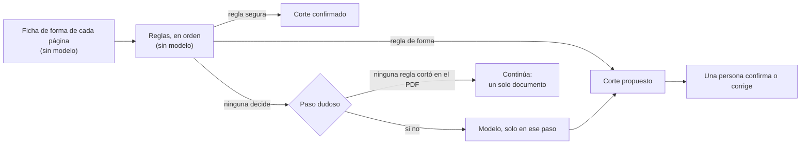

# Documentos compuestos y documentos incluidos — propuesta

**Estado:** propuesta para que el dueño la revise antes de construir (D-525, P-350), 25 oct 2026. No se construyó nada.
**De dónde sale:** la observación 3 del dueño (un PDF que junta muchos documentos), la [investigación del cortador](../investigacion/corte/informe.md) y una prueba en seco del cortador sobre la base, sin modificarla (sus detalles tienen datos reales y quedan fuera del repositorio; acá van solo números).

## En pocas palabras

- Un PDF puede juntar varios documentos. Hoy la app lo trata como uno solo: un tipo, un título y todas sus personas mezcladas.
- **El archivo no se toca.** Cada documento incluido pasa a ser un documento más de la base, con su página, su tipo, su fecha, sus personas, sus casos y sus copias, y dice de qué compuesto es y qué páginas, o qué parte de una página, ocupa.
- **Los cortes los propone la app:** primero reglas, sobre la ficha de forma de cada página y sin modelo; el modelo, solo en los pasos dudosos; y lo dudoso lo confirma una persona, en una pantalla con las páginas en miniatura.
- **Lo ya leído no se vuelve a leer:** el texto, las personas y el resumen del compuesto se reparten por página entre sus incluidos, sin consultas. Las consultas son solo para los cortes dudosos (51 en la prueba en seco, para 12 PDF).
- **Core entra como un proveedor más** para lo dudoso y para dos documentos en una misma hoja, con el mismo formato de respuesta que el cortador local.
- Quedan **8 preguntas para el dueño** (sección 10), cada una con una recomendación.

## 1. El problema

Un ejemplo inventado. Un PDF de 23 páginas, «Documentación adjunta», que un estudio presentó con un escrito:

| Páginas | Qué es |
|---|---|
| 1 a 3 | el escrito (digital, firmado) |
| 4 a 6 | un poder (escaneado) |
| 7 y 8 | una partida de nacimiento y su certificación al dorso (escaneo, otro papel) |
| 9 | dos fotos de documento de identidad en la misma hoja: la de Ana Pereyra y la de Luis Gómez |
| 10 a 22 | seis partidas más, cada una con su hoja de firmas digital |
| 23 | una declaratoria de herederos |

Lo que hace hoy la app con ese PDF:

- **Es un solo documento,** con el tipo y el título de su primera parte (un escrito), no los del conjunto.
- **Las personas se mezclan:** todas las que nombra cualquiera de las 23 páginas figuran como nombradas en «el escrito». No se sabe cuál viene del poder y cuál de una partida.
- **No se puede buscar por tipo:** buscar «partidas de defunción» no encuentra la que está en las páginas 15 y 16.
- **No puede estar en un caso por partes:** si la declaratoria también sirve en otro expediente, hay que poner ahí el PDF entero.
- **«Copias y versiones» no ve lo repetido:** el mismo documento de identidad adjuntado en dos escritos son dos PDF distintos que comparten una página, y nunca se dice que es el mismo documento.
- Lo manuscrito que se leyó creó personas falsas; por eso ya se decidió no transcribirlo solo (D-518).

**Cuánto pasa** (medido sobre la base de prueba, solo números): 127 PDF, 583 páginas. 14 PDF tienen señales gruesas de ser compuestos (los armó una herramienta para unir PDF, o alternan escaneo y digital, o cambian de papel), y 3 más están en la hoja de partes del dueño. En la prueba en seco, 12 de esos PDF (124 páginas) dieron 79 documentos incluidos.

## 2. Las palabras (D-512)

| Concepto | Adentro (canónico) | En el código | En la pantalla, vertical jurídica |
|---|---|---|---|
| El PDF que junta varios documentos | documento compuesto | `compound` | escrito con documentación adjunta, o documentación adjunta |
| Cada documento que junta | documento incluido | `piece` (el nombre interno que ya se usa con Core) | documento adjunto |
| El límite entre dos documentos incluidos | corte | `cut` | corte |

- Las palabras de la pantalla salen del vocabulario de la vertical, nunca del código, y no dependen de dónde vino el PDF (del portal, de una carpeta o de un correo).
- Que un documento sea compuesto es su **estructura**. Qué papel cumple en el caso (escrito, despacho, notificación) es otra cosa y se guarda aparte, como hoy.

## 3. Cómo se guarda un documento incluido

### La idea

- **El archivo no se toca.** El PDF original sigue entero, con su huella: es la prueba.
- **Cada documento incluido es un documento más de la base.** Tiene el mismo registro que hoy tiene cualquier documento, así que todo lo que la base ya sabe hacer con un documento (tipo, datos, personas, casos, copias y versiones, búsqueda, plantillas) le sirve sin inventar algo nuevo en cada capa.
- **Además, un registro nuevo dice dónde está:** de qué compuesto es, en qué orden y qué páginas o qué región ocupa.

### Qué se guarda de cada documento incluido

| Qué | Ejemplo | Dónde se guarda |
|---|---|---|
| De qué compuesto es y en qué orden | el 3.º de «Documentación adjunta» | registro nuevo |
| Qué ocupa: páginas, o una región de una página | páginas 7 y 8; o la mitad de arriba de la página 9 | registro nuevo |
| Si el corte está propuesto o confirmado, y quién lo confirmó | propuesto; confirmado por una regla segura; confirmado por una persona | registro nuevo |
| Por qué se cortó | «la página 7 es otro papel»; «lo dijo el modelo, con confianza alta»; «lo marcó una persona» | registro nuevo |
| Tipo y etapa | partida de nacimiento | como cualquier documento; si no se sabe, «sin clasificar» |
| Fecha, emisor y los demás datos de su tipo | 12 mar 1961; Registro Civil | como cualquier documento |
| Personas y lo que dice de ellas, con su cita | Ana Pereyra, nacida en tal fecha | como cualquier documento |
| Su texto | el texto de las páginas 7 y 8 | se corta del texto del compuesto, sin volver a leer |

- **La región** es un rectángulo medido en proporciones de la página («de arriba hasta la mitad»), así no depende de la resolución del escaneo. Es para los casos como dos fotos de documento de identidad en una hoja (D-518). En la investigación fueron 2 cortes de 80.
- **El texto** de cada incluido sale del que la base ya guarda del compuesto, que está separado por página. No se vuelve a leer nada. Para una región: si la lectura guardada no tiene la posición de las palabras, el texto de la página queda en el primer documento de esa página hasta que se lea la región (una consulta, cuando una persona confirma la región).
- **Ninguna página se descarta:** cada página queda en exactamente un documento incluido (en la investigación se cumplió siempre). Lo que no se puede clasificar queda «sin clasificar», a la vista y en la búsqueda.
- **El compuesto sigue siendo un documento:** conserva su archivo, su huella, sus ubicaciones y su texto entero. Su tipo es «documento compuesto» y su título habla del conjunto, armado sin modelo con los tipos de sus incluidos: «Documentación adjunta: escrito, poder, siete partidas y declaratoria».

### Los estados de un corte

Como todo lo que propone la app, lo dudoso lo confirma una persona (R-03):

- **Confirmado por una regla segura:** las reglas que no fallaron ni en la investigación ni en la prueba en seco (la página siguiente está en blanco o tiene solo el pie; el mismo código de documento en las dos páginas; hojas notariales correlativas; las dos caras de una tarjeta). No piden nada.
- **Propuesto:** todo lo demás (las reglas de forma, el cambio de escaneo a digital, «página x de y», las fórmulas de apertura y de cierre, la respuesta del modelo). Se ve con su motivo y espera a una persona. Se marcan «para mirar» los que dejan un documento de una o dos páginas y los del modelo con confianza media o baja.
- **Confirmado por una persona:** lo que una persona confirmó, unió, partió o marcó. Se guarda con lo que se le mostró, como las otras decisiones, y una lectura nueva no lo cambia.
- Qué hacer con lo que se apoya en un corte propuesto (por ejemplo, decir que ese documento de identidad es el mismo que otro) es la pregunta 3.

### Lo que se descartó

- **Partir el archivo en PDF nuevos:** no; el original no se toca (ya decidido). Una copia aparte se hace solo a pedido (sección 6.4).
- **Guardar los incluidos solo como secciones de la página del compuesto,** sin ser documentos de la base: cada capa (personas, casos, copias, búsqueda, plantillas) tendría que aprender qué es «una parte de un documento», y aun así el mismo documento de identidad no podría estar en dos escritos. Es la pregunta 1.

### Para quien lo construya

- Una tabla nueva, `content_piece`: el compuesto, el orden, el documento incluido (un `content` propio), la primera y la última página, la región (si hay), el estado, quién lo decidió, el motivo y la confianza. Va en una versión nueva de la base (la siguiente a la 29 de hoy), con su migración y su prueba.
- Un incluido no tiene un archivo propio (`file`): su identidad es la huella del compuesto más sus páginas o su región. Como la base identifica un documento por su texto, dos incluidos con el mismo texto son el mismo documento (lo que se busca para el mismo documento de identidad digital), salvo los de muy poco texto propio (sección 5.4).

## 4. Cómo se detectan los cortes



1. **La ficha de forma** (D-522) dice de cada página, sin modelo, si es un escaneo o digital, su papel y su resolución, sus imágenes, su texto propio, y si trae «página x de y», un código de documento o una fórmula de apertura o de cierre.
2. **Las reglas** se aplican en orden y la primera que vale decide «continúa», «empieza otro» o «dudoso» (la tabla completa, con sus aciertos y errores, está en la [investigación](../investigacion/corte/informe.md)).
3. **El modelo** mira solo los pasos dudosos, con las imágenes de las dos páginas.
4. **Una persona** confirma o corrige lo propuesto (sección 6.3).

### Los números de la investigación

Seis PDF de prueba, 134 páginas, 80 cortes y 88 documentos, medidos contra la hoja de partes del dueño:

| Variante | Consultas al modelo | Cortes encontrados | De cada 100 cortes propuestos, cuántos son reales | Documentos exactos |
|---|---|---|---|---|
| Solo reglas | 0 | 62 de 80 (78 %) | 84 | 47 de 88 |
| **Reglas, y el modelo solo en lo dudoso (la que conviene)** | **47** | **79 de 80 (99 %)** | **85** | **72 de 88** |
| Reglas, y el modelo en lo dudoso y en las reglas de forma | 100 | 73 de 80 (91 %) | 94 | 69 de 88 |
| El modelo en todos los pasos | 128 | 73 de 80 (91 %) | 96 | 70 de 88 |

- La variante que conviene encuentra casi todos los cortes con la tercera parte de las consultas. Sus errores son cortes de más, casi todos en adjuntos de un documento (la certificación al dorso, el comprobante de un timbre, la hoja de firmas), y se arreglan uniendo dos documentos en la pantalla, que es más fácil que encontrar un documento perdido dentro de otro.

### Lo que enseñó la prueba en seco sobre la base

12 PDF, 124 páginas, sin cambiar nada: 79 documentos incluidos, 40 con algo para mirar; 51 consultas para cortar y 79 más para el tipo y una descripción de cada documento. De los 67 cortes, 27 los hizo la regla «cambia de escaneo a digital», 14 una fórmula de cierre, 10 el modelo, 7 otra captura, 5 una fórmula de apertura y 4 otro papel.

- Un PDF de 24 páginas (partidas escaneadas, cada una con su hoja de firmas digital) quedó en 24 pedazos, cuando probablemente son unos 13: la regla de escaneo a digital, que en la investigación no había fallado, corta antes de cada hoja de firmas.
- 28 de las 51 consultas para cortar se fueron en dos PDF que resultaron uno y dos documentos.

### Mejoras antes de construir

Son reglas generales, en el catálogo (R-26), y se miden contra la hoja de partes, que mide y no enseña (R-25):

1. **Una hoja de firmas, una constancia de firma o una hoja de digitalización nunca empieza un documento:** se une al anterior. Se reconoce por el vocabulario del catálogo o por el sello verificado del servicio de firma (D-519).
2. **El cambio de escaneo a digital pasa a ser una regla de forma:** propone, no confirma.
3. **La regla de otro papel vale solo entre escaneos de 100 puntos por pulgada o más** (una foto no tiene tamaño de papel), como ya hace la regla de las dos caras de una tarjeta.
4. **Las reglas de forma consultan al modelo solo si el documento siguiente sería de una o dos páginas;** si no, quedan propuestas, sin consulta.
5. **Ahorro:** si ninguna regla encontró un corte en un PDF, sus pasos dudosos no van al modelo: queda como un solo documento, y una persona puede partirlo. En la prueba en seco habría ahorrado 28 de las 51 consultas, a cambio de a lo sumo 1 corte (el único que hizo el modelo en esos dos PDF). Con las tablas de la investigación, en la hoja de partes ahorra 6 consultas, evita 2 cortes de más y no pierde ninguno. Además, los PDF de la base que no son compuestos (la gran mayoría) nunca van al modelo. Sale de las tablas, no se corrió: se mide antes de usarlo.
6. **En lo que se lee nuevo, la pregunta del corte va en la misma consulta que lee la página escaneada** (lo propuso el dueño en la observación 3): para esas páginas no hay consulta aparte. Sin medir.

### El tipo y la descripción de cada incluido

- Los da el paso de tipo que la app ya tiene: primero las marcas del catálogo, y el modelo una vez por grupo de documentos parecidos. La descripción se arma con los datos del tipo (fecha, emisor, personas), sin consulta.
- En la prueba en seco fueron 79 consultas aparte; con el paso que ya existe deberían ser bastante menos (sin medir).

### Dos documentos en una hoja (regiones)

- Si la página trae dos imágenes separadas (dos fotos puestas en un PDF digital), la ficha lo ve sin modelo y se propone una región por imagen.
- Si es un solo escaneo con dos tarjetas, un cortador por páginas no lo ve. Por ahora lo marca una persona, dibujando el rectángulo; lo automático se le pide a Core (sección 8).

### Lo manuscrito (D-518)

- Se detecta y se marca en cada documento incluido; no se transcribe solo; una persona puede pedir la lectura de un documento (P-334).
- La ficha de forma todavía no distingue lo impreso de lo manuscrito: eso hay que construirlo, o pedírselo a Core.

## 5. Qué cambia en cada capa

### 5.1 La lectura y lo que se dice de cada documento

- Hoy la base lee cada documento una vez con el modelo, y cada persona que encuentra, cada cosa que dice de ella y cada punto del resumen guardan la página de su cita.
- **Con los incluidos, eso se reparte por página:** lo de las páginas 7 y 8 pasa a ser de la partida. Sin consultas. Lo que no dice de qué página es queda en el compuesto.
- Lo nuevo se sigue leyendo una vez por compuesto (el mismo costo que hoy) y se reparte igual. Un incluido se lee aparte solo si su tipo tiene un tratamiento propio que lo mejora:
  - **documento de identidad:** la zona de lectura automática del dorso trae número, fecha de nacimiento y dígitos de control, que se comprueban sin modelo;
  - **formularios** (partidas, certificados): los campos, como datos;
  - **manuscrito:** solo a pedido de una persona.
- «Lo esencial» del compuesto se agrupa por documento incluido.
- Al cambiar un corte (unir o partir), lo de esas páginas se vuelve a repartir, sin consultas.

### 5.2 Las personas

- La página de una persona dice en qué documento incluido se la nombra: «Partida de nacimiento, en Documentación adjunta, páginas 7 y 8», y no «el PDF de 23 páginas».
- Hoy, si el escrito y el poder nombran a la misma persona, la lectura lo une adentro del documento. Partidos, son dos documentos, y lo une la resolución de identidades entre documentos, que ya existe. Lo que dijo la lectura («es la misma que…») se conserva como evidencia para esa resolución, para que no aparezcan identidades dudosas nuevas.
- Una lectura dudosa de manuscrito no crea una persona: queda «sin confirmar» y se compara con las personas del caso (observación 3).

### 5.3 Los casos: ¿apuntan al compuesto o al incluido?

Propuesta: a los dos, cada uno con su papel (pregunta 4).

- **El compuesto entra al caso como hoy:** es lo que se presentó.
- **Sus incluidos están en el caso a través de él:** se ven debajo, no se guardan otra vez, y si el compuesto sale del caso, salen con él.
- **Un incluido puede entrar por su cuenta a otro caso:** la declaratoria que también sirve en el otro expediente. Ahí se guarda, como cualquier documento.
- Las propuestas de caso por evidencia (el mismo número de expediente, el mismo importe) miran el incluido donde está la evidencia, no el PDF entero.

### 5.4 «Copias y versiones»

- **El mismo documento de identidad adjuntado en dos escritos es el mismo documento:**
  - si los dos son digitales y tienen el mismo texto, la base ya los trata como uno (identifica un documento por su texto): el mismo incluido aparece en los dos compuestos, sin decisión;
  - si son dos escaneos, se comparan como hoy cualquier par («prácticamente el mismo», «copia»), y el número de documento cuenta como dato clave (D-497): si coincide, se propone «el mismo»; si difiere, son distintos. Lo confirma una persona en «Copias y versiones».
- **Un incluido y un archivo suelto** (la declaratoria adjuntada acá y también guardada como PDF propio en otra carpeta) se comparan igual y pueden ser el mismo documento. Hoy eso salía como «uno dentro de otro».
- **Un compuesto y sus propios incluidos nunca forman un par:** están uno dentro del otro por construcción.
- **Un texto muy corto no hace a dos incluidos el mismo documento** (por ejemplo, una hoja de firmas genérica): por debajo de un mínimo de texto propio, que va en el catálogo, no se unen por texto.

### 5.5 La búsqueda

- Cada incluido tiene su texto en el índice, y su tipo y sus datos en los filtros: «partidas de defunción» encuentra la de las páginas 15 y 16.
- El resultado muestra el incluido, con «en Documentación adjunta, páginas 15 y 16». Si lo buscado está en un incluido, el compuesto entero no aparece además: aparece una vez.
- El compuesto se encuentra por su nombre y por su conjunto.

### 5.6 Las plantillas

- Las plantillas se arman con los documentos incluidos, no con el compuesto: siete partidas de compuestos distintos pueden ser «hechas con la misma plantilla».
- Un compuesto nunca es plantilla ni ejemplar de una: es un conjunto, no un modelo.
- Generar un documento desde una plantilla no cambia.

### 5.7 Lo que pueden pedir el chat y otros programas

- Las acciones nuevas (confirmar un corte, unir, partir, marcar una región, cambiar el tipo, guardar aparte) entran al contrato de operaciones (D-498): el chat puede proponerlas y las confirma una persona en la app.

## 6. Las pantallas

### 6.1 La página del documento compuesto

```
Documentación adjunta: escrito, poder, siete partidas y declaratoria
Escrito con documentación adjunta · 23 páginas · 11 documentos adjuntos · 3 para mirar
[Abrir el original]  [Revisar los cortes]

Documentos adjuntos
 N.º  Páginas  Qué es                     Fecha         Emisor           Personas
 1    1 a 3    Escrito                    4 jun 2024    (el estudio)     Ana Pereyra y 2 más
 2    4 a 6    Poder general judicial     2 feb 2023    (una escribanía) Ana Pereyra, Luis Gómez
 3    7 y 8    Partida de nacimiento      12 mar 1961   Registro Civil   Ana Pereyra       ◐ para mirar: la página 8 es otro papel
 4    9 (arriba) Documento de identidad   —             —                Ana Pereyra       ◐ región marcada a mano
 …
 11   23       Sin clasificar             —             —                —

Lo esencial
 · Escrito: …
 · Poder: …
```

- El título y el tipo son los del conjunto, no los de la primera parte.
- Arriba, la lista de los documentos incluidos: páginas, qué es, fecha, emisor, personas y, si hace falta, por qué hay que mirarlo.
- «Lo esencial», agrupado por documento incluido.
- El texto entero y las ubicaciones, como hoy.

### 6.2 La página de cada documento incluido

Es igual a la de cualquier documento (título por su tipo y sus datos, personas, datos, casos, copias y versiones, texto), y además:

- arriba, «Documento adjunto de Documentación adjunta, páginas 7 y 8», con enlace al compuesto, y «Anterior · Siguiente» para recorrer los incluidos;
- las páginas del original, en imagen, para mirarlas sin abrir el PDF, y «Abrir el original en la página 7»;
- el estado del corte, si está propuesto: «Propuesto: la página 8 es otro papel. [Confirmar] [Unir con el anterior] [Revisar los cortes]»;
- «Guardar este documento aparte»;
- si tiene manuscrito: «Tiene partes escritas a mano que no se leyeron. [Pedir la lectura]».

### 6.3 Cómo se confirma o se corrige un corte

«Revisar los cortes» abre la tira de páginas del compuesto en miniatura, con una raya entre dos páginas donde hay un corte:

- raya llena: confirmado; raya punteada: propuesto, con su motivo al pasar el ratón («la página 8 es otro papel»);
- un clic en una raya: «Unir»; un clic entre dos páginas sin raya: «Partir acá»;
- arrastrar sobre una página: «Marcar región», para dos documentos en una hoja;
- cada documento muestra su tipo, que se puede cambiar o dejar «sin clasificar»;
- «Confirmar todos» confirma lo propuesto que la persona dejó como está; todo se puede deshacer.

La vista de atención dice «N documentos compuestos con cortes para mirar» y lleva a esta pantalla, con los «para mirar» primero. Cuánto trabajo da: en la prueba en seco, 40 de 79 documentos tenían algo para mirar; con las mejoras de la sección 4 deberían ser menos (sin medir).

### 6.4 «Guardar este documento aparte», a pedido

- Hace un PDF con esas páginas del original, sin modificarlas, o con la región recortada como una página.
- Va a la carpeta de trabajo, en «Generados», con un nombre armado con el tipo, la fecha y las partes («Partida de nacimiento – Ana Pereyra – 1961.pdf»); la persona puede elegir otro lugar.
- La base sabe desde el primer momento que ese PDF es el mismo documento que el incluido: no lo vuelve a leer.
- La copia no lleva la firma digital del original (una firma cubre el PDF entero); el PDF nuevo dice de qué archivo y de qué páginas salió.

## 7. Cómo se reprocesa lo ya leído

- **Qué documentos:** las reglas corren sobre los 127 PDF de la base, sin modelo y en segundo plano. Se cortan los que tengan algún corte: se esperan los 15 de las mediciones (los 12 de la prueba en seco y los 3 de la hoja de partes), y quizá alguno más. Un PDF sin ningún corte queda como está.
- **Cuántas consultas al modelo, una sola vez:**
  - para cortar: en la prueba en seco fueron 51 para los 12 PDF; con el ahorro de la sección 4 se irían hasta 28 de esas 51. Los 3 de la hoja suman a lo sumo 47 (todo lo dudoso de los 6 PDF de la investigación);
  - para el tipo: el paso de tipo que ya existe, en lugar de las 79 consultas aparte de la prueba en seco;
  - para lo que dicen los documentos: ninguna; lo leído se reparte por página.
  - Antes de correrlo sobre la base, otra prueba en seco, con las mejoras, para tener el número medido.
- **Las respuestas de la hoja de partes no se cargan como confirmaciones** de los 3 PDF que están en ella: pasan por el mismo cortador, porque la hoja mide y no enseña (R-25); cargarla arruinaría las mediciones que vengan.
- **El respaldo:** antes de la versión nueva, una copia de la base. Los archivos no se tocan. Los cortes se deshacen: «Deshacer los cortes» devuelve todo al compuesto.
- **La versión de la base:** una versión nueva, con su migración y su prueba. La migración solo agrega lo nuevo y no dispara ninguna lectura (como se decidió para lo ya reconocido, D-523). Cortar lo ya leído es una tarea en segundo plano, y la vista de atención muestra lo que propuso.
- **Lo leído de lo manuscrito antes de decidir no transcribirlo (D-518):**
  - la lectura de imágenes con Codex escribe lo manuscrito entre corchetes («[manuscrito: …]»), así que donde quedó marcado se encuentra sin consultas;
  - propuesta: se conserva (ya se pagó), pero queda como «lectura de manuscrito sin confirmar»: no crea personas ni afirmaciones, se ve con su marca, y una persona puede confirmarla, que equivale a haber pedido la lectura. Las personas que salieron solo de ahí pasan a «sin confirmar»;
  - donde la lectura vieja no lo marcó, no se sabe sin detectar el manuscrito: antes hay que medir cuántas páginas son (pregunta 6).

## 8. El papel de Core

- Core aceptó ofrecer las piezas de un documento (respuesta al mensaje 003), sin fecha.
- **Entra como un proveedor elegible más,** como en la lectura: Desktop corre siempre las reglas en el dispositivo, sin modelo, y le pide a un proveedor solo lo dudoso. Hoy ese proveedor es Codex; cuando Core lo ofrezca, se elige en Ajustes. La base guarda qué proveedor respondió cada cosa.
- **Qué le pediríamos a Core:**
  1. la misma respuesta que da el cortador local: para cada documento, sus páginas o su región (un rectángulo en proporciones de la página), su tipo con las palabras canónicas de nuestro catálogo (se lo mandamos), su confianza y su motivo;
  2. poder mandarle solo un paso dudoso (dos páginas) o una página, no el PDF entero;
  3. encontrar dos documentos en una misma hoja, como las dos fotos de documento de identidad, que un cortador por páginas no ve;
  4. marcar dónde hay manuscrito, firmas y sellos, sin transcribir lo manuscrito (D-518);
  5. la lectura propia de cada tipo: la zona de lectura automática de un documento de identidad, los campos de un formulario, las tablas;
  6. el precio por página y por pieza, y que lo que falla no se cobre;
  7. que borre lo que le mandamos al terminar, como en la lectura.
- **Lo que queda en Desktop, sea cual sea el proveedor:** las reglas, el guardado, las pantallas y la confirmación de una persona. Si algún día todo el preprocesamiento corre en el dispositivo (lo que el dueño está evaluando, P-321), el formato no cambia.

## 9. Orden propuesto para construir

Cada etapa termina medida contra la hoja de partes y vista por el dueño en la app; ninguna se cierra por una lista de tareas.

| Etapa | Qué | Tamaño relativo | ¿Usa el modelo? |
|---|---|---|---|
| 1 | Guardar los incluidos y mostrarlos: la versión nueva de la base, la página del compuesto con su lista, la de cada incluido; solo los cortes de reglas seguras | Mediano | No |
| 2 | Revisar los cortes: la tira de páginas; unir, partir, confirmar, deshacer; la vista de atención | Mediano | No |
| 3 | El cortador entero: las reglas de forma, las mejoras de la sección 4 y el modelo en lo dudoso | Chico (ya existe en la investigación) | Solo en lo dudoso |
| 4 | Las capas: repartir lo leído por página, personas, casos, copias y versiones, búsqueda, plantillas | Grande | No |
| 5 | Reprocesar la base, después de otra prueba en seco | Chico | Una vez |
| 6 | Regiones y «Guardar este documento aparte» | Mediano | No |
| 7 | Core como proveedor, cuando lo ofrezca | Según Core | Sí |

En conjunto es bastante más grande que las observaciones 1 y 2. Las etapas 1 a 3 solas ya dejan ver y corregir los cortes.

## 10. Preguntas para el dueño

### Pregunta 1. ¿Cada documento incluido es un documento de la base, o solo una sección de la página del compuesto?

- **Qué es:** cómo de «documento» es un documento incluido.
- **Ejemplo:** la partida de las páginas 7 y 8.
- **Opciones y qué cambia:**
  - a) **Un documento propio:** tiene su página, aparece al buscar por tipo, puede estar en otro caso y puede ser «el mismo documento» que otro.
  - b) **Una sección del compuesto:** se ve en la página del compuesto, con su tipo y sus personas, pero no puede estar sola en un caso ni ser la misma que otra; la búsqueda lleva al compuesto.
- **Qué cuesta:** a) es lo más grande (la etapa 4 entera); b) más o menos la mitad, pero habría que rehacerla si después se quieren los casos o las copias.
- **Recomiendo a).**

### Pregunta 2. ¿Qué cortes se confirman solos?

- **Qué es:** la app propone cortes, y algunas reglas no fallaron nunca en la investigación.
- **Ejemplo:** una página en blanco va con el documento anterior: es seguro. En cambio, «la página 8 es otro papel» puede ser la certificación al dorso de la misma partida.
- **Opciones y qué cambia:**
  - a) **Los de reglas seguras se confirman solos; el resto queda propuesto.**
  - b) **Todos propuestos:** una persona mira todo (en la prueba en seco, los 79).
  - c) **Todos confirmados, salvo los «para mirar»:** menos trabajo, pero un corte de más en un adjunto quedaría firme sin que nadie lo vea.
- **Qué cuesta:** lo mismo de construir; cambia el trabajo de la persona: el máximo con b), el mínimo con c).
- **Recomiendo a).**

### Pregunta 3. ¿Lo que se apoya en un corte propuesto espera a que se confirme?

- **Qué es:** la regla de que lo propuesto no alimenta lo propuesto (R-03). Un incluido propuesto tiene tipo, personas y texto, y además podría generar otras propuestas: «es el mismo documento que…», «va en tal caso».
- **Ejemplo:** el documento de identidad de la página 9 está propuesto. ¿Se propone ya que es el mismo que el adjuntado en otro escrito?
- **Opciones y qué cambia:**
  - a) **La lectura no espera; las propuestas, sí:** tipo, personas, texto y búsqueda usan el incluido propuesto, con su marca; lo que sería una propuesta nueva (copias y versiones, casos, plantillas) espera a que se confirme el corte.
  - b) **Nada espera:** se ve todo antes, pero es una propuesta sobre otra.
  - c) **Todo espera:** hasta que alguien confirme, el compuesto se ve como hoy.
- **Qué cuesta:** parecido en las tres; a) pide que cada capa sepa qué cortes están confirmados.
- **Recomiendo a).**

### Pregunta 4. ¿El caso apunta al compuesto o a sus incluidos?

- **Qué es:** qué documento queda en el caso cuando el que se presentó es un compuesto.
- **Ejemplo:** la «Documentación adjunta» está en el caso de una sucesión, y su declaratoria también sirve en otro expediente.
- **Opciones y qué cambia:**
  - a) **El compuesto entra al caso y sus incluidos con él; un incluido puede entrar solo a otro caso.**
  - b) **Cada incluido entra por separado:** el caso muestra 11 documentos en lugar de 1, y se pierde qué se presentó junto.
  - c) **Solo el compuesto:** la declaratoria no puede estar sola en el otro expediente.
- **Qué cuesta:** a) mediano; b) y c), un poco menos.
- **Recomiendo a).**

### Pregunta 5. ¿Lo que dice cada incluido se reparte de la lectura que ya está, o se lee cada uno de nuevo?

- **Qué es:** de dónde salen las personas, los datos y el resumen de cada incluido.
- **Ejemplo:** el PDF de 23 páginas ya se leyó, y cada persona que encontró tiene la página de su cita.
- **Opciones y qué cambia:**
  - a) **Repartir por página, sin consultas;** se lee aparte solo lo que tiene un tratamiento propio (documento de identidad, formularios) o lo que pide una persona.
  - b) **Leer cada incluido de nuevo,** con instrucciones de su tipo: quizá mejor, pero una consulta por incluido (79 en la prueba en seco) y otra vez con cada compuesto nuevo.
- **Qué cuesta:** a) ninguna consulta; b) una por incluido, siempre, que va contra bajar el costo del modelo (D-513) salvo que mida mejor.
- **Recomiendo a),** y medir b) solo en los tipos donde a) falle.

### Pregunta 6. ¿Qué pasa con lo manuscrito que ya se leyó antes de decidir no transcribirlo?

- **Qué es:** antes de la decisión del 24 de octubre se leyeron páginas manuscritas, y de ahí salieron personas, algunas falsas.
- **Ejemplo:** una partida con el nombre de la madre escrito a mano, leído con un error, creó una persona que no existe.
- **Opciones y qué cambia:**
  - a) **Se conserva como «lectura de manuscrito sin confirmar»:** no crea personas ni afirmaciones, se ve marcada, y una persona puede confirmarla.
  - b) **Se borra:** queda como si no se hubiera leído; si se quiere, se pide la lectura otra vez (y se paga otra vez).
  - c) **Se deja como está:** sigue creando personas, también las falsas.
- **Qué cuesta:** a) mediano (hay que encontrar lo manuscrito en lo guardado; donde Codex lo marcó, es fácil); b) chico; c) nada.
- **Recomiendo a).**

### Pregunta 7. ¿Se empieza con Desktop o se espera a Core?

- **Qué es:** quién corta lo dudoso mientras Core no ofrece las piezas.
- **Ejemplo:** los 51 pasos dudosos de la prueba en seco.
- **Opciones y qué cambia:**
  - a) **Empezar ya con Desktop** (reglas, y Codex en lo dudoso), con Core como proveedor cuando lo ofrezca y con el mismo formato.
  - b) **Esperar a Core:** no se gasta cupo de Codex, pero no hay fecha, y sin los cortes no avanza nada de esta propuesta.
- **Qué cuesta:** a) usa cupo de Codex solo en lo dudoso (en la prueba en seco, 51 consultas para 12 PDF, una sola vez; después, unas pocas por cada compuesto nuevo); b) nada hoy, todo después.
- **Recomiendo a).**

### Pregunta 8. ¿Las regiones (dos documentos en una hoja) se hacen ahora o después?

- **Qué es:** partir una página en dos documentos.
- **Ejemplo:** las dos fotos de documento de identidad de la página 9.
- **Opciones y qué cambia:**
  - a) **En esta propuesta, a mano:** una persona dibuja el rectángulo; más la regla sin modelo para dos imágenes separadas. Lo automático, con Core.
  - b) **Después:** mientras tanto, esa página es un solo documento incluido, con las dos personas.
- **Qué cuesta:** a) mediano (la pantalla para dibujar y el recorte para guardar aparte); b) nada ahora. En la investigación fueron 2 cortes de 80.
- **Recomiendo a),** en la etapa 6, después de lo demás.

## 11. Riesgos y lo que falta medir

- **Cortes de más en los adjuntos** (la certificación al dorso, el timbre, la hoja de firmas): 14 de 93 cortes propuestos en la investigación. Se arreglan uniendo, y las mejoras de la sección 4 deberían bajarlos (sin medir).
- **Dos documentos en la misma página** no los ve ningún cortador por páginas (2 de 80 cortes).
- **Si el PDF original cambia** (otra versión del archivo), sus cortes vuelven a «propuesto»; lo que había confirmado una persona se ofrece otra vez si las páginas siguen iguales.
- **Un incluido no tiene un archivo propio,** y hoy la app abre la página de un documento por su archivo: el incluido necesita su propia dirección (el compuesto y su número). Es trabajo interno de la etapa 1.
- **La lista de documentos crece** (79 incluidos de 12 PDF en la prueba en seco): las listas tienen que poder plegar los incluidos bajo su compuesto.
- **Al llamar al modelo con imágenes,** hay que comprobar que las imágenes existen: si una ruta no existe, Codex contesta igual, sin verlas (de la investigación).
- **Falta medir:** las mejoras de la sección 4 (contra la hoja de partes y en otra prueba en seco); cuántas páginas ya leídas tienen manuscrito; y si repartir por página deja bien a las personas (la hoja de respuestas de personas, antes y después).

## Documentos relacionados

- [Investigación del cortador](../investigacion/corte/informe.md): las reglas, las variantes y cómo repetir la medición.
- [Base documental](base-documental.md): cómo se guarda hoy un documento, su texto, sus personas y sus casos.
- [Documentos parecidos](parecidos-propuesta.md): «Copias y versiones».
- [Servicios de IA](servicios-de-ia-propuesta.md): Core y las piezas de un documento.
- [Contrato de operaciones](contrato-de-operaciones.md): lo que pueden pedir el chat y otros programas.
- Decisiones: vocabulario (D-512), manuscrito y regiones (D-518), ficha de forma (D-522), lo ya leído (D-523), costo del modelo (D-513).
