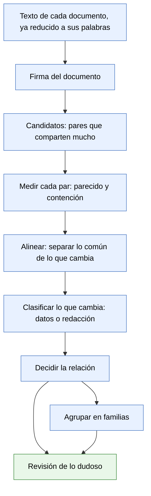

# Documentos parecidos — propuesta

**Estado:** propuesta para revisar · 13 de octubre de 2026 · nada de esto está construido
**Alcance:** cómo reconocer documentos que se parecen sin ser idénticos, y qué hacer con ellos. Es la etapa 2 del [documento de diseño](base-documental.md) (pendiente P-015). No describe código.

Cuando esta propuesta esté acordada, lo que quede firme pasa al documento de diseño.

## 1. El problema

Hoy la base reconoce que dos archivos son **el mismo documento** en dos casos: tienen los mismos bytes, o tienen exactamente las mismas palabras. Para comparar palabras ya deja de lado lo que depende del formato: mayúsculas, acentos, puntuación, saltos de línea y encabezados de página. Por eso un Word y su PDF se reconocen como uno.

Alcanza con una sola palabra de diferencia para que deje de reconocerlos. Y ahí caen situaciones muy distintas, que hoy la base no distingue:

- El mismo documento con un pie de página agregado al convertirlo a PDF.
- El mismo papel escaneado dos veces, leído con pequeñas diferencias.
- Un borrador y su versión corregida.
- Un borrador y la carta que finalmente se envió, escaneada con sellos y formulario.
- Dos contratos hechos con el mismo modelo, para dos clientes distintos.

Los primeros dos son el mismo documento. El último son dos documentos distintos, aunque compartan casi todo el texto. Confundirlos en cualquiera de los dos sentidos es grave en un estudio: o se muestran como distintos cien copias de lo mismo, o se trata como duplicado un contrato que no lo es.

**La regla que ordena todo:** importa menos cuánto texto comparten dos documentos que **qué es lo que cambia** entre ellos.

## 2. Lo que medimos en la carpeta de prueba

Para no proponer sobre supuestos, medimos los 30 documentos con texto de la carpeta de prueba (cartas documento, facturas, correos). Se compararon de a pares. Dos medidas:

- **Parecido:** de todo el texto de los dos documentos juntos, qué parte tienen en común.
- **Contención:** qué parte del documento más corto está dentro del más largo.

| Caso real | Contención | Parecido | Qué cambia |
|---|---|---|---|
| Borrador de una carta y su segunda versión | 96 % | 79 % | 41 palabras en 2 tramos; ninguna es una cifra |
| Segunda versión del borrador y la carta enviada, escaneada | 98 % | 58 % | El escaneo trae 188 palabras más: formulario y sellos |
| Otro borrador y su carta enviada, escaneada | 81 % | 46 % | Lo mismo, más errores de lectura del escaneo |
| Dos facturas del mismo proveedor (13 facturas, 78 pares) | 84 a 92 % | 73 a 85 % | 30 a 100 palabras en 11 a 21 tramos cortos; nueve de cada diez son cifras |
| Dos cartas documento distintas del mismo remitente | 30 a 65 % | 12 a 39 % | Cientos de palabras, en muchos tramos |

Tres cosas que esta medición deja a la vista:

1. **El porcentaje solo no separa los casos.** Las facturas (documentos distintos) y las versiones de un borrador (el mismo documento, corregido) comparten porcentajes parecidos. Lo que las separa es qué cambia: en las facturas, cifras repartidas en muchos tramos cortos; en el borrador, redacción en dos tramos.
2. **Hacen falta las dos medidas.** El borrador y la carta enviada tienen un parecido de solo 58 %, pero el borrador está casi entero (98 %) dentro de la carta. Sin la contención, esa relación se pierde.
3. **Hay que agrupar, no listar pares.** Trece facturas producen 78 pares. Nadie debería revisar 78 avisos: es una sola familia de trece.

## 3. Las relaciones que proponemos distinguir

| Relación | Qué significa | Ejemplo | Qué hace la app |
|---|---|---|---|
| **Mismo documento** | Mismos bytes o mismas palabras | Un Word y su PDF | Ya lo hace: los trata como uno |
| **Prácticamente el mismo** | Cambian muy pocas palabras, sueltas, y ninguna es un dato | PDF con pie agregado; dos lecturas del mismo escaneo | Propone tratarlos como uno |
| **Versión** | Mismo documento con cambios de redacción | Borrador y borrador corregido | Los relaciona; no dice cuál vale |
| **Contenido en** | Uno está casi entero dentro del otro | Borrador dentro de la carta enviada; un anexo dentro de un contrato | Los relaciona, con la dirección |
| **Misma plantilla, otros datos** | Mismo texto de base; cambian los datos | Dos contratos del mismo modelo; las facturas de un proveedor | Los agrupa como familia; siguen siendo documentos distintos |
| **Parecidos** | Comparten tramos, sin relación clara | Dos cartas del mismo remitente | No avisa; queda consultable |

Los nombres de estas relaciones son términos que ve el usuario: salen del vocabulario por vertical, como el resto.

## 4. El recorrido, paso a paso

Todo lo azul es cálculo: corre en la máquina, sin modelo y sin costo. Lo verde es una persona.

1. **Texto.** Se parte del texto que la base ya guarda de cada documento, reducido a sus palabras como hoy.
2. **Firma.** De cada documento se calcula una vez una firma compacta: un resumen numérico de sus secuencias de cinco palabras seguidas. Dos documentos que comparten mucho texto tienen firmas parecidas. Se guarda junto al documento.
3. **Candidatos.** Comparar todos los documentos contra todos no escala a un archivo de decenas de miles. Las firmas permiten encontrar directamente los pares que vale la pena mirar. Un documento nuevo se compara solo contra las firmas existentes.
4. **Medir.** Para cada par candidato se calculan el parecido y la contención exactos.
5. **Alinear.** Se ponen los dos textos lado a lado y se marca qué tramos coinciden y cuáles no, como hace un comparador de versiones.
6. **Clasificar lo que cambia.** Cada tramo distinto se mira por dentro:
   - **Datos:** cifras, importes, fechas, números de comprobante o de expediente, documentos de identidad, y nombres propios.
   - **Redacción:** texto corriente.
   - Una señal fuerte de plantilla: **la misma sustitución repetida**. Si donde un texto dice un nombre el otro dice siempre otro, es el mismo modelo con otra parte.
7. **Decidir la relación**, con las reglas de la sección 5.
8. **Familias.** Los documentos unidos por "misma plantilla" o por "versión" forman una familia. Se revisa la familia, no cada par.
9. **Revisión.** Lo que no queda claro se le pregunta a una persona, y su respuesta se guarda para no volver a preguntar.

## 5. Cómo se decide

Los números son puntos de partida: se ajustan midiendo sobre carpetas reales antes de mostrar nada.

| Si… | Entonces |
|---|---|
| Comparten casi todo (97 % o más) y lo que cambia son pocas palabras sueltas, ninguna un dato | Prácticamente el mismo |
| El corto está casi entero en el largo (90 % o más) y el largo tiene bastante más texto | Contenido en |
| Comparten mucho (80 % o más) y lo que cambia son sobre todo datos, en muchos tramos cortos o como sustitución repetida | Misma plantilla, otros datos |
| Comparten mucho (80 % o más) y lo que cambia es sobre todo redacción | Versión |
| Comparten entre 50 y 80 %, o las señales se contradicen | A revisión |
| Menos de 50 % | Parecidos: no se avisa |

Dos cuidados:

- **Un solo dato distinto alcanza para que no sean el mismo documento.** Dos contratos idénticos salvo el monto son dos contratos.
- **La app no decide cuál versión es la vigente ni cuál vino primero.** Junta indicios (fechas del archivo, nombre, carpeta) y, si son claros, lo sugiere.

## 6. Qué ve el usuario

- **En el detalle de un documento:** una sección "Documentos relacionados", con la relación y la posibilidad de ver las diferencias lado a lado, con los datos que cambian resaltados.
- **En Inicio, "requiere atención":** las familias y los casos dudosos que esperan una decisión. Una línea por familia.
- **En Documentos:** filtrar por familia y ver cuántos documentos tiene cada una.
- **Al revisar:** confirmar la relación propuesta, cambiarla por otra o decir "no tienen relación".

## 7. Qué se guarda

- La firma de cada documento, calculada una vez.
- Cada relación: los dos documentos, el tipo, las medidas, y si es propuesta, confirmada o rechazada.
- Las familias.

Lo calculado se puede rehacer entero a partir de los textos. Lo que decide una persona no se pisa: una relación rechazada no vuelve a proponerse.

Vale la regla del diseño para el espacio compartido: una relación se ve solo si se ven sus dos documentos.

## 8. Límites

- **Nunca fusiona por su cuenta.** Propone; "mismo documento" exacto es lo único automático, como hoy.
- **Los escaneos bajan los porcentajes.** El texto leído de una imagen trae errores, y un mismo papel leído dos veces da textos distintos. Por eso los umbrales para texto reconocido tienen que ser más tolerantes, y esos casos van más seguido a revisión.
- **Documentos muy cortos** (una carátula, un recibo de tres líneas) no tienen texto suficiente para comparar.
- **Reconocer nombres propios sin modelo es aproximado.** La sustitución repetida cubre el caso principal; lo que se escape va a revisión.
- **No usa inteligencia artificial.** El tipo de documento de cada familia sí la va a usar, una vez por familia, y es un paso posterior.

## 9. Decisiones que necesitamos del dueño del producto

1. **"Prácticamente el mismo":** ¿la app los trata como uno sola, o siempre pide confirmación? Recomendación: pedir confirmación al principio y automatizar cuando los umbrales estén probados con casos reales.
2. **El wiki:** hoy todos los documentos van al wiki, salvo las copias exactas. ¿Sigue así con las familias? Recomendación: sí por ahora; trece facturas son trece hechos distintos.
3. **Las relaciones de la sección 3:** ¿son las que un estudio necesita? ¿Falta alguna, por ejemplo "traducción de" o "respuesta a"?
4. **Material de prueba:** la carpeta actual no tiene contratos. Hace falta un conjunto de contratos hechos con un mismo modelo, que es el caso más común en un estudio, para ajustar las reglas. No puede salir de las carpetas con datos de clientes reales que no se copian.
5. **Los nombres** con que el usuario ve cada relación.

## 10. Cómo lo construiríamos

En pasos chicos, cada uno comprobable antes del siguiente:

1. **Medir sin mostrar nada.** La firma, los candidatos y las medidas, más una herramienta que corre en solo lectura sobre carpetas reales y entrega una tabla como la de la sección 2. Sirve para ajustar los umbrales.
2. **Alinear, clasificar y guardar relaciones.** Aparece "Documentos relacionados" en el detalle de un documento.
3. **Familias y revisión.** Aparecen en Inicio y en Documentos; se puede confirmar y rechazar.
4. **Después:** las relaciones en el grafo (P-016), y la plantilla de cada familia con sus datos variables, que es la base de la etapa 5 del diseño.

## 11. Para qué más sirve

- **Plantillas y documentos nuevos** (etapa 5): lo que se repite en una familia es la plantilla; lo que cambia son los campos.
- **Tipo de documento:** se le pregunta al modelo una vez por familia, no por documento.
- **Control de calidad del reconocimiento de texto:** dos lecturas del mismo papel que difieren en una cifra son un aviso.
- **Limpieza del archivo:** cuánto de lo guardado son copias y versiones.
