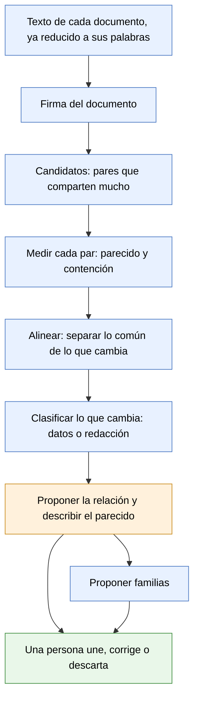

# Documentos parecidos — propuesta

**Estado:** propuesta en revisión · 14 de octubre de 2026 · quinta versión · nada de esto está construido
**Alcance:** cómo reconocer documentos que se parecen sin ser idénticos, y qué hacer con ellos. Es la etapa 2 del [documento de diseño](base-documental.md) (pendiente P-015). No describe código.

Cuando esta propuesta esté acordada, lo que quede firme pasa al documento de diseño.

**Qué cambió en esta versión:** las definiciones del dueño del producto (sección 3), una segunda medición sobre contratos (sección 2), el papel de la inteligencia artificial (sección 7), el análisis en pasadas sobre todo el archivo (sección 8) y cuatro cuidados que faltaban: los correos, las familias que crecen de más, el conjunto de prueba anotado y los identificadores oficiales.

## 1. El problema

Hoy la base reconoce que dos archivos son **el mismo documento** en dos casos: tienen los mismos bytes, o tienen exactamente las mismas palabras. Para comparar palabras ya deja de lado lo que depende del formato: mayúsculas, acentos, puntuación, saltos de línea y encabezados de página. Por eso un Word y su PDF se reconocen como uno.

Alcanza con una sola palabra de diferencia para que deje de reconocerlos. Y ahí caen situaciones muy distintas, que hoy la base no distingue:

- El mismo documento con un pie de página agregado al convertirlo a PDF.
- El mismo papel escaneado dos veces, leído con pequeñas diferencias.
- Un borrador y su versión corregida.
- Un contrato y su ejemplar firmado y escaneado.
- Dos contratos hechos con el mismo modelo, para dos personas distintas.

Los primeros son el mismo documento. El último son dos documentos distintos, aunque compartan casi todo el texto. Confundirlos en cualquiera de los dos sentidos es grave en un estudio: o se muestran como distintos cien copias de lo mismo, o se trata como duplicado un contrato que no lo es.

**La regla que ordena todo:** importa menos cuánto texto comparten dos documentos que **qué es lo que cambia** entre ellos.

**El criterio para ajustar todo lo demás:** en un estudio, unir dos cosas distintas (mezclar dos clientes) es mucho peor que dejar un duplicado sin detectar. Ante la duda, no se une.

## 2. Lo que medimos

Para no proponer sobre supuestos, se midieron dos conjuntos de la carpeta de prueba, en solo lectura. Dos medidas por cada par de documentos:

- **Parecido:** de todo el texto de los dos documentos juntos, qué parte tienen en común.
- **Contención:** qué parte del documento más corto está dentro del más largo.

### Cartas, facturas y correos (30 documentos con texto)

| Caso real | Contención | Parecido | Qué cambia |
|---|---|---|---|
| Borrador de una carta y su segunda versión | 96 % | 79 % | 41 palabras en 2 tramos; ninguna es una cifra |
| Segunda versión del borrador y la carta enviada, escaneada | 98 % | 58 % | El escaneo trae 188 palabras más: formulario y sellos |
| Otro borrador y su carta enviada, escaneada | 81 % | 46 % | Lo mismo, más errores de lectura del escaneo |
| Dos facturas del mismo proveedor (13 facturas, 78 pares) | 84 a 92 % | 73 a 85 % | 30 a 100 palabras en 11 a 21 tramos cortos; nueve de cada diez son cifras |
| Dos cartas documento distintas del mismo remitente | 30 a 65 % | 12 a 39 % | Cientos de palabras, en muchos tramos |

### Contratos, acuerdos, recibos y boletas (42 archivos)

| Caso real | Contención | Parecido | Qué cambia |
|---|---|---|---|
| El mismo acuerdo de desvinculación para tres personas | 80 a 88 % | 58 a 72 % | 110 a 260 palabras en 18 a 27 tramos; entre un cuarto y la mitad son cifras; el resto, nombres y condiciones. Hay sustituciones que se repiten |
| Un acuerdo y su ejemplar con firma digital | 100 % | 79 % | Nada del texto original: el firmado le suma un solo bloque, que es la constancia de la firma |
| Borrador de un contrato largo y su versión final | 95 % | 78 % | 1.200 palabras en 74 tramos; una de cada seis es una cifra |
| Dos boletas del mismo organismo | 91 % | 78 a 83 % | Casi solo cifras |
| Dos fichas de cliente de personas distintas | 100 % | 100 % | **Nada: el texto extraído es idéntico** |
| Ejemplares firmados que son solo imagen (5 de los 42 archivos) | — | — | No tienen texto que comparar hasta que se leen |

Además había cuatro grupos de copias exactas, que la base ya resuelve hoy.

Los porcentajes de esta tabla se calcularon con una herramienta de extracción de texto distinta de la que usa la app, que leyó menos archivos. La cantidad de imágenes y el caso de las fichas sí se comprobaron con el motor de la app. Los porcentajes definitivos salen de la herramienta del paso 1 de la sección 14.

### Lo que deja a la vista

1. **El porcentaje solo no separa los casos.** Facturas distintas y versiones de un mismo borrador comparten porcentajes parecidos. Los separa qué cambia.
2. **Hacen falta las dos medidas.** Un borrador puede parecerse solo 58 % a la carta enviada y estar 98 % adentro de ella.
3. **Hay que agrupar, no listar pares.** Trece facturas producen 78 pares. Se revisa una familia, no 78 avisos.
4. **Mirar solo las cifras no alcanza.** En los acuerdos para personas distintas, buena parte de lo que cambia son nombres. Hay que reconocer nombres e identificadores, y la sustitución repetida.
5. **Parte del material firmado es solo imagen.** Sin leerlo no se puede relacionar con su versión sin firmar. Para esos documentos el reconocimiento de texto no es opcional.
6. **Un defecto en lo que ya está construido, confirmado con el motor de la app.** Dos fichas de cliente de personas distintas figuran como copias una de la otra. Son el mismo formulario en blanco, completado para dos personas: las respuestas viven en los campos del formulario y no salen al extraer el texto, así que el texto de las dos es idéntico y la regla "mismo texto, mismo documento" las une. Una tercera ficha, que se guardó con las respuestas ya impresas en la página, sí se distingue. Se corrige antes que nada (P-074).

## 3. Definiciones del dueño del producto

Acordadas el 13 de octubre de 2026:

- **Los parecidos no se unen solos.** Hace falta una persona, al menos hasta tener más experiencia práctica.
- **Se muestran como hoy se muestran las copias.** En el detalle de un documento aparecen sus documentos parecidos, con una descripción de en qué consiste el parecido.
- **La persona los une y elige con qué relación,** con botones en esa misma lista.
- **El wiki:** en principio todos los documentos siguen yendo al wiki. Cuando una persona une dos documentos como el mismo, queda **uno solo como fuente del wiki**. Lo elige la persona al unirlos; la app, a lo sumo, sugiere cuál. Las páginas del wiki que salieron de ellos podrían unirse también.
- **Las relaciones tienen que poder ampliarse sin rehacer nada.** La lista va a cambiar a medida que se vean archivos de distintos estudios.
- **Los nombres de las relaciones son configurables.** No van escritos en el programa: pueden cambiar entre verticales y entre países.
- **Se reduce el uso de inteligencia artificial, no se elimina.** Se usa donde agrega valor y de la forma más eficiente (sección 7).

Acordadas el 14 de octubre de 2026:

- **Las relaciones no se limitan a lo que se puede medir.** También entran las que se infieren, por ejemplo "dice lo mismo con otras palabras" (sección 4).
- **"Ejemplar firmado" solo si la firma se puede verificar.** Una carta documento con la marca de agua "VISTA PREVIA - SIN VALOR LEGAL" no es un ejemplar firmado: es una vista previa que generó el sistema del correo antes de enviarla.
- **Distinguir en qué etapa está un documento:** un borrador hecho con un procesador de texto, una vista previa generada por el sistema que lo va a despachar, o un documento ya procesado (enviado, recibido, firmado).
- **Un catálogo de tipos de documento** que describa las particularidades de cada tipo y se vaya ampliando de a poco, para mejorar el reconocimiento (sección 5 bis).
- **Las firmas electrónicas siguen estándares:** se pueden reconocer con reglas.
- **Los nombres de archivo no son evidencia firme.** Plantean una hipótesis; manda el contenido.
- **El tipo de documento requiere el modelo, y conviene saberlo temprano:** si se conoce el tipo, la medición se puede ajustar por tipo. Las pasadas de cálculo y de modelo se alternan, cada una con un propósito definido (sección 8).
- **Compartir una persona no es compartir un asunto.** Quien prestó dinero a una empresa y además es su consultor aparece en dos asuntos sin relación.
- **No se hacen inferencias sobre inferencias.** Toda conclusión se ancla en las fuentes; la excepción se verifica contra ellas.
- **El proceso tiene que decir qué falta,** no solo qué hay.
- **Las reglas del procesamiento se documentan aparte,** para que las revise una persona en cualquier momento y las respeten los agentes: [reglas-de-procesamiento.md](reglas-de-procesamiento.md).

## 4. Las relaciones

Punto de partida. La lista es un dato de configuración, no algo escrito en el programa: agregar una relación no exige cambiar el resto.

### Las que se miden comparando textos

| Relación | Qué significa | Ejemplo |
|---|---|---|
| **Mismo documento** | Mismos bytes o mismas palabras. Ya existe y es la única automática | Un Word y su PDF |
| **Prácticamente el mismo** | Cambian muy pocas palabras, sueltas, y ninguna es un dato | PDF con pie agregado; dos lecturas del mismo escaneo |
| **Ejemplar firmado** | El mismo documento, firmado por una o más partes, y la firma se puede verificar | Un contrato y su ejemplar con firma electrónica |
| **Vista previa** | El documento tal como lo generó el sistema que lo va a despachar, antes de enviarlo; no tiene valor legal | El borrador de una carta documento y la vista previa del correo |
| **Versión** | Mismo documento con cambios de redacción | Borrador y versión final |
| **Contenido en** | Uno está casi entero dentro del otro | Un anexo dentro de un contrato; un correo dentro de la respuesta |
| **Misma plantilla, otros datos** | Mismo texto de base; cambian los datos o se agrega una cláusula | El mismo acuerdo para tres personas; las facturas de un proveedor |
| **Parecidos** | Comparten tramos, sin relación clara | Dos cartas del mismo remitente |

### Las que se infieren

No salen de comparar palabras: salen de cruzar datos o de leer el significado, a veces con el modelo.

| Relación | Qué significa | Cómo se obtiene |
|---|---|---|
| **Dice lo mismo con otras palabras** | El mismo contenido, redactado distinto | Comparando el significado (sección 7) |
| **Traducción de** | El mismo documento en otro idioma | Comparando el significado y el idioma |
| **Respuesta a** | Uno contesta al otro | Leyendo los dos |
| **Constancia de firma de** | El resumen que emite un servicio de firma electrónica sobre el proceso de firma de otro documento | Datos del documento firmado que la constancia nombra |
| **Acuse de recibo de** | La constancia de que un envío llegó a su destinatario | El número de envío y la fecha que comparte con el documento enviado |
| **Mismo asunto** | Parte del mismo caso o del mismo contrato | Datos raros compartidos: expediente, contrato, importes |
| **Misma persona, otro asunto** | Involucran a la misma persona en asuntos distintos | Una persona compartida sin nada más en común |

Los nombres de estas tablas son un punto de partida aceptado. Salen del vocabulario, que hoy se define por vertical y por idioma y tiene que admitir además variantes por país. Conviene validarlos con un estudio: por ejemplo, si un abogado dice "plantilla" o "modelo".

"Queda uno solo como fuente del wiki" vale para las relaciones en que los dos son el mismo documento: prácticamente el mismo, ejemplar firmado y versión. No vale para "misma plantilla" ni para "contenido en", donde son documentos distintos.

## 5. El recorrido, paso a paso

Azul: cálculo, en la máquina y sin costo. Naranja: cálculo, con ayuda opcional de un modelo. Verde: una persona.

1. **Texto.** Se parte del texto que la base ya guarda de cada documento. Dos preparaciones nuevas:
   - **Correos:** cada respuesta arrastra los mensajes anteriores. Antes de comparar se separa lo nuevo de lo citado; si no, cada correo aparece contenido en el siguiente y el mismo hecho se cuenta varias veces.
   - **Imágenes:** un documento sin texto no se puede comparar hasta que se lee.
2. **Firma.** De cada documento se calcula una vez una firma compacta: un resumen numérico de sus secuencias de cinco palabras seguidas. Dos documentos que comparten mucho texto tienen firmas parecidas.
3. **Candidatos.** Comparar todos contra todos no escala a decenas de miles de documentos. Las firmas se reparten en casilleros de modo que los documentos parecidos caen juntos, y solo se comparan los que comparten casillero. Un documento nuevo se compara solo contra lo que ya hay.
4. **Medir.** Para cada par candidato, el parecido y la contención exactos.
5. **Alinear.** Los dos textos lado a lado, marcando qué tramos coinciden y cuáles no.
6. **Clasificar lo que cambia.** Cada tramo distinto se mira por dentro:
   - **Identificadores oficiales:** CUIT, DNI, número de expediente, número de comprobante, citas de normas. Se reconocen por su forma, sin modelo y casi sin error. Si cambia uno, son documentos distintos con certeza, y la app puede decir cuál cambió.
   - **Otros datos:** importes, fechas, nombres propios.
   - **Redacción:** texto corriente.
   - **Sustitución repetida:** si donde un texto dice un nombre el otro dice siempre otro, es el mismo modelo con otra parte.
7. **Proponer la relación,** con las reglas de la sección 6, y **describir el parecido** en una frase: "Mismo texto de base; cambian el nombre de la parte, el CUIT y tres importes".
8. **Proponer familias.** Los documentos relacionados por plantilla o por versión forman una familia. El riesgo es el encadenamiento: A se parece a B, B a C, y terminan todos juntos por un solo vínculo equivocado. Dos defensas:
   - cada familia tiene un **documento principal** (el más completo, o el ejemplar firmado), y un documento entra si se parece al principal, no a cualquier miembro;
   - una familia que crece o se dispersa demasiado se marca para revisión.
9. **Una persona decide.** Une con la relación propuesta, elige otra o descarta. Su decisión se guarda y no se vuelve a preguntar.

## 5 bis. El catálogo de tipos de documento

### El problema

Muchas relaciones no se pueden decidir sin saber qué tipo de documento es cada uno. Tres ejemplos de la carpeta de prueba:

- Una carta documento puede ser un **borrador** escrito en un procesador de texto, una **vista previa** que generó el sistema del correo (con la marca "VISTA PREVIA - SIN VALOR LEGAL") o una carta **ya procesada** por el correo, firmada y recibida. Comparando el texto, las tres se parecen.
- Un PDF que salió de un servicio de firma electrónica trae una firma digital incrustada **aunque ninguna parte lo haya firmado**: el servicio sella cada versión que emite. Quién firmó se lee en la página de constancia que el servicio agrega, o en el certificado de cada firma.
- En una factura, lo que importa para encontrar una serie y sus huecos es la fecha de emisión y el período, no el nombre del archivo.

### La propuesta

Un **catálogo de tipos de documento** que forma parte de la base y se amplía de a poco. Para cada tipo describe:

| Qué describe | Ejemplo para "carta documento" |
|---|---|
| Qué es, en palabras del vertical | Comunicación fehaciente enviada por correo |
| Sus etapas y cómo se reconoce cada una | Borrador: archivo de procesador de texto. Vista previa: marca de agua "VISTA PREVIA - SIN VALOR LEGAL". Procesada: formulario del correo con sellos y firma |
| Sus marcas verificables sin modelo | La marca de agua; el formato del formulario del correo |
| Los datos que interesan | Remitente, destinatario, fecha, número de pieza, facturas reclamadas |
| Qué documentos suelen acompañarlo | La vista previa suele tener una carta procesada después |
| Cómo se mide por tipo | Dos cartas con distinto número de factura son documentos distintos |

**Cómo se usa:**

1. **Primero las marcas verificables,** con reglas: una marca de agua conocida, una firma digital, la página de constancia de un servicio de firma, los campos de un formulario.
2. **Después el modelo,** para lo que las reglas no resuelven: elige el tipo de una lista cerrada (las del catálogo) o propone uno nuevo marcado como tal. Se le pregunta una vez por documento, o una vez por familia cuando los miembros son prácticamente iguales.
3. **Una persona confirma** los tipos nuevos y sus descripciones, y así el catálogo crece.

**Firmas electrónicas.** Las firmas digitales incrustadas en un PDF siguen un estándar: se pueden contar, leer su certificado y saber qué servicio las emitió, sin modelo. La salvedad es la de arriba: una firma del servicio que sella el documento no es la firma de una parte. La regla se arma por servicio: qué certificados son del servicio y cuáles de las personas, y cómo es su página de constancia.

**El contenido del catálogo** está en [catalogo-de-tipos.md](catalogo-de-tipos.md): la primera versión, con la carta documento de dos correos, su acuse de recibo, los PDF de servicios de firma electrónica, las constancias de firma y los formularios PDF.

**Por qué gradual.** Cada estudio, cada vertical y cada país tiene sus tipos. El catálogo arranca con los tipos de la carpeta de prueba (carta documento, factura, acuerdo, recibo, boleta, ficha de cliente, constancia de firma) y crece con el uso.

## 6. Cómo se propone la relación

Los números son puntos de partida: se ajustan con el conjunto de prueba de la sección 11 antes de mostrar nada. **Cuando se conoce el tipo de documento, valen las reglas de su tipo en el catálogo** (sección 5 bis); esta tabla es la regla general.

| Si… | Se propone |
|---|---|
| Comparten casi todo (97 % o más) y lo que cambia son pocas palabras sueltas, ninguna un dato | Prácticamente el mismo |
| Uno contiene al otro entero y le suma un solo bloque (la constancia de una firma), y la firma de una parte se puede verificar | Ejemplar firmado |
| Uno contiene casi todo el texto del otro y tiene las marcas de una vista previa | Vista previa |
| El corto está casi entero en el largo (90 % o más) y el largo tiene bastante más texto | Contenido en |
| Comparten mucho (80 % o más) y lo que cambia son sobre todo datos, en tramos cortos o como sustitución repetida | Misma plantilla, otros datos |
| Comparten mucho (80 % o más) y lo que cambia es sobre todo redacción | Versión |
| Comparten entre 50 y 80 %, o las señales se contradicen | Se muestra como "parecido", sin relación sugerida |
| Menos de 50 % | No se muestra |

Tres cuidados:

- **Un solo dato distinto alcanza para que no sean el mismo documento.** Dos contratos idénticos salvo el monto son dos contratos.
- **La app no decide cuál versión es la vigente ni cuál vino primero.** Junta indicios (fechas del archivo, nombre, carpeta) y, si son claros, lo sugiere.
- **El texto leído de una imagen trae errores.** Para esos pares los umbrales son más tolerantes y la propuesta se muestra con menos certeza.

## 7. Dónde entra la inteligencia artificial

El cálculo encuentra y mide; el modelo lee, clasifica y explica. Nunca se le pregunta al modelo por todos los pares: solo por lo que ya se seleccionó, y una vez. Las pasadas de cálculo y de modelo **se alternan**, cada una con un propósito definido (sección 8).

| Uso | Qué aporta | Cuándo |
|---|---|---|
| Leer imágenes y escaneos | Sin esto, los documentos que son solo imagen quedan afuera | Ya existe; una vez por documento |
| **Tipo de documento y etapa** | Saber si es una carta documento, y si es borrador, vista previa o procesada. Con el tipo, la medición se ajusta | Temprano: después de los pares seguros, una vez por documento o por familia |
| Verificar una firma que es imagen | Una firma escaneada no tiene certificado | Solo en los candidatos a ejemplar firmado |
| Datos de cada tipo | Fecha de emisión, período, importe, partes | Cuando el formulario o las reglas del tipo no alcanzan |
| Describir qué cambió en palabras de abogado | "Cambia el plazo de 30 a 60 días y se agrega una cláusula de confidencialidad" | A pedido, al abrir un par |
| Opinar sobre los pares dudosos | Una sugerencia con su razón, antes de que decida la persona | Solo en la zona de 50 a 80 % |
| **Parecido por significado** | Relacionar documentos que dicen lo mismo con otras palabras: una traducción, una respuesta | Pasada propia (sección 8) |

Sobre el último punto: comparar secuencias de palabras encuentra el mismo texto; no encuentra el mismo tema dicho distinto. Para eso cada documento se convierte en una representación numérica de su significado, y se buscan los cercanos. La app ya tiene esa capacidad para las páginas del wiki; la base todavía no la usa.

## 8. Pasadas sobre todo el archivo

### 8.1 Por qué

Hoy cada documento se procesa por separado y una sola vez. Parte de lo más valioso solo se ve mirando el archivo entero:

- **Cruces por datos compartidos.** Un acuerdo, sus recibos de pago y su ejemplar firmado no se parecen en el texto, pero nombran a la misma persona y los mismos importes. Eso los une como partes de un mismo asunto, que es lo que un abogado busca.
- **Series y faltantes.** Seis recibos de cuotas o trece facturas mensuales forman una serie. Recién viendo la serie se nota que falta una.
- **Lo común no es señal.** El nombre y el CUIT del propio estudio aparecen en casi todo y no relacionan nada. Eso solo se sabe después de ver el archivo entero.
- **La plantilla, una vez conocida, permite releer.** Con tres o más miembros se sabe qué es fijo y qué es un campo, y cada miembro se puede releer para sacar sus datos ordenados.
- **Consolidar nombres.** El modelo propone tipos de documento de a una familia por vez, y el wiki crea páginas de a un documento por vez. Que "Acuerdo de desvinculación" y "Acuerdo de terminación" son lo mismo solo se ve mirando el conjunto.

### 8.2 El riesgo

Repetir pasadas no alcanza para que el resultado mejore. Lo que una pasada decide cambia lo que ve la siguiente, y sin un diseño cuidado pasan tres cosas conocidas:

- **No termina:** cada vuelta corrige algo marginal y dispara otra.
- **Oscila:** una vuelta propone algo y la siguiente lo deshace.
- **Errores en cascada:** una propuesta equivocada se usa como base de otra, y esa de otra. Es el mismo fenómeno que el encadenamiento de familias de la sección 5.

### 8.3 Las reglas

Las reglas que hacen que las pasadas converjan y aporten valor están en un documento propio, [reglas-de-procesamiento.md](reglas-de-procesamiento.md), para que se puedan revisar en cualquier momento y valgan para todo análisis de la base, no solo para los parecidos. Las que más pesan acá:

- **No se infiere sobre lo inferido** (R-02) y **lo propuesto no alimenta lo propuesto** (R-03): son la defensa principal contra los errores en cascada.
- **Una pasada, un objetivo** (R-10), **de lo seguro a lo incierto** (R-11) y **solo se agrega evidencia** (R-12): garantizan que el proceso termine.
- **Familias contra un documento principal** (R-14): evita el encadenamiento.
- **Se trabaja solo sobre lo que cambió** (R-15) y **cada pasada se mide por separado** (R-17).

### 8.4 Las pasadas

La idea que ordena todo: **primero se agrupa con cálculo, y el modelo se usa sobre los grupos, no sobre cada documento ni sobre cada par.** Trece facturas del mismo proveedor son una sola pregunta al modelo, no trece; y nunca se le pregunta por los miles de pares posibles.

| Pasada | Hace | Objetivo | Usa | Produce | Uso del modelo |
|---|---|---|---|---|---|
| **0 · Lo común** | Cálculo | Saber qué es común en el archivo | Todo el texto y los datos reconocidos | El peso de cada secuencia de palabras y de cada dato según lo raro que es; el texto de rutina (membrete, pie de firma) | Ninguno |
| **1 · Pares seguros** | Cálculo | Proponer mismo documento, prácticamente el mismo, versión y contenido en | Candidatos por firma; medidas sin el texto de rutina; comparación lado a lado | Propuestas con su evidencia | Ninguno |
| **2 · Marcas** | Cálculo | Reconocer lo que se verifica sin modelo | Firmas digitales, páginas de constancia, marcas de agua, campos de formulario, números de envío | Marcas por documento | Ninguno |
| **3 · Grupos provisionales** | Cálculo | Juntar lo que tiene el mismo texto de base | Pares con mucha redacción en común y datos distintos; sustituciones repetidas | Grupos con un documento principal cada uno | Ninguno |
| **4 · Tipo y etapa** | Modelo | Saber qué tipo de documento es y en qué etapa está | Las marcas, el texto del principal y el catálogo de tipos | Tipo y etapa, de la lista cerrada, para todo el grupo | **Una pregunta por grupo** (al principal) y una por documento que quedó solo; ninguna si las marcas ya alcanzan |
| **5 · Datos por tipo** | Cálculo, y modelo si no alcanza | Sacar los datos que interesan según el tipo | Las reglas del tipo; los campos de formulario | Fechas, importes, partes, números | Solo para los documentos donde las reglas del tipo no encontraron lo que buscaban |
| **6 · Relaciones por tipo** | Cálculo | Confirmar o corregir las propuestas con las reglas del tipo | Tipo, etapa, marcas y datos | Misma plantilla, ejemplar firmado, vista previa, acuse de recibo; familias | Ninguno |
| **7 · Lo dudoso** | Modelo | Opinar sobre los pares que las reglas no resolvieron | El par, con lo que cambia resaltado | Una sugerencia con su razón, para la persona | Solo pares de la zona media, con un límite por vuelta |
| **8 · Correos** | Cálculo | Reconstruir cadenas de correo | Lo citado en cada respuesta | Cadenas, con el correo más completo como principal | Ninguno |
| **9 · Significado** | Modelo | Proponer "dice lo mismo con otras palabras", "traducción de", "respuesta a" | La representación del significado de cada documento, calculada una vez | Propuestas | Una vez por documento, para la representación; las comparaciones son cálculo |
| **10 · Mismo asunto, series y faltantes** | Cálculo | Cruzar el archivo entero | Datos raros compartidos y familias, solo de lo confirmado | Mismo asunto o misma persona con otro asunto; series; avisos de faltante | Ninguno |
| **11 · Consistencia** | Cálculo y modelo | Unificar nombres y detectar contradicciones | Tipos, páginas del wiki, familias | Nombres a unificar; avisos | Una pregunta por lista de nombres parecidos, no por documento |

La pasada 10 solo se apoya en lo que confirmó una persona (R-03). Todo el recorrido se repite únicamente mientras haya algo tocado: una decisión humana nueva o un documento nuevo.

**Qué hace la pasada de correos.** Cuando alguien responde un correo, el mensaje nuevo suele llevar debajo, citado, todo lo anterior. Un correo impreso a PDF (como los tres "Correo - …" de la carpeta de prueba) trae entonces toda la conversación hasta ese momento. Esta pasada separa en cada correo lo nuevo de lo citado, reconstruye qué mensaje contesta a cuál, y se queda con el más completo como principal. Sin ella, el mismo hecho se contaría una vez por cada respuesta que lo cita, y cada correo aparecería "contenido en" el siguiente.

### 8.5 La persona dentro del recorrido

- **Qué se le muestra primero:** lo que más trabajo destraba. Por ejemplo, confirmar el principal de una familia grande resuelve de una vez a todos sus miembros.
- **Qué no se le pregunta:** lo que ya respondió, salvo que la evidencia haya cambiado.
- **Cuándo se deja de proponer:** si la persona rechaza seguido lo que se le muestra, la pasada que lo produjo se frena y se revisa.

### 8.6 Qué cambia en la construcción

Las pasadas 0 a 7 son esta etapa, con un catálogo inicial chico. Las demás se construyen después, pero condicionan desde ahora qué se guarda: las marcas y los datos de cada documento, su tipo, la evidencia de cada propuesta, y cada decisión humana con la evidencia que se le mostró.

## 9. Qué ve el usuario

- **En el detalle de un documento,** debajo de sus copias: "Documentos parecidos". Por cada uno, la relación propuesta, la descripción del parecido y los botones para unir con esa relación, elegir otra o descartar. Se pueden ver las diferencias lado a lado, con los datos que cambian resaltados.
- **En Inicio, "requiere atención":** las familias propuestas que esperan una decisión. Una línea por familia.
- **En Documentos:** filtrar por familia y por relación.

## 10. Qué se guarda

- La firma de cada documento y los identificadores y datos reconocidos en él.
- Cada relación: los dos documentos, el tipo, las medidas, cómo se llegó a ella y su estado: propuesta, unida por una persona o descartada.
- Las familias.

Lo calculado se puede rehacer entero a partir de los textos. Lo que decide una persona no se pisa ni se pierde: se puede deshacer, y una relación descartada no vuelve a proponerse.

Vale la regla del diseño para el espacio compartido: una relación se ve solo si se ven sus dos documentos.

## 11. Cómo sabemos que funciona

Antes de mostrar nada, un **conjunto de prueba anotado**: entre 50 y 100 documentos con la respuesta correcta escrita a mano (qué pares son el mismo documento, cuáles versiones, cuáles la misma plantilla). Sobre ese conjunto se mide cuántas relaciones propone bien y cuántas se le escapan, y se ajustan los umbrales con el criterio de la sección 1: preferir que se escape una antes que proponer una falsa.

La primera hoja de respuestas ya está armada sobre la carpeta de prueba (cartas, facturas, contratos, acuerdos, recibos, boletas y formularios) y la está revisando el dueño del producto. Queda fuera del repositorio porque nombra archivos y personas reales.

## 12. Límites

- **Nunca une por su cuenta.**
- **Documentos muy cortos** (una carátula, un recibo de tres líneas) no tienen texto suficiente para comparar.
- **Reconocer nombres propios sin modelo es aproximado.** La sustitución repetida cubre el caso principal.
- **Unir las páginas del wiki** cuando se unen dos documentos está previsto pero no diseñado: hay que definir qué pasa con lo que cada página decía distinto.

## 13. Decisiones abiertas

1. **Qué pasa con lo ya incorporado al wiki** cuando se unen dos documentos que ya tenían páginas.

## 14. Cómo lo construiríamos

En pasos chicos, cada uno comprobable antes del siguiente:

0. **Corregir el caso de los formularios** (P-074): hecho. Lo completado en los campos forma parte del texto, y los campos se guardan aparte.
1. **Medir sin mostrar nada.** La firma, los candidatos, las medidas, los identificadores y las marcas verificables (firmas digitales, constancias, marcas de agua), más una herramienta que corre en solo lectura sobre carpetas reales y se compara contra la hoja de respuestas.
2. **El catálogo inicial y el tipo de documento.** Los tipos de la carpeta de prueba, y la pasada del modelo que propone tipo y etapa.
3. **Alinear, clasificar y proponer.** Aparece "Documentos parecidos" en el detalle, con la descripción y los botones para unir.
4. **Familias.** Aparecen en Inicio y en Documentos.
5. **Después:** correos, significado, mismo asunto, series y faltantes, consistencia; las relaciones en el grafo (P-016), y la plantilla de cada familia con sus campos, que es la base de la etapa 5 del diseño.
