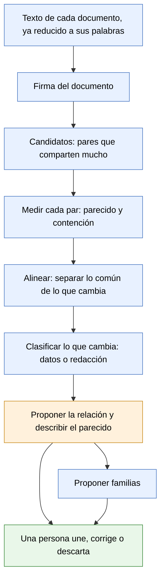

# Documentos parecidos — propuesta

**Estado:** propuesta en revisión · 14 de octubre de 2026 · cuarta versión · nada de esto está construido
**Alcance:** cómo reconocer documentos que se parecen sin ser idénticos, y qué hacer con ellos. Es la etapa 2 del [documento de diseño](base-documental.md) (pendiente P-015). No describe código.

Cuando esta propuesta esté acordada, lo que quede firme pasa al documento de diseño.

**Qué cambió en esta versión:** las definiciones del dueño del producto (sección 3), una segunda medición sobre contratos (sección 2), el papel de la inteligencia artificial (sección 7), el análisis en pasadas sobre todo el archivo (sección 8) y cuatro cuidados que faltaban: los correos, las familias que crecen de más, el conjunto de prueba anotado y los identificadores oficiales.

## 1. El problema

Hoy la base reconoce que dos archivos son **el mismo documento** en dos casos: tienen los mismos bytes, o tienen exactamente las mismas palabras. Para comparar palabras ya deja de lado lo que depende del formato: mayúsculas, acentos, puntuación, saltos de línea y encabezados de página. Por eso un Word y su PDF se reconocen como uno.

Alcanza con una sola palabra de diferencia para que deje de reconocerlos. Y ahí caen situaciones muy distintas, que hoy la base no distingue:

- El mismo documento con un pie de página agregado al convertirlo a PDF.
- El mismo papel escaneado dos veces, leído con pequeñas diferencias.
- Un borrador y su versión corregida.
- Un contrato y su ejemplar firmado y escaneado.
- Dos contratos hechos con el mismo modelo, para dos personas distintas.

Los primeros son el mismo documento. El último son dos documentos distintos, aunque compartan casi todo el texto. Confundirlos en cualquiera de los dos sentidos es grave en un estudio: o se muestran como distintos cien copias de lo mismo, o se trata como duplicado un contrato que no lo es.

**La regla que ordena todo:** importa menos cuánto texto comparten dos documentos que **qué es lo que cambia** entre ellos.

**El criterio para ajustar todo lo demás:** en un estudio, unir dos cosas distintas (mezclar dos clientes) es mucho peor que dejar un duplicado sin detectar. Ante la duda, no se une.

## 2. Lo que medimos

Para no proponer sobre supuestos, se midieron dos conjuntos de la carpeta de prueba, en solo lectura. Dos medidas por cada par de documentos:

- **Parecido:** de todo el texto de los dos documentos juntos, qué parte tienen en común.
- **Contención:** qué parte del documento más corto está dentro del más largo.

### Cartas, facturas y correos (30 documentos con texto)

| Caso real | Contención | Parecido | Qué cambia |
|---|---|---|---|
| Borrador de una carta y su segunda versión | 96 % | 79 % | 41 palabras en 2 tramos; ninguna es una cifra |
| Segunda versión del borrador y la carta enviada, escaneada | 98 % | 58 % | El escaneo trae 188 palabras más: formulario y sellos |
| Otro borrador y su carta enviada, escaneada | 81 % | 46 % | Lo mismo, más errores de lectura del escaneo |
| Dos facturas del mismo proveedor (13 facturas, 78 pares) | 84 a 92 % | 73 a 85 % | 30 a 100 palabras en 11 a 21 tramos cortos; nueve de cada diez son cifras |
| Dos cartas documento distintas del mismo remitente | 30 a 65 % | 12 a 39 % | Cientos de palabras, en muchos tramos |

### Contratos, acuerdos, recibos y boletas (42 archivos)

| Caso real | Contención | Parecido | Qué cambia |
|---|---|---|---|
| El mismo acuerdo de desvinculación para tres personas | 80 a 88 % | 58 a 72 % | 110 a 260 palabras en 18 a 27 tramos; entre un cuarto y la mitad son cifras; el resto, nombres y condiciones. Hay sustituciones que se repiten |
| Un acuerdo y su ejemplar con firma digital | 100 % | 79 % | Nada del texto original: el firmado le suma un solo bloque, que es la constancia de la firma |
| Borrador de un contrato largo y su versión final | 95 % | 78 % | 1.200 palabras en 74 tramos; una de cada seis es una cifra |
| Dos boletas del mismo organismo | 91 % | 78 a 83 % | Casi solo cifras |
| Dos fichas de cliente de personas distintas | 100 % | 100 % | **Nada: el texto extraído es idéntico** |
| Ejemplares firmados que son solo imagen (5 de los 42 archivos) | — | — | No tienen texto que comparar hasta que se leen |

Además había cuatro grupos de copias exactas, que la base ya resuelve hoy.

Los porcentajes de esta tabla se calcularon con una herramienta de extracción de texto distinta de la que usa la app, que leyó menos archivos. La cantidad de imágenes y el caso de las fichas sí se comprobaron con el motor de la app. Los porcentajes definitivos salen de la herramienta del paso 1 de la sección 14.

### Lo que deja a la vista

1. **El porcentaje solo no separa los casos.** Facturas distintas y versiones de un mismo borrador comparten porcentajes parecidos. Los separa qué cambia.
2. **Hacen falta las dos medidas.** Un borrador puede parecerse solo 58 % a la carta enviada y estar 98 % adentro de ella.
3. **Hay que agrupar, no listar pares.** Trece facturas producen 78 pares. Se revisa una familia, no 78 avisos.
4. **Mirar solo las cifras no alcanza.** En los acuerdos para personas distintas, buena parte de lo que cambia son nombres. Hay que reconocer nombres e identificadores, y la sustitución repetida.
5. **Parte del material firmado es solo imagen.** Sin leerlo no se puede relacionar con su versión sin firmar. Para esos documentos el reconocimiento de texto no es opcional.
6. **Un defecto en lo que ya está construido, confirmado con el motor de la app.** Dos fichas de cliente de personas distintas figuran como copias una de la otra. Son el mismo formulario en blanco, completado para dos personas: las respuestas viven en los campos del formulario y no salen al extraer el texto, así que el texto de las dos es idéntico y la regla "mismo texto, mismo documento" las une. Una tercera ficha, que se guardó con las respuestas ya impresas en la página, sí se distingue. Se corrige antes que nada (P-074).

## 3. Definiciones del dueño del producto

Acordadas el 13 de octubre de 2026:

- **Los parecidos no se unen solos.** Hace falta una persona, al menos hasta tener más experiencia práctica.
- **Se muestran como hoy se muestran las copias.** En el detalle de un documento aparecen sus documentos parecidos, con una descripción de en qué consiste el parecido.
- **La persona los une y elige con qué relación,** con botones en esa misma lista.
- **El wiki:** en principio todos los documentos siguen yendo al wiki. Cuando una persona une dos documentos como el mismo, queda **uno solo como fuente del wiki**. Lo elige la persona al unirlos; la app, a lo sumo, sugiere cuál. Las páginas del wiki que salieron de ellos podrían unirse también.
- **Las relaciones tienen que poder ampliarse sin rehacer nada.** La lista va a cambiar a medida que se vean archivos de distintos estudios.
- **Los nombres de las relaciones son configurables.** No van escritos en el programa: pueden cambiar entre verticales y entre países.
- **Se reduce el uso de inteligencia artificial, no se elimina.** Se usa donde agrega valor y de la forma más eficiente (sección 7).

## 4. Las relaciones

Punto de partida. La lista es un dato de configuración, no algo escrito en el programa: agregar una relación no exige cambiar el resto.

| Relación | Qué significa | Ejemplo |
|---|---|---|
| **Mismo documento** | Mismos bytes o mismas palabras. Ya existe y es la única automática | Un Word y su PDF |
| **Prácticamente el mismo** | Cambian muy pocas palabras, sueltas, y ninguna es un dato | PDF con pie agregado; dos lecturas del mismo escaneo |
| **Ejemplar firmado** | El mismo documento, con firmas y sellos | Un contrato y su escaneo firmado |
| **Versión** | Mismo documento con cambios de redacción | Borrador y versión final |
| **Contenido en** | Uno está casi entero dentro del otro | Un anexo dentro de un contrato; un correo dentro de la respuesta |
| **Misma plantilla, otros datos** | Mismo texto de base; cambian los datos | El mismo acuerdo para tres personas; las facturas de un proveedor |
| **Parecidos** | Comparten tramos, sin relación clara | Dos cartas del mismo remitente |

Candidatas para más adelante, porque no se detectan comparando palabras: "traducción de", "respuesta a", "trata del mismo asunto" (sección 7).

Los nombres de esta tabla son un punto de partida aceptado. Salen del vocabulario, que hoy se define por vertical y por idioma y tiene que admitir además variantes por país. Conviene validarlos con un estudio: por ejemplo, si un abogado dice "plantilla" o "modelo".

"Queda uno solo como fuente del wiki" vale para las relaciones en que los dos son el mismo documento: prácticamente el mismo, ejemplar firmado y versión. No vale para "misma plantilla" ni para "contenido en", donde son documentos distintos.

## 5. El recorrido, paso a paso

Azul: cálculo, en la máquina y sin costo. Naranja: cálculo, con ayuda opcional de un modelo. Verde: una persona.

1. **Texto.** Se parte del texto que la base ya guarda de cada documento. Dos preparaciones nuevas:
   - **Correos:** cada respuesta arrastra los mensajes anteriores. Antes de comparar se separa lo nuevo de lo citado; si no, cada correo aparece contenido en el siguiente y el mismo hecho se cuenta varias veces.
   - **Imágenes:** un documento sin texto no se puede comparar hasta que se lee.
2. **Firma.** De cada documento se calcula una vez una firma compacta: un resumen numérico de sus secuencias de cinco palabras seguidas. Dos documentos que comparten mucho texto tienen firmas parecidas.
3. **Candidatos.** Comparar todos contra todos no escala a decenas de miles de documentos. Las firmas se reparten en casilleros de modo que los documentos parecidos caen juntos, y solo se comparan los que comparten casillero. Un documento nuevo se compara solo contra lo que ya hay.
4. **Medir.** Para cada par candidato, el parecido y la contención exactos.
5. **Alinear.** Los dos textos lado a lado, marcando qué tramos coinciden y cuáles no.
6. **Clasificar lo que cambia.** Cada tramo distinto se mira por dentro:
   - **Identificadores oficiales:** CUIT, DNI, número de expediente, número de comprobante, citas de normas. Se reconocen por su forma, sin modelo y casi sin error. Si cambia uno, son documentos distintos con certeza, y la app puede decir cuál cambió.
   - **Otros datos:** importes, fechas, nombres propios.
   - **Redacción:** texto corriente.
   - **Sustitución repetida:** si donde un texto dice un nombre el otro dice siempre otro, es el mismo modelo con otra parte.
7. **Proponer la relación,** con las reglas de la sección 6, y **describir el parecido** en una frase: "Mismo texto de base; cambian el nombre de la parte, el CUIT y tres importes".
8. **Proponer familias.** Los documentos relacionados por plantilla o por versión forman una familia. El riesgo es el encadenamiento: A se parece a B, B a C, y terminan todos juntos por un solo vínculo equivocado. Dos defensas:
   - cada familia tiene un **documento principal** (el más completo, o el ejemplar firmado), y un documento entra si se parece al principal, no a cualquier miembro;
   - una familia que crece o se dispersa demasiado se marca para revisión.
9. **Una persona decide.** Une con la relación propuesta, elige otra o descarta. Su decisión se guarda y no se vuelve a preguntar.

## 6. Cómo se propone la relación

Los números son puntos de partida: se ajustan con el conjunto de prueba de la sección 11 antes de mostrar nada.

| Si… | Se propone |
|---|---|
| Comparten casi todo (97 % o más) y lo que cambia son pocas palabras sueltas, ninguna un dato | Prácticamente el mismo |
| Uno contiene al otro entero y le suma un solo bloque (la constancia de una firma digital), o es una imagen leída que contiene casi todo el texto del otro | Ejemplar firmado |
| El corto está casi entero en el largo (90 % o más) y el largo tiene bastante más texto | Contenido en |
| Comparten mucho (80 % o más) y lo que cambia son sobre todo datos, en tramos cortos o como sustitución repetida | Misma plantilla, otros datos |
| Comparten mucho (80 % o más) y lo que cambia es sobre todo redacción | Versión |
| Comparten entre 50 y 80 %, o las señales se contradicen | Se muestra como "parecido", sin relación sugerida |
| Menos de 50 % | No se muestra |

Tres cuidados:

- **Un solo dato distinto alcanza para que no sean el mismo documento.** Dos contratos idénticos salvo el monto son dos contratos.
- **La app no decide cuál versión es la vigente ni cuál vino primero.** Junta indicios (fechas del archivo, nombre, carpeta) y, si son claros, lo sugiere.
- **El texto leído de una imagen trae errores.** Para esos pares los umbrales son más tolerantes y la propuesta se muestra con menos certeza.

## 7. Dónde entra la inteligencia artificial

El cálculo encuentra y mide; el modelo lee, explica y ayuda donde el cálculo no alcanza. Nunca se le pregunta al modelo por todos los pares: solo por los que el cálculo ya seleccionó, y una vez.

| Uso | Qué aporta | Cuándo |
|---|---|---|
| Leer imágenes y escaneos | Sin esto, los documentos que son solo imagen quedan afuera | Ya existe; una vez por documento |
| Describir qué cambió en palabras de abogado | "Cambia el plazo de 30 a 60 días y se agrega una cláusula de confidencialidad" | A pedido, al abrir un par |
| Opinar sobre los pares dudosos | Una sugerencia con su razón, antes de que decida la persona | Solo en la zona de 50 a 80 % |
| Nombrar los datos que cambian | Saber que un nombre es "la parte" y un importe "el monto" | Una vez por familia |
| Tipo de documento | "Acuerdo de desvinculación", "boleta de aportes" | Una vez por familia |
| **Parecido por significado** | Relacionar documentos que tratan de lo mismo con otras palabras: una traducción, una respuesta, dos contratos sobre el mismo asunto | Capa posterior |

Sobre el último punto: comparar secuencias de palabras encuentra el mismo texto; no encuentra el mismo tema dicho distinto. Para eso cada documento se convierte en una representación numérica de su significado, y se buscan los cercanos. La app ya tiene esa capacidad para las páginas del wiki; la base todavía no la usa. Es complementaria y va después: primero lo que se puede afirmar con certeza.

## 8. Pasadas sobre todo el archivo

### 8.1 Por qué

Hoy cada documento se procesa por separado y una sola vez. Parte de lo más valioso solo se ve mirando el archivo entero:

- **Cruces por datos compartidos.** Un acuerdo, sus recibos de pago y su ejemplar firmado no se parecen en el texto, pero nombran a la misma persona y los mismos importes. Eso los une como partes de un mismo asunto, que es lo que un abogado busca.
- **Series y faltantes.** Seis recibos de cuotas o trece facturas mensuales forman una serie. Recién viendo la serie se nota que falta una.
- **Lo común no es señal.** El nombre y el CUIT del propio estudio aparecen en casi todo y no relacionan nada. Eso solo se sabe después de ver el archivo entero.
- **La plantilla, una vez conocida, permite releer.** Con tres o más miembros se sabe qué es fijo y qué es un campo, y cada miembro se puede releer para sacar sus datos ordenados.
- **Consolidar nombres.** El modelo propone tipos de documento de a una familia por vez, y el wiki crea páginas de a un documento por vez. Que "Acuerdo de desvinculación" y "Acuerdo de terminación" son lo mismo solo se ve mirando el conjunto.

### 8.2 El riesgo

Repetir pasadas no alcanza para que el resultado mejore. Lo que una pasada decide cambia lo que ve la siguiente, y sin un diseño cuidado pasan tres cosas conocidas:

- **No termina:** cada vuelta corrige algo marginal y dispara otra.
- **Oscila:** una vuelta propone algo y la siguiente lo deshace.
- **Errores en cascada:** una propuesta equivocada se usa como base de otra, y esa de otra. Es el mismo fenómeno que el encadenamiento de familias de la sección 5.

### 8.3 Las reglas

Son prácticas establecidas en el campo que estudia cómo reconocer registros que se refieren a lo mismo, en la revisión asistida de documentos que hacen los estudios en litigios, y en el refinamiento de grafos de conocimiento. Adaptadas a nuestro caso:

1. **Cada pasada tiene un único objetivo,** con sus entradas, lo que produce, lo que puede cambiar y su criterio de corte (8.4). Una pasada que lo quiere hacer todo no se puede medir ni frenar.
2. **De lo seguro a lo incierto.** Primero lo exacto, después lo que comparte mucho texto, después lo que se infiere por datos compartidos. Así lo que se apoya en resultados anteriores se apoya en lo más confiable.
3. **Solo se agrega evidencia.** Una pasada escribe propuestas y les cambia la certeza; nunca une ni borra. Como la evidencia posible es finita y solo crece, el proceso termina.
4. **Lo propuesto no alimenta lo propuesto.** Una pasada puede apoyarse en una relación confirmada por una persona, no en otra propuesta. Esta es la defensa principal contra los errores en cascada.
5. **Las decisiones humanas son reglas firmes.** Un "sí" se puede usar como base. Un "no tienen relación" bloquea esa relación para siempre, en todas las pasadas, salvo que aparezca evidencia nueva y distinta. Se guarda junto con la evidencia que se le mostró a la persona, para saber cuándo la evidencia cambió.
6. **El resultado no depende del orden.** Procesar los documentos en otro orden, o volver a correr una pasada sin cambios, da lo mismo. Esto hace que repetir sea seguro y que un documento nuevo no desordene lo anterior.
7. **Las familias se arman contra un documento principal,** no por cadena. Cada familia tiene un principal: el más completo, o el ejemplar firmado. Un documento entra si se parece al principal, no si se parece a algún miembro. Es como lo hacen las herramientas de revisión de documentos en litigios, y evita el encadenamiento por construcción. Una familia que crece demasiado o se dispersa demasiado se marca para revisión.
8. **Se trabaja solo sobre lo que cambió.** Después de la primera vez, cada pasada mira solo los documentos tocados por algo nuevo (un documento agregado, una decisión humana) y sus vecinos. Se corta cuando no queda nada tocado.
9. **Cada pasada tiene un límite propio:** cuántos pares evalúa, cuántas preguntas le hace al modelo, cuántas propuestas le pone en la cola a la persona.
10. **Se mide cada pasada por separado** contra el conjunto de prueba (sección 11): cuántas propuestas acierta, cuántas relaciones se le escapan y cuántas propuestas acepta la persona. Si una pasada empeora la precisión, se ajusta antes de volver a correrla.
11. **El modelo aporta evidencia, no decide.** Su opinión pesa como una evidencia más, acotada. Se guarda con lo que se le preguntó, la versión de la pregunta y la del modelo: la misma pregunta no se hace dos veces, y repetir la pasada da lo mismo.
12. **Los nombres consolidados quedan fijos.** Cuando una persona confirma que dos nombres son el mismo tipo de documento, el nombre elegido pasa a una lista cerrada. Las preguntas siguientes al modelo eligen de esa lista o proponen uno nuevo marcado como tal.

### 8.4 Las pasadas

| Pasada | Objetivo | Usa | Produce | Puede cambiar | Se corta cuando |
|---|---|---|---|---|---|
| **0 · Lo común** | Saber qué es común en el archivo | Todo el texto y los datos reconocidos | El peso de cada secuencia de palabras y de cada dato según lo raro que es; la lista de texto de rutina (membrete, pie de firma) | Solo pesos | Una corrida; se recalcula al llegar documentos nuevos |
| **1 · Pares seguros** | Proponer mismo documento, prácticamente el mismo, ejemplar firmado, versión y contenido en | Candidatos por firma, medidas sin el texto de rutina, la comparación lado a lado | Propuestas con su evidencia y su descripción | Propuestas y su certeza | No quedan pares tocados |
| **2 · Plantillas** | Proponer "misma plantilla, otros datos" y fijar la plantilla de cada familia | Mucha redacción en común con datos distintos; sustituciones repetidas; formularios PDF, que traen plantilla y datos separados | Familias propuestas con su principal; los campos de cada miembro | Propuestas de familia | No aparecen plantillas nuevas |
| **3 · Correos** | Reconstruir cadenas de correo | Lo citado en cada respuesta | Cadenas, con el correo más completo como principal | Propuestas de cadena | No quedan correos tocados |
| **4 · Mismo asunto** | Proponer qué documentos son del mismo caso aunque no compartan texto | Datos raros compartidos: número de expediente, CUIT, DNI, una persona, un importe | Propuestas de "mismo asunto", nunca de "mismo documento" | Propuestas | Límite de propuestas o casi sin cambios |
| **5 · Series** | Encontrar series y faltantes | Familias confirmadas, con sus fechas o números | Series y avisos de faltante | Propuestas de serie | No quedan familias tocadas |
| **6 · Consistencia** | Unificar nombres y detectar contradicciones | Tipos de documento, páginas del wiki, familias | Nombres a unificar; avisos (una familia con dos números de expediente, un "no tienen relación" dentro de una familia) | Propuestas y avisos; nunca renombra lo confirmado | No quedan avisos nuevos |

Las pasadas 4 y 5 solo se apoyan en lo confirmado por una persona (regla 4). Todo el recorrido se repite únicamente mientras haya algo tocado, que en la práctica es una decisión humana nueva o un documento nuevo.

### 8.5 La persona dentro del recorrido

- **Qué se le muestra primero:** lo que más trabajo destraba. Por ejemplo, confirmar el principal de una familia grande resuelve de una vez a todos sus miembros.
- **Qué no se le pregunta:** lo que ya respondió, salvo que la evidencia haya cambiado.
- **Cuándo se deja de proponer:** si la persona rechaza seguido lo que se le muestra, la pasada que lo produjo se frena y se revisa.

### 8.6 Qué cambia en la construcción

Las pasadas 1 y 2 son esta etapa. Las demás se construyen después, pero condicionan desde ahora qué se guarda: los datos reconocidos de cada documento, la evidencia de cada propuesta, y cada decisión humana con la evidencia que se le mostró.

## 9. Qué ve el usuario

- **En el detalle de un documento,** debajo de sus copias: "Documentos parecidos". Por cada uno, la relación propuesta, la descripción del parecido y los botones para unir con esa relación, elegir otra o descartar. Se pueden ver las diferencias lado a lado, con los datos que cambian resaltados.
- **En Inicio, "requiere atención":** las familias propuestas que esperan una decisión. Una línea por familia.
- **En Documentos:** filtrar por familia y por relación.

## 10. Qué se guarda

- La firma de cada documento y los identificadores y datos reconocidos en él.
- Cada relación: los dos documentos, el tipo, las medidas, cómo se llegó a ella y su estado: propuesta, unida por una persona o descartada.
- Las familias.

Lo calculado se puede rehacer entero a partir de los textos. Lo que decide una persona no se pisa ni se pierde: se puede deshacer, y una relación descartada no vuelve a proponerse.

Vale la regla del diseño para el espacio compartido: una relación se ve solo si se ven sus dos documentos.

## 11. Cómo sabemos que funciona

Antes de mostrar nada, un **conjunto de prueba anotado**: entre 50 y 100 documentos con la respuesta correcta escrita a mano (qué pares son el mismo documento, cuáles versiones, cuáles la misma plantilla). Sobre ese conjunto se mide cuántas relaciones propone bien y cuántas se le escapan, y se ajustan los umbrales con el criterio de la sección 1: preferir que se escape una antes que proponer una falsa.

La primera hoja de respuestas ya está armada sobre la carpeta de prueba (cartas, facturas, contratos, acuerdos, recibos, boletas y formularios) y la está revisando el dueño del producto. Queda fuera del repositorio porque nombra archivos y personas reales.

## 12. Límites

- **Nunca une por su cuenta.**
- **Documentos muy cortos** (una carátula, un recibo de tres líneas) no tienen texto suficiente para comparar.
- **Reconocer nombres propios sin modelo es aproximado.** La sustitución repetida cubre el caso principal.
- **Unir las páginas del wiki** cuando se unen dos documentos está previsto pero no diseñado: hay que definir qué pasa con lo que cada página decía distinto.

## 13. Decisiones abiertas

1. **Qué usos del modelo de la sección 7 entran primero.** Propuesta: la primera entrega mide solo con cálculo y con la lectura de imágenes que ya existe, para saber hasta dónde llega el cálculo. La segunda suma "describir qué cambió", a pedido y de a un par, que es el uso más barato y el que más ayuda a decidir.
2. **Qué pasa con lo ya incorporado al wiki** cuando se unen dos documentos que ya tenían páginas.

## 14. Cómo lo construiríamos

En pasos chicos, cada uno comprobable antes del siguiente:

0. **Corregir el caso de los formularios** (P-074): hecho. Lo completado en los campos forma parte del texto, y los campos se guardan aparte.
1. **Medir sin mostrar nada.** La firma, los candidatos, las medidas y los identificadores, más una herramienta que corre en solo lectura sobre carpetas reales. Con ella se arma y se mide el conjunto de prueba.
2. **Alinear, clasificar y proponer.** Aparece "Documentos parecidos" en el detalle, con la descripción y los botones para unir.
3. **Familias.** Aparecen en Inicio y en Documentos.
4. **Después:** la tercera pasada, las relaciones en el grafo (P-016), el parecido por significado, y la plantilla de cada familia con sus campos, que es la base de la etapa 5 del diseño.
